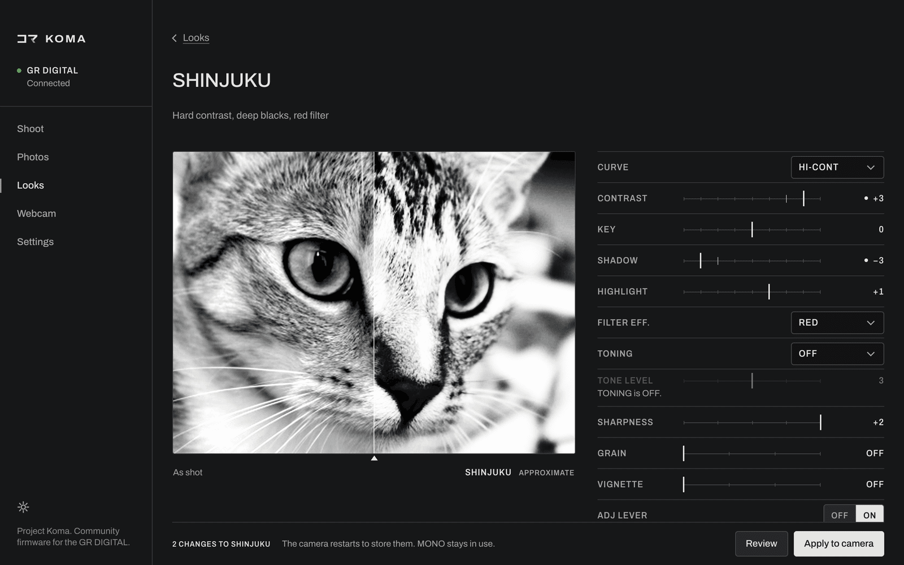
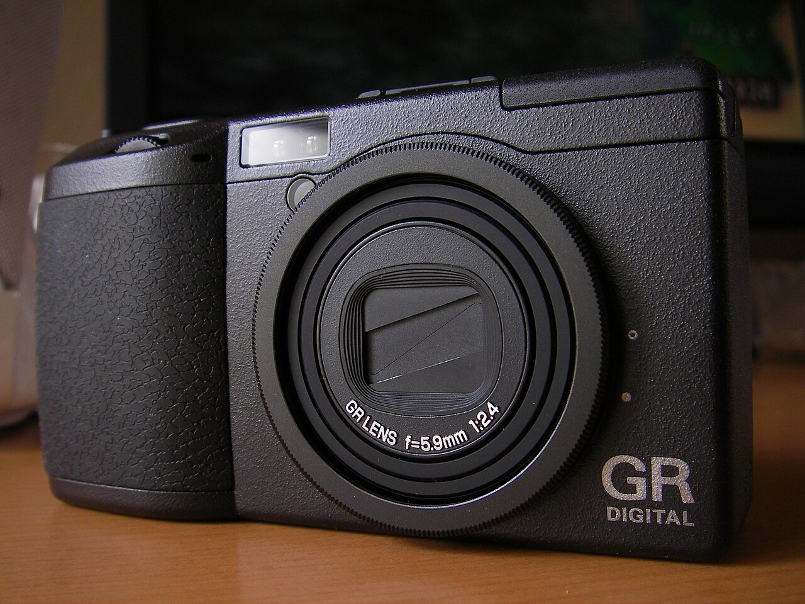
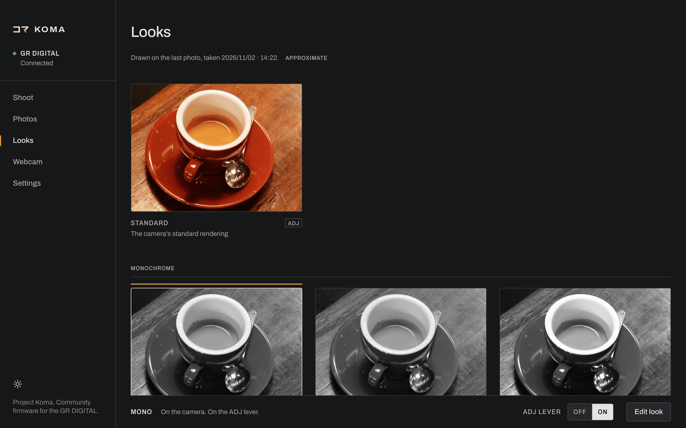
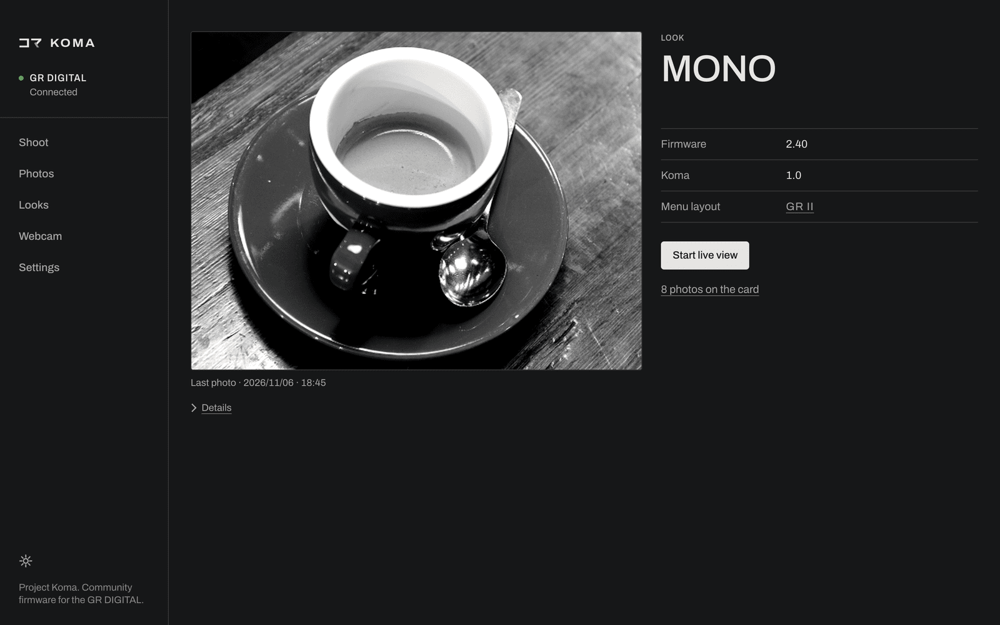
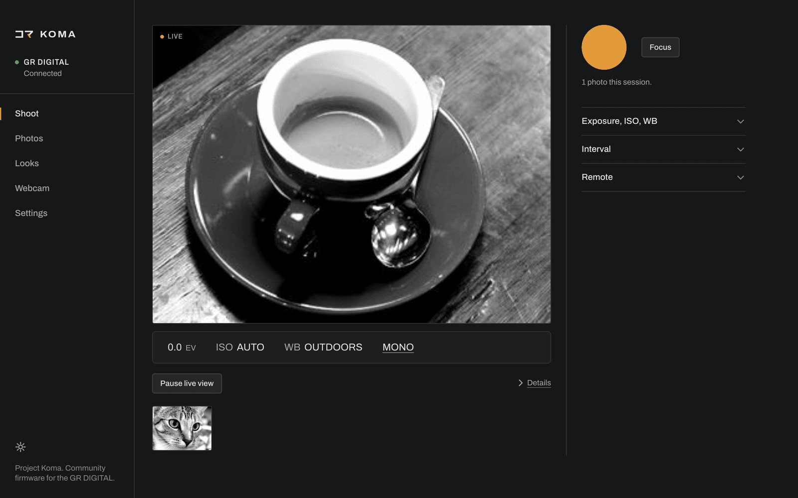
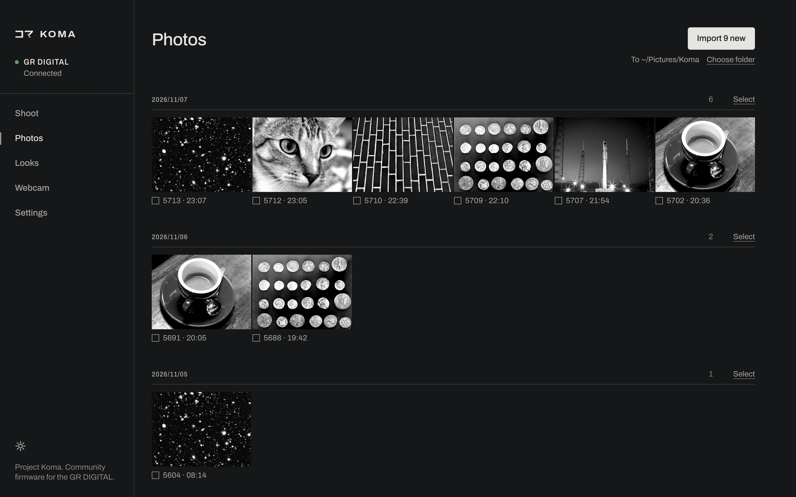
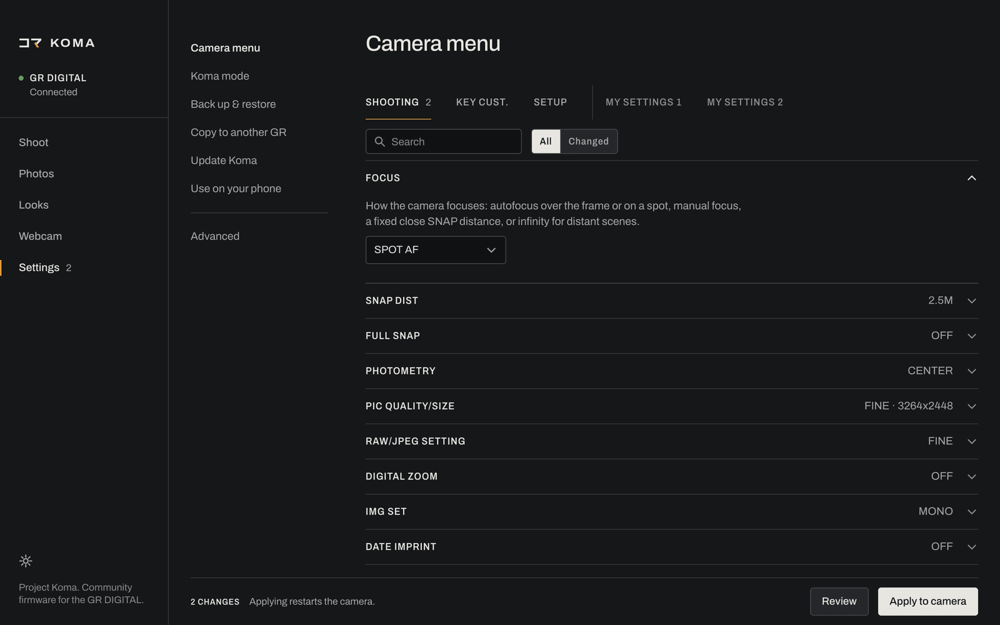
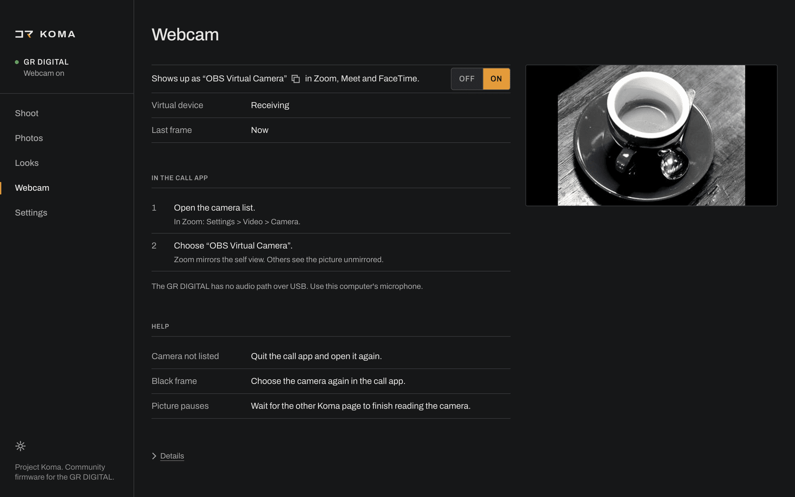

<picture>
  <source media="(prefers-color-scheme: dark)" srcset="docs/assets/koma-logo-dark.svg">
  
</picture>

[English](README.md) · [日本語](README.ja.md)

# Koma

Komaは、リコーの初代GR DIGITAL（2005年）に後継のGRが備える撮影機能を加えます。21年間抱えてきた2つの問題を直し、USBでデスクトップアプリとつなぎます。ライブビューを見ながらテザー撮影ができ、次のZoom会議ではWebカメラにもなります。



## できること

### 後継GRの撮影機能

- スナップフォーカスの距離は1m〜無限遠の6段階。
- フルプレススナップ：シャッターボタンを一気に押し込むと、ピントを探さずにスナップ距離で撮影します。
- オートISOの上限と、シャッター速度の低速限界。
- 液晶モニターに白とび警告とフォーカスピーキングを表示。
- 最長240秒の長時間露光。
- カメラ本体のメニューにKOMAタブを追加。GR II風のメニュー構成も選べます。

### 21種類のルック

- モノクロ10種、カラー6種、STANDARD、SELECT（1色だけ残し、ほかはモノクロ）、カスタム枠3つ。すべてIMG SET（画像設定）から選びます。
- GR IIIのハードモノトーンとソフトモノトーン。GR DIGITAL IVのものをもとに作ったブリーチバイパス。
- どのルックも編集できます。トーンカーブ8種、コントラスト、キー（明るさ）、シャドウ、ハイライト、モノクロ用フィルター、調色、彩度、暖かさ、ティント、シャープネス、粒状感（グレイン）、周辺減光を調整できます。
- よく使うルックをADJレバーに割り当てられます。

### 2005年のファームウェアの修正

- 日付と時刻を保持します。純正のGR DIGITALはバッテリーを長く抜いておくと日時を忘れますが、Komaが元に戻します。
- SDHC・SDXCカードが使えます。純正は2GBまでですが、Komaは64GBで動作を確認しています。
- バッテリーログをカードに記録します。

### Komaアプリ

- ライブビュー付きのテザー撮影。
- OBS Virtual Camera経由のWebカメラ。
- 写真の取り込み。
- 最後に撮った写真でルックを編集し、カメラに送信。
- カメラの全設定のバックアップと復元、別のGR DIGITALへのコピー。

## なぜ「Koma」か

コマは、フィルムの1コマ、つまり1回の露光を指す言葉で、写真の最小単位です。リコーのファームウェアは、`f_cur_koma_no`、`f_dcim_new_koma`、`Rec Koma NO`といった文字列の中で、1枚1枚をコマとして数えています。名前は、はじめからそこにありました。

## 対応機種

> [!WARNING]
> **リコーGR、GR II、GR III、GR IVには対応していません。** GR DIGITAL II〜IVも対象外です。Komaが動くのは2005年の初代GR DIGITALだけです。



<sub>Photo: [yoppy](https://commons.wikimedia.org/wiki/File:Ricoh_GR_Digital_-_128675954.jpg), CC BY 2.0</sub>

| カメラ | ファームウェア | 状況 |
|---|---|---|
| リコーGR DIGITAL（2005年） | 2.40 | 実機で確認済み。 |

## インストール

macOS：

```sh
brew install overscanindustries/koma/koma
```

LinuxとWindowsでは[pipx](https://pipx.pypa.io)を使います。

```sh
pipx install koma-gr
```

LinuxとWindowsでは、USBの設定がもう1つ必要です。[インストール](docs/ja/install.md)を参照してください。

## 起動

```sh
koma
```

カメラのUSB CONNECTION（USB接続）をORIGINALにして電源を入れ、それからUSBケーブルをつなぎます。`koma --tray`でトレイアイコンを常駐させ、`koma doctor`でUSBを確認できます。

セットアップでは、リコーの2.40アップデートファイル（[リコーからダウンロード](https://www.ricoh-imaging.co.jp/english/r_dc/download/firmware/grd/win.html)）をもとに、パソコン上でKomaをビルドします。2GB以下のSDカードが必要です。

> 改造ファームウェアを書き込むと、カメラが使えなくなることがあります。

## 画面

| | |
|---|---|
|  |  |
| ルックを選びます。カメラのIMG SETに表示されます。 | カメラ、現在のルック、最後に撮った写真を確認します。 |
|  |  |
| ライブビューでテザー撮影します。 | カードから新しい写真を取り込みます。 |
|  |  |
| カメラの設定を変更し、バックアップします。 | カメラをWebカメラとして使います。 |

## ドキュメント

[インストール](docs/ja/install.md) · [ユーザーガイド](docs/ja/user-guide.md) · [制限事項](docs/ja/limitations.md) · [ホストツール](docs/ja/host-tools.md) · [仕組み](docs/ja/how-it-works.md) · [ビルド](docs/ja/building.md) · [バージョン](docs/ja/versioning.md) · [内部資料（英語）](docs/internals/README.md) · [変更履歴](docs/ja/changelog.md) · [コントリビューション（英語）](CONTRIBUTING.md)

## クレジット

リバースエンジニアリングの内容は[仕組み](docs/ja/how-it-works.md)で説明しています。

Komaはリコーとは無関係です。RicohおよびGRはリコーイメージングの商標で、カメラを特定するために使用しています。

## ライセンス

KomaはOverscan Industriesが[MITライセンス](LICENSE)のもとでメンテナンスしています。リコーのファームウェアとソフトウェアはこのライセンスの対象外です。
