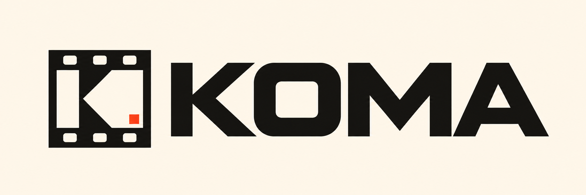

# Koma

Koma adds features to the original Ricoh GR DIGITAL (2005) on top of its last firmware, 2.40. Ricoh's code still runs the camera.

## What you get

- 10 black-and-white looks, 6 colour looks and SELECT (one colour kept, the rest grey), rendered into the JPEG and editable per look.
- A KOMA menu tab with snap distance, an ISO-auto ceiling, a slowest-shutter limit, 240 s exposures, highlight alert and focus peaking.
- SDHC and SDXC cards at full size (64 GB tested).
- Tethered shooting, live view in a browser, settings edits and photo download over USB, and a webcam through OBS.
- The camera's settings as a file you can back up, edit or copy to another GR DIGITAL.

## How it works

The Koma firmware is Ricoh's 2.40 plus a small loader, flashed once with the camera's own update procedure. At each power-on the loader installs the features from a package, `GRMOD.BIN`, on the card or in internal memory. With no package the camera behaves as stock. You build both from your own copy of Ricoh's update. See [writing features](docs/internals/writing-features.md).

## Status

Koma is an early hobby project. The menu, the main looks, large cards, the USB tools and settings files have run on cameras. Some features have run only in an emulator so far, and the guides mark them. Recovery from a flash that fails to boot has not been tested. Flash only a camera you are prepared to lose.

## Requirements

A first-model GR DIGITAL on 2.40, Ricoh's 2.40 update, an SD card of 2 GB or less, and a Mac or Linux computer with Python 3.12 and LLVM 20 (plus libusb for the USB tools).

## Documentation

- [Install](docs/install.md)
- [User guide](docs/user-guide.md)
- [Building](docs/building.md)
- [Internals](docs/internals/README.md), a reference for the 2.40 firmware

Bug reports and pull requests are welcome. Never commit Ricoh firmware or images built from it.

## Licence

[MIT](LICENSE). Ricoh's firmware and software belong to Ricoh and are not included. Koma is not affiliated with or endorsed by Ricoh.
