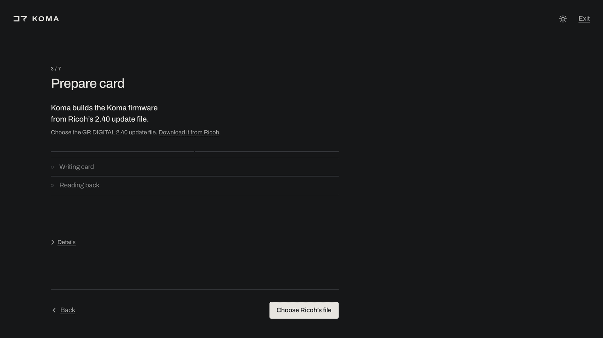
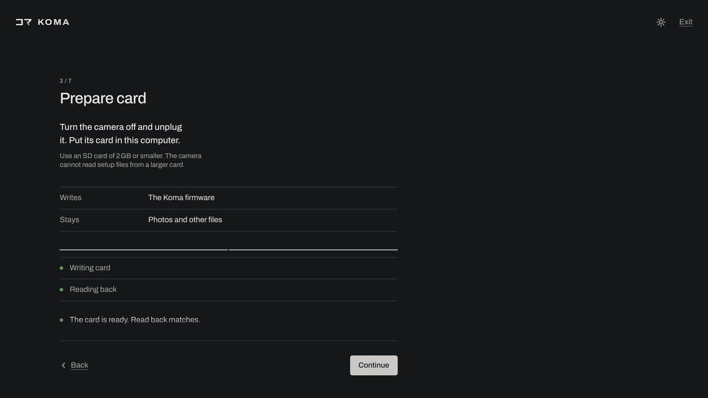
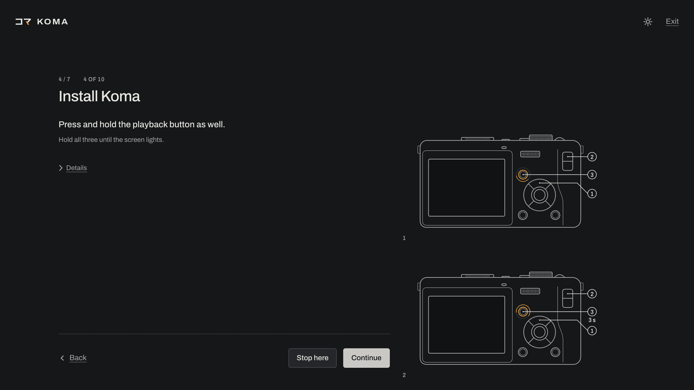
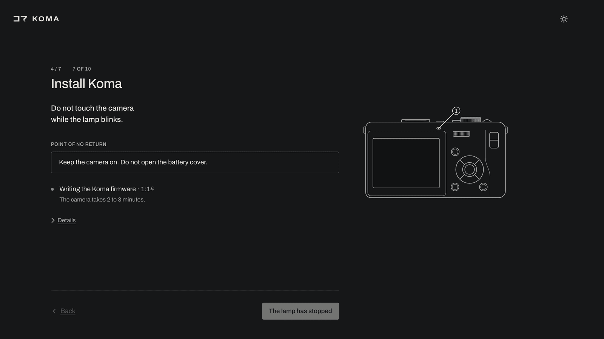
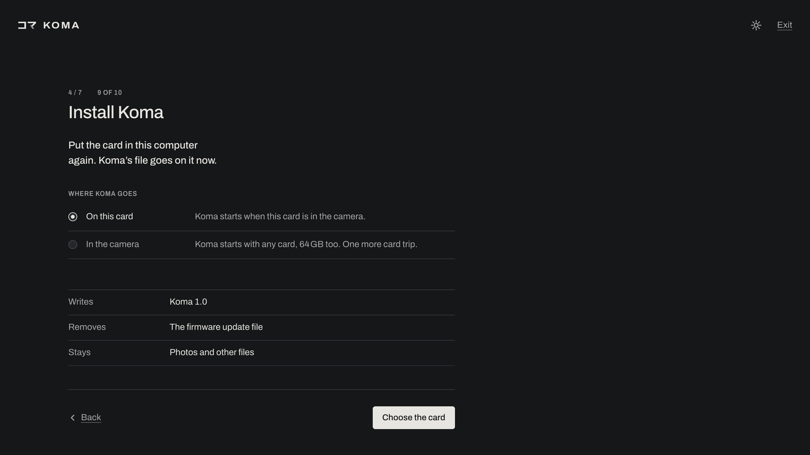

# Install

## The app

The app needs Python 3.10 or newer and libusb. Run `koma` to open it at `http://localhost:8765/`; press Ctrl-C to quit. Use `koma --tray` to run it in the menu bar or system tray.

### macOS

```
brew install overscanindustries/koma/koma
```

For webcam support, install with pipx instead: `brew install pipx libusb`, then `pipx install "koma-gr[tray,webcam]"`.

### Linux

```
pipx install koma-gr
```

Use `pipx install "koma-gr[tray,webcam]"` for the tray icon and the webcam. libusb is usually installed already; if `koma doctor` says it is not, install it (Debian and Ubuntu: `sudo apt install libusb-1.0-0`).

Run `koma --install-udev-rule` to install the required udev rule. It asks for an administrator password. To install it by hand, save this line as `/etc/udev/rules.d/70-koma-gr.rules`:

```
SUBSYSTEM=="usb", ATTR{idVendor}=="05ca", ATTR{idProduct}=="2218", TAG+="uaccess"
```

then run `sudo udevadm control --reload-rules && sudo udevadm trigger` and replug the camera. 

### Windows

Install [pipx](https://pipx.pypa.io) (`py -m pip install --user pipx`, then `py -m pipx ensurepath` and open a new terminal), then:

```
pipx install koma-gr
```

Use `pipx install "koma-gr[tray,webcam]"` for the tray icon and the webcam. libusb comes with the package.

Windows also needs the WinUSB driver for the camera, once per computer:

1. On the camera, set SETUP > USB CONNECTION to ORIGINAL. Turn the camera on, then plug in the USB cable.
2. Download Zadig from [zadig.akeo.ie](https://zadig.akeo.ie) and run it.
3. Choose Options > List All Devices, then pick the device whose USB ID reads `05CA 2218` (it may show as GR DIGITAL or with no name).
4. Set the driver to WinUSB and click Install Driver (or Replace Driver).
5. Run `koma doctor`. The `camera driver` line should read WinUSB.

To undo, uninstall the device in Device Manager and tick the box that deletes its driver.

### Check

Run `koma doctor` to check USB dependencies and drivers. The camera does not need to be plugged in.

## Koma on the camera

Open the app and follow setup. You need Ricoh's 2.40 update file, a charged battery, an SD card of 2 GB or less and a card reader. The app builds the firmware from your copy on your computer.

Download the update from [Ricoh's GR DIGITAL firmware page](https://www.ricoh-imaging.co.jp/english/r_dc/download/firmware/grd/win.html) ([`gr-240.exe`](https://www.ricoh-imaging.co.jp/english/r_dc/download/firmware/exe/gr-240.exe)). The app also accepts the `qrflect3` file inside it.

| File | SHA-256 |
|---|---|
| `gr-240.exe` | `e9257cbd89cd3f07163ef8700a9143121ecb69ecee94c1c935c7b7486fafa555` |
| `qrflect3` | `de00e03d563fd1bdd0a2a925761b1a029993425049841119e3e83eef990c783b` |



Choose Ricoh's file when setup asks for it.



Setup writes the firmware to the card and reads it back.



Setup shows each button to press on the camera.



Flashing modified firmware can make the camera unusable. Do not touch the camera or cut power while the lamp blinks.

Choose **On this card** to keep Koma on the setup card. Choose **In the camera** to use Koma with other cards, including FAT32 SDHC and SDXC cards. The camera's updater needs the small card for setup in either case.



For installation without the app, updating, removal and restoring Ricoh firmware, see [manual installation](manual-install.md).
