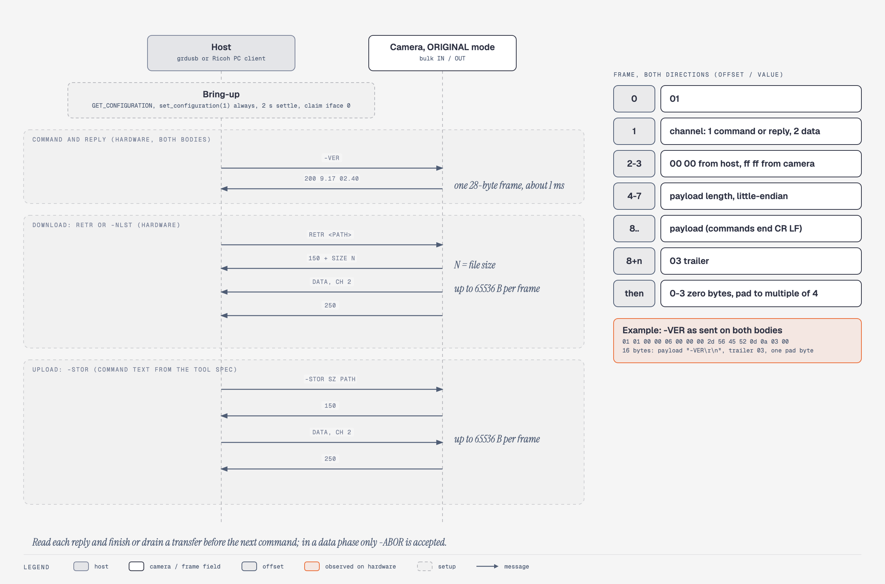
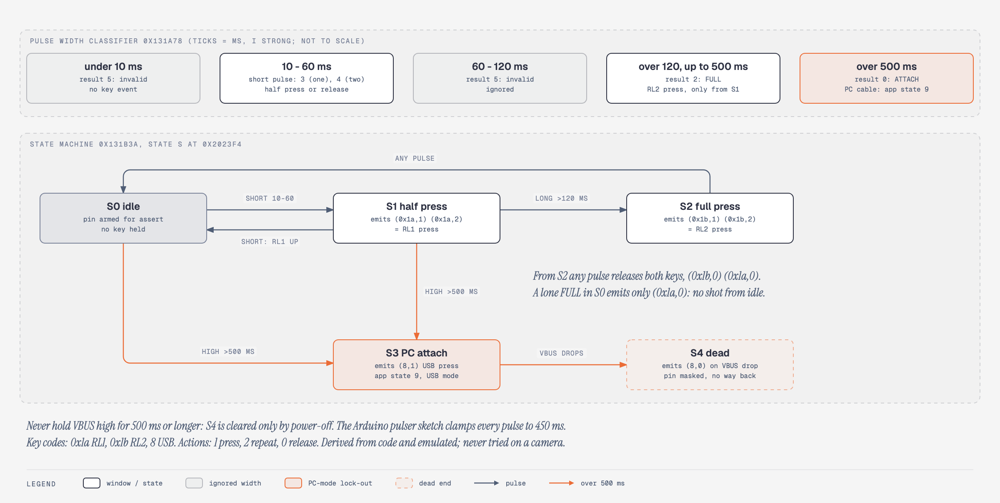

# 07. USB protocol

**Summary.** In ORIGINAL mode (`05ca:2218`, vendor class) the camera speaks a framed, FTP-like text protocol over bulk endpoints `0x81` IN and `0x02` OUT, dispatched through a 35-record command table at `0x1fb400` that is unchanged from 1.08 to 2.40. USB reads and writes card files and injects keys through `-CCTL`, but it cannot flash: an update is only staged on the card. Stock `-CCTL` cannot fire the shutter; Koma's `tether` feature makes it fire, and Koma adds five verbs on dead table records (`-KSET`, `-KGET`, `-KSTA`, `-PEEK`, `-LVFR`), all hardware-proven on both bodies on 2026-11-08. Stock firmware also holds a CA-1 cable-release decoder on the VBUS line; it is derived and emulated only, never tried on a camera.

Tags: HW, EMU, STATIC, INFERRED, defined in [features](evidence-ledger.md).

Addresses are firmware 2.40 runtime addresses. Camera-ID values are not reproduced.

Related chapters: [05 settings and adjustment store](05-settings-and-adjustment-store.md), [08 card scripts and service terminal](08-card-scripts-and-service-terminal.md) (shares the key-injection primitives and a second USB line handler), [13 display, live view and USB streaming](13-display-live-view-and-usb-streaming.md) (USB sender and buffers, handler contract, file slots, PTP, `-LVFR` frames, tether and stall mechanics), [03 firmware image and update format](03-firmware-image-and-update-format.md), [09 recovery and failure modes](09-recovery-and-failure-modes.md), [10 emulator and tooling](10-emulator-and-tooling.md).

## Key addresses

| Address | Meaning | Tag |
|---|---|---|
| `0x1fb400` | Command table: 35 records of 36 bytes plus terminator ID `0xffff` | `STATIC` |
| `0x1fb910` | `-CCTL` subcommand table | `STATIC` |
| `0xcbd64` | Command parser: upper-cases the verb (3-5 chars), rejects ID 0 with `501` | `STATIC` |
| `0x1fb3e4`, `0x1fb3e8` / `0x1fb3ec` | Parsed record ID; the two parsed decimal arguments `a,b` | `STATIC` |
| `0xcc304` | Dispatcher: calls the handler of the first record whose ID equals `[0x1fb3e4]` | `STATIC` |
| `0xcae88` / `0xcb0d4` | Frame receive / frame build | `STATIC` |
| `0xcb6c4` | Transfer state machine | `STATIC` |
| `0xcb7b4` / `0xcb834` | Ignore commands while a reply is pending / drop all but `-ABOR` in a data phase | `STATIC` |
| `0xcb834` / `0xcb9cc` | Data-phase states 4 ("150 sent") and 6 ("next chunk"); continue only for IDs 2, 10, 13, 14, 26 | `STATIC` |
| `0xca8a4` / `0xcda50` | Normal USB event handler / service-line handler, chosen by `0x1bd2c8` | `STATIC` |
| `0x1bd241` | USB mode byte: 0 ORIGINAL, 1 PTP, 2 MASS STR | `STATIC` |
| `0x5f3f0`, `0x5f500`, `0xd8ca2` | Descriptor patching and selection | `STATIC` |
| `0x5fda8`, `0x5f688` | Bulk IN send; needs controller state `0x30` | `STATIC` |
| `0x5f730`, `0xcaa5c`, `0xcac64` | Zero-length-packet rule (PIO tail, reply sent, data frames) | `STATIC` |
| `0xd931e` / `0xd9372` / `0x606c8` | Vendor control request handler (`0x20`, `0x22`) / its wrapper / EP0 SETUP dispatcher | `STATIC` |
| `0x1bd2ec` | `-CCTL` remote state (0, 1, 2) | `STATIC` |
| `0x1bd1b8` | `remtin` flag; set by `0x4fc78`, cleared by `0x4fc84` | `STATIC` |
| `0x23a888` / `0x23a88c` | Cable-in flag / boot service-key flag; 1 and 0 together force app state 9 | `STATIC` |
| `0x4fd1e` / `0x4fe44` | App-state resolver / the state-9 force (Koma `tether` redirect site) | `STATIC` |
| `0xcd090` | `-CCTL remtout` call to `0x4fc84` (Koma `tether` redirect site) | `STATIC` |
| `0x6d670`, `0x6d6f0`, `0x6d840` | State-9 runner and handlers (table `0x1a911c`); `0x6d6f0` is the only caller of PTP switch `0xc4b64` | `STATIC` |
| `0x5d5d0(0x800)` | USB session start | `STATIC` |
| `0x114824` | `-VER` side state machine (3 s timer) | `STATIC` |
| `0xb2560` | File-system sector function; op codes 1-3 read-like, 4-6 write-like | `INFERRED` |
| `0xb6910`, `0xb685c`, `0xb99be` | File-system close path that can write on a damaged cluster chain (the R\* class below) | `STATIC` |
| `0xb7954` | Directory reader; a root listing is bounded by the FAT12/16 root-entry count `[0x2dfd8e]` | `STATIC` |
| `0x5d18c`, `0xd6dec`, `0xd6c58`, `0xd6a62` | Camera-side updater, all-image flash, one-image flash, type-5 routine | `STATIC` |
| `0x26e04`, `0x26f38` | `QUICKVER.UP` read / flash (validation-skipping) | `STATIC` |
| `0x1319e8` | CA-1 VBUS decoder init | `STATIC` |
| `0x1bd240` | Writable MASS STR latch (RAM) | `STATIC` |

## Identity and descriptors

| Mode `0x1bd241` | VID:PID | Configurations | Interface class | Tag |
|---|---|---|---|---|
| 0 ORIGINAL | `05ca:2218` | 2, both vendor | `ff/00/00` | `HW` (both bodies) |
| 2 MASS STR | `05ca:0109` | cfg 1 mass storage, cfg 2 vendor | `08/06/50`, then `ff/00/00` | `STATIC` |
| 1 PTP | `05ca:0331` | 1 | `06/01/01` | `STATIC` |

- `bcdUSB` 2.00, EP0 packet 64, strings "Ricoh Company Ltd." and "GR DIGITAL", no serial string, `bcdDevice` 0000 (`STATIC`). macOS lists the camera as "GR DIGITAL", `05ca:2218`, with no volume mounted (`HW`). Ricoh's INF names `USB\VID_05CA&PID_2218`; libgphoto2 and usb.ids have no `2218` entry.
- ORIGINAL endpoints: `0x81` bulk IN, `0x02` bulk OUT, `0x83` interrupt IN (64 bytes); bulk packet 64 (full speed) or 512 (high speed). Driver pipes 1, 2, 7 (`STATIC`; descriptor walker `EMU`). libusb reported high speed (480 Mbit/s) on the main body (`HW 2026-11-07`; rates and the controller are in [13](13-display-live-view-and-usb-streaming.md)).
- Mode 0/2 follows setting byte `0x1b0d7`; store byte `0x08010017 == 0xff` forces 0. A non-zero word `0x1a9072` takes VID/PID/strings from store table `0x080116ba` (rebranded units) (`STATIC`).
- The service-line selector `0x1bd2c8` does not change the descriptors (`EMU`, six mode/speed comparisons).
- The only runtime switch from mode 0 to PTP is `0xc4b64`, called from `0x6d6f0` on key codes 24/36 in state 9; there is no automatic switch for a silent host (`STATIC`, bounded). Every host feature in this chapter needs ORIGINAL mode.

## Bring-up

| Step | Detail | Tag |
|---|---|---|
| 0 | Turn the camera on first, then plug in USB; plugged in while off, it boots a lens-retracted mode that remote control cannot use | `HW` |
| 1 | Enumerate; check numeric descriptors, then the two strings, single device; refuse if the active configuration is not 0 or 1 | `STATIC` |
| 2 | `GET_CONFIGURATION`, then always `set_configuration(1)`, then verify. Bulk IN needs controller state `0x30` (`INFERRED` "configured"); Ricoh's Mac client configures on every start | `STATIC` |
| 3 | Settle 2 s (Ricoh's XP `RDT3CM32` sleeps 1,500 ms plus a 500 ms wait), claim interface 0; no reset, no clear-halt, no `QUIT` | `STATIC` |
| 4 | Optional vendor request `bmRequestType 0x41, bRequest 0x22, wValue 3` (Ricoh's serial "set DTR/RTS"); nothing in the bulk command path reads it | `STATIC` |
| Result | Steps 1-3 suffice: replies arrive in one frame about 1 ms after the write | `HW 2026-11-06` both bodies |

Request `0x22` matters for the service console, not for file transfer: it sets ready flag `0x1bd294`, which gates console text on bulk IN ([08](08-card-scripts-and-service-terminal.md)).

### Cable sense and session events

- `0x23a888` is the cable-in flag, not a session state. Boot sets it when GPIO `0x38` reads active in all 25 samples of poll loop `0x1e968` (store at `0x1e98a`); at run time it follows event `(8,x)` posted by the UsbShutter task `0x131b3a` (case 0 attach `(8,1)`, case 1 detach `(8,0)`) (`STATIC`). That GPIO `0x38` is VBUS sense is `INFERRED`; its polarity is unresolved (here "active", while the boot-key analysis in [08](08-card-scripts-and-service-terminal.md) reads the pin as low).
- `0x23a88c` is the service boot flag, written only at boot (`STATIC`).
- Session-end event `0x801` is never posted in 2.40 (its senders have no caller). Stock unplug works through `(8,0)`: in state 9 the filter `0x4fe6c` rewrites it to `0x720d` and the camera powers off (`STATIC`; the power-off after unplugging matches `HW 2026-11-06 main`). Detail in [13](13-display-live-view-and-usb-streaming.md).

## Frame format

Both directions use the same layout (`STATIC`; `HW 2026-11-06` both bodies).

| Offset | Size | Value |
|---|---|---|
| 0 | 1 | `0x01` |
| 1 | 1 | Channel: 1 command/reply, 2 data |
| 2 | 2 | host `00 00`; camera `ff ff` |
| 4 | 4 | Payload length, little-endian |
| 8 | n | Payload |
| 8+n | 1 | `0x03` |
| | 0-3 | Zero pad to a multiple of 4 |

- `-VER` on the wire: `01 01 00 00 06 00 00 00 2d 56 45 52 0d 0a 03 00`. The reply `200 9.17 02.40\r\n` (format string `200 9.17 %02x.%02x` at `0xccbc4`) is 25 bytes padded to 28 (`HW` both bodies).
- Data payload ≤ 65,536 bytes; Ricoh's Windows code rejects replies above 256 bytes. There is no checksum (`STATIC`).
- A first byte other than `0x01` resets receive state; a missing trailer is rejected at `0xcaf74`. Ricoh's PC clients scan for the first `0x01` and ignore bytes 2-3 (`STATIC`).
- Commands are ASCII ending CR LF; the parser stops at CR. Paths: `/EXT0` (or `/ext0`) is the card `/ATA1`; `/IROM` passes through; relative paths take the current directory; up to 256 characters (`STATIC`).
- Replies use FTP-style 3-digit codes.
- Download: command, `150 …`, channel-2 frames, `250 …`. Upload: `-STOR <size> <path>`, `150`, host frames, `250` (`STATIC`; `HW`).
- After a reply the firmware ignores commands until the reply is sent; in a data phase it drops everything except `-ABOR`. A host must read each reply and finish a transfer before the next command (`STATIC`).

### Zero-length packets and the interrupt endpoint

- Host to camera: no ZLP is needed (`STATIC`).
- Camera to host: a ZLP follows a reply or short final frame whose padded length is an exact multiple of the packet size. A full 65,536-byte data frame is 65,548 bytes on the wire and gets none (`STATIC`). Multi-megabyte reads and whole-card backups complete (`HW`), consistent with the rule; no exact-multiple frame has been captured.
- `0x83` carries 12-byte line-state notifications starting `c1 20`, queued after vendor requests `0x20`/`0x22`. Only Ricoh's Windows 2000 serial driver reads it (`STATIC`).

## Command table

### Layout

36-byte records at `0x1fb400`, nine words: `[0]` name pointer, `[1]` command ID, `[2]` takes a path, `[3]` takes a size token, `[4]` takes two decimal numbers `a,b` (1-7 digits each, into `0x1fb3e8`/`0x1fb3ec`), `[5]` takes a `-CCTL` subcommand, `[6]` the `-ATTR` field, `[7]` the `-SDIS` field, `[8]` handler pointer (Thumb bit set); terminator ID `0xffff` (`STATIC`). `-STOR` sets `[3]`, `-PRET` sets `[4]`, `-CCTL` sets `[5]`.

- 35 records, 34 non-null handler words (`QUIT` is null), 26 non-zero IDs: 1-5, 7-11, 13-16, 19, 22-27, 32-36. IDs 6, 12, 17, 18, 20, 21 and 28-31 are unassigned. A `MKD` handler (`0xcc728`) exists with no table entry; the gap at ID 6 suggests records were removed at build time (`INFERRED`) (`STATIC`).
- Nine records have ID 0 and are rejected with `501` before dispatch.
- Four assigned IDs have bare-return handlers that send no reply: `-SDIS` (22), `-GDIS` (23), `-FUPL` (25), `-FDWL` (26). No known Ricoh client sends `-FDWL`.

**Data-phase gate.** States 4 (`0xcb834`) and 6 (`0xcb9cc`) continue a data phase only for IDs 2 (`RETR`), 10 (`-NLST`), 13 (`-PRET`), 14 (`-SRET`) and 26 (`-FDWL`); any other ID stalls. `-CCTL` (ID 16) can never carry a data frame. ID 26 is therefore a dead record the state machine already accepts as a data verb; Koma's `-LVFR` takes it over, and Koma's other data verbs rewrite their parsed ID to 26 (`STATIC`). The handler contract and buffer layout are in [13](13-display-live-view-and-usb-streaming.md).

### Command reference

Safety class (direct-call graph, bounded): **R** read-only; **R\*** read-only, but closing a file with a damaged chain can write (`0xb6910` path); **S** session RAM only; **W** writes the card; **X** acts on camera state.

| Command (ID) | Handler | Effect | Class | Tag |
|---|---|---|---|---|
| `-VER` (11) | `0xccb5c` | `200 9.17 VV.VV`; also arms a 3 s timer whose expiry posts message `0xa201` to the main task (see below) | R\* | `HW` both bodies |
| `-GCID` (27) | `0xcd3a0` | `200 CameraID=… for -GCID.` | R | `HW` |
| `-GSID` (32) | `0xcd43e` | `200 SD ID=… for -GSID.` (empty with no card) | R | `HW spare` |
| `-TIME` (33) | `0xcd51c` | `200 YYYY/MM/DD HH:MM:SS for -TIME.` (RAM clock copy) | R | `HW spare` |
| `-DCAP <vol>` (19) | `0xcd27c` | `200 /EXT0 capacity N byte,free N byte.`; `451` with no card | R | `HW` |
| `-NLST <path>` (10) | `0xcc970` | `150 data connection for -NLST.`, 32-byte FAT-layout records (size big-endian at `0x1c`), `250 -NLST command success.`; `/` returns a 5-byte volume name; `450 Open error` if the directory cannot be opened. Hangs on a FAT32 card root, see below | R | `HW` |
| `RETR <path>` (2) | `0xcc434` | `150 data connection for RETR.(N)` (string `0xcc554`), data, `250`; a missing file answers `450` at once | R\* | `HW` |
| `PWD` (7) | `0xcc7c0` | `257 "/EXT0" directory.` | R | `HW spare` |
| `-RTST` (35) | `0xcd6cc` | `200 RTC status=N for -RTST.` (spare: N = 1) | R | `HW spare` |
| `-INFO <path>` (15) | `0xccf14` | `200 N byte W= H= K= for -INFO.` (JPEGs gave 1280x960 and 2592x1944); non-image gives W=0 H=0 | R\* | `HW spare` |
| `-FDAT <path>` (36) | `0xcd73c` | `200 date=YYYY:MM:DD hh:mm:ss for -FDAT.`; empty date for a non-image | R\* | `HW spare` |
| `-PRET <path>,<off>,<len>` (13) | `0xccbea` | `150 data connection for -PRET.`, partial data, `250 -PRET command success.`; the path ends at the first comma | R\* | `STATIC` (never sent) |
| `-SRET <path>` (14) | `0xccd98` | `150 N byte Seek=…`, EXIF-parsed data, `250` | R\* | `STATIC` |
| `-GTPN` (34) | `0xcd660` | `200 TotalPhotoNo=N`; an uninitialised state calls fatal handler `0x5de6c` | R | `STATIC` |
| `CWD <path>` (1) | `0xcc384` | `250`/`501`; sets the RAM current directory | S | `STATIC` |
| `-ABOR` (24) | `0xcd7c8` | `426`/`226`; deletes a partial upload | W | `STATIC` |
| `-STOR <size> <path>` (3) | `0xcc598` | `150`, data, `250`; writes a file, deleting any existing one first | W | `HW main` |
| `DELE <path>` (4) | `0xcc628` | `250`/`500`; deletes a file | W | `HW main` |
| `RMD <path>` (5) | `0xcc6a8` | removes a directory | W | `STATIC` |
| `RNFR` (8), `RNTO` (9) | `0xcc86c`, `0xcc8ec` | rename (`350`; `250`/`500`) | W | `STATIC` |
| `-CCTL [,n[,n]]` (16) | `0xcd000` | remote key/dial injection, see below | S; `poff` X | `HW` both bodies |
| `-SDIS` (22), `-GDIS` (23), `-FUPL` (25), `-FDWL` (26) | `0xcd398`, `0xcd39a`, `0xcd39c`, `0xcd39e` | bare return, no reply; Koma reuses all four records ([Koma verbs](#koma-verbs)) | stub | `STATIC` |
| `-SPWD`, `-SINF`, `-ATTR`, `-PWOF`, `-GFCI`, `-GFGI`, `-SGID` (ID 0) | `0xccbe8`, `0xcd278`, `0xcd394`, `0xcd396`, `0xcd438`, `0xcd43a`, `0xcd43c` | `501` before dispatch | none | `STATIC` |
| `QUIT` (ID 0) | null | `501` | none | `STATIC` |
| `-FMT` (ID 0) | `0xcd27a` | `501 Syntax error in parameters or arguments.`; format is unreachable by USB | none | `HW spare` |

`-SRET`/`-FDAT` grew their file-info buffer from `0x84` to `0x88` bytes between 2.10 and 2.31; nothing else in the table changed across the seven held releases (`STATIC`). Ricoh's Mac Mounter also sends `MKD` and `-ATTR`, which this firmware rejects; those verbs belong to older network-family cameras (`INFERRED`).

Host card commands during a shot write are not safe: once on the spare, a 1,115,388-byte JPEG was found damaged on the card itself (its JPEG header at offset 1,048,576) after the host polled the predicted name with `-INFO`/`-NLST` while the camera was writing it (`HW 2026-11-08 spare`; the race mechanism is `INFERRED`). The file-slot layer behind it is in [13](13-display-live-view-and-usb-streaming.md).

### Root listing on FAT32 cards

On a 64 GB FAT32 card, `-NLST /EXT0` answers `150 data connection for -NLST.` within about 2 ms and then sends no data and no `250`; the host times out and the transfer state machine stays in state 6, where only `-ABOR` is accepted. `-NLST /EXT0/DCIM` and its subdirectories, `RETR` of root files, and `RETR` of a missing root file (`450` at once) all work (`HW 2026-11-08 main`, generation 2 Koma firmware, build 2b).

Cause, in stock 2.40 code (`STATIC`): directory reader `0xb7954` (via readdir `0x5644c`) treats a depth-0 handle as the FAT12/16 fixed root region bounded by BPB `RootEntCnt` `[0x2dfd8e]` and has no FAT32 branch. On FAT32 that count is 0, so the first readdir returns NULL; `-NLST` then answers `150` with a data length of 0, and the transmit side (`0xcaa5c`) sends nothing for length 0, so the event that would send `250` never comes. It is not caused by Koma's card driver or by Mac-created entries, and formatting in the camera does not help (every FAT32 card has `RootEntCnt` 0). A firmware fix is designed (hooks at `0xb7992`/`0xb79ca`), not built. komabridge 0.3.1 and later never list the card root.

## `-CCTL` remote control

### Subcommands

Format `-CCTL keyset,3,22\r\n`: one space after the verb, comma-separated decimals of 1-4 characters. Replies `200 -CCTL <name> command successful.`, `451 -CCTL <name> command failure`, `501 Syntax error …` (`STATIC`: names `0x53d18..0x53f78`, replies `0xcd0f0..0xcd248`; `HW`).

| Subcommand | ID, args | Accepted when | Effect | Tag |
|---|---|---|---|---|
| `remtin` | `0x1004`, 0 | state 0 | `0x4fc78` sets `0x1bd1b8` = 1; state 1 | `HW` (`200`) |
| `diaset,N` | `0x1002`, 1 | state ≠ 0, N < 9 | `mg1_dialset` `0x65d70`; state 2 | `HW` (`200` for 0..8, `451` for 9) |
| `keyset,A,C` | `0x1001`, 2 | state 2, A < 4, C < 42 | `mg1_keyset` `0x65cfc` | `HW` (`200`; `451` out of remote mode) |
| `remtout` | `0x1003`, 0 | state ≠ 0 | `0x4fc84` clears `0x1bd1b8`; state 0 | `HW` (`200`) |
| `poff,N` | `0x1005`, 1 | any state | `mg1_poff` `0x661b0`: saves CONFIG, arms reboot | `STATIC` (never sent) |

A is the action (0 release, 1 hold, 3 tap), C the key code; codes and dial values are the script interpreter's ([08](08-card-scripts-and-service-terminal.md)). `diaset` is needed before `keyset`. Firmware test string `keyset,3,22` is a DISP tap (`INFERRED`).

Hazards (`STATIC`):
- `remtout` clears only `0x1bd1b8` and the state word; injected keys and the virtual dial persist. Release first with `keyset,0,C` or `keyset,0,2` (all injection off, dial back to 9). Koma's `tether` adds this clean-up to `remtout` itself.
- A USB session event (`0x539b4`) zeroes `0x1bd2ec` but not the flag or the injected keys.
- `diaset` posts `{0,0}`, which can emit dial event `(0,4)`; state 9 drops it.
- Code 24/36 with action 1 switches to PTP in state 9; code 7 pressed / 8 released becomes power-off message `0x720d` (`INFERRED`). Code 8 is also the USB attach/detach key code, so `keyset,1,8` / `keyset,0,8` would fake a cable event.
- `-CCTL` handlers share block `0x2c39a0` with the script task: do not combine with a running card script.

### Why stock `-CCTL` does not shoot

On the spare (2.40, ORIGINAL mode, dial on Movie), every subcommand above answered as listed, `keyset,1,26` (RL1 held 3.5 s) and `keyset,1,27` (RL2 held 1 s) and the releases answered `200`, `-VER` still answered after every run, and no file was created over nine dial positions (`HW 2026-11-06 spare`, one body, judged by file count only).

That result is consistent with the code (`STATIC`):
- `0x4fd1e` ends at `0x4fe44` with `if (0x23a888 == 1 && 0x23a88c == 0) state(0x1bd1c0) = 9`, regardless of dial. State 9 is not a capture state: its handlers `0x6d6f0`/`0x6d840` take no action on RL1/RL2, and the record runner `0x29b28` serves only the record states 2, 3, 4, 5, 10, 12 and 13.
- State 9 is also what starts the USB session (`0x6d670` calls `0x5d5d0(0x800)`), so removing the force (`0x4fe4a` `d104` → `e004`) would most likely stop USB from opening at all (`EMU`: that variant never posted `0x800`).
- Ricoh's own remote path in main loop `0x282e4` re-resolves the state when `remtin` is set (only when the state-9 runner exits with `0x23a870 == 6`), but the force at `0x4fe44` ignores the flag, so it resolves to 9 again. A force that skips only when the flag is clear also fails: 9 stays stored in `0x1bd1c0`, and `0x4fd1e` re-derives from the dial only for the record states (`EMU`).

### Koma `tether`: the redirect

Koma's `tether` feature ([tools/koma/features/tether.py](../../tools/koma/features/tether.py)) makes `-CCTL` fire the shutter while the USB session stays up, with 4-byte `BL` redirects into the resident package (`STATIC`). Two of them explain how it defeats the stock force:

| Site | Stock | Redirect |
|---|---|---|
| `0x4fe44` | `ldr r0,=0x23a864 ; ldr r1,[r0,#0x24]` (loads the cable-in flag for the force) | `bl tether_force`: returns the same registers, except when the cable is in, it is not the service boot, the `remtin` flag is set and key injection is on (`[0x2b9d34] != 0`). Then it skips the force; if the stored state is 9 it stores 2 and calls `0x4fd1e` once, so the state re-resolves from the virtual dial (`diaset,4` gives state 2). With the cable out while `remtin` is still set (unplug mid-tether) it clears the remote state and resolves from the physical dial |
| `0xcd090` | `bl 0x4fc84` (`remtout` flag clear) | `bl tether_out`: clears the flag, the `-CCTL` state, injected keys and the virtual dial, then, if attached and not in state 9, posts dial event `(0,4)` so the camera returns to state 9; the reply stays `200` |

Tether 1.8 has three more redirects: the `keyset` call `0xcd03a` and the `diaset` call `0xcd05e` (Auto Power Off hold and divergence handling), and record-runner dispatch `0xd27f2`, which swallows the `-VER` timer message `0xa201` while USB is attached or `remtin` is set (`STATIC`; details in [13](13-display-live-view-and-usb-streaming.md)).

Hardware, generation 2 Koma firmware, build 2b with package koma04w (`HW 2026-11-08`): on the main body a tether shot from the bridge selftest (7.59 s to the file) and four shots from the Koma Setup page, with the USB session alive afterwards; on the spare three shots from the Remote view (half-press, then full). A quick-press shot in the spare's selftest made no file. A second tethered session in one power-on used to take 10-20 s to arm; the `stallfix` feature brings it to 0.66 s (`HW`). The stall, Auto Power Off handling and live view under tether are in [13](13-display-live-view-and-usb-streaming.md).

Superseded: an earlier design used a 32-byte stub at `0x4fe44` plus a 48-byte routine over the Dcfs self-test island at `0x56f80`; it ran only in the emulator and was never flashed.

### Version and family history

The 35-record table, `-CCTL` ID 16, its 5-entry subcommand table, the handler and the state-9 force are relocation-identical in 1.08 (table `0x1f54e8`, force `0x4fb58`), 1.09, 2.01, 2.02, 2.10, 2.31 and 2.40 (`STATIC`). The `remtin` branch in `0x282e4` exists from 1.08, so the spare's 1.08 → 2.40 update did not change `-CCTL` behaviour (`INFERRED`). Among Ricoh's ARM models only GX, GX8 and GR enable `-CCTL` (ID `0x10` plus reply strings); R1, R2, R3, G4, 400G wide, Pro G3 and 500G wide carry the record with ID 0 and no reply strings. GR `0xcd000` is block-identical to GX8 `0xb04d4` (`STATIC`).

## Koma verbs

Koma packages add five verbs by repointing dead records of the stock table (name, argument flag, handler); no stock code is hooked. All run in the USB task with the stock handler contract ([13](13-display-live-view-and-usb-streaming.md)). Source: [ksettings.py](../../tools/koma/features/ksettings.py), [liveview.py](../../tools/koma/features/liveview.py).

| Verb | Record (stock ID) | Syntax | Replies | Tag |
|---|---|---|---|---|
| `-KSET <off>,<val>` | `-SDIS` (22) | Decimal offset from `0x1b000`, value 0..255; only the Koma rows `0x8b5..0x8cf`, recipe records and FX table `0x910..0xa13`, and a whitelist of stock bytes (EV, ISO, WB, metering, IMG SET, SETTING1/2, TE) with the values stock writes. Writes RAM; the normal power-off save persists it | `200 -KSET <off>=<val>`; `451 -KSET range` / `value` / `busy` (menu, ADJ or detail screen open, half-press held, camera not idle); `501` syntax | `HW 2026-11-08` both (EV round trip); main (web-page writes) |
| `-KGET <off>,<len>` | `-GDIS` (23) | `1 ≤ len`, `off + len ≤ 4096` | `150` + one data frame (raw settings bytes) + `250`, using the firmware's `-PRET` lines; `451 -KGET range` | `HW 2026-11-08` |
| `-KSTA` | `-FUPL` (25) | none | `150` + one frame of big-endian u32 (version word `0x4b53LLNN`, then fixed state words, optional extension block) + `250`; answers in any app state | `HW 2026-11-08` |
| `-PEEK <addr>,<len>` | `-PWOF` (ID 0, given ID `0x25`) | Hex address 1-7 digits, decimal length 1..256, range inside `[0x1a8000, 0x3e5000)` | `150` + raw bytes + `250`; `501 -PEEK range` | `HW 2026-11-08 main` |
| `-LVFR <mode>,<seq>` | `-FDWL` (26) | Mode 0 (160x120 grey), 1 (320x240 JPEG scan), 2 (OSD page), 3 (640x240 ring JPEG); `seq` echoed | `150 -LVFR`, one frame with a 16-byte `LVFR` header, `250 -LVFR`; `451 -LVFR off` when live view is not running or the camera is not in tethered state 2 (`[0x1f502f] != 1` or `[0x1bd1c0] != 2`; modes 0, 1, 3; mode 2 has no gate); `501 -LVFR mode` for an unsupported mode, checked before the gate | `HW 2026-11-08` both |

`-KGET`, `-KSTA` and `-PEEK` set the parsed ID to 26 after dispatch so the data-phase gate passes. `-LVFR` frame format, modes and rates are in [13](13-display-live-view-and-usb-streaming.md); the settings byte map is in [05](05-settings-and-adjustment-store.md).

## Reply codes

| Code | Meaning | Tag |
|---|---|---|
| `200` | Success for non-transfer commands | `HW` |
| `257` | `PWD` reply | `HW` |
| `451` | `-DCAP` with no card; `-CCTL` failure; Koma verb refusals | `HW` |
| `501` | Syntax error, ID-0 command, unknown `-CCTL` name | `HW` |
| `150`, `250` | Transfer start / completion | `HW` |
| `450` | `Open error`: `RETR` of a missing file (`HW 2026-11-08 main`); `-STOR`/`-NLST` open failure (`STATIC`) | `HW`, `STATIC` |
| `226`, `426` | `-ABOR` outcomes | `STATIC` |
| `350`, `500` | `RNFR`/`RNTO`/`DELE`/`RMD`/`CWD` outcomes | `STATIC` |

## `-VER` side effect

`-VER` (`0xccb5c`) reads the flash header and sends event 1 to a PictBridge-like state machine `0x114824`; in state 0 that arms a 3 s timer whose expiry posts event `0xb`, which becomes message `0xa201` to the main task `0x6d6f0` and runs UI functions (`0x4544c`, `0x3da80`, `0xc8328`, `0x29fbe`) with no sink in the direct-call graph (`STATIC`). So `-VER` is not free of state effects.

| Observation | Tag |
|---|---|
| After one `-VER`, the main body's screen went off and the AF/flash lamp blinked green as during an update; it was then unplugged, turned off, and worked normally afterwards | `HW 2026-11-06 main` (one observation, no timing) |
| The spare stayed enumerated at t + 2, 5, 10, 20 s after `-VER` on 2.40, and across about ten sessions | `HW 2026-11-06 spare` |
| Ricoh's update notes describe the same screen-dark, blinking-lamp state when the PC tool connects; the tool sends `-VER` first | Ricoh documentation |

The main body left the USB device list because it was unplugged, not because the camera dropped off. Linking the blackout to the 3 s timer is `INFERRED`. Under Koma, `tether` swallows `0xa201` while USB is attached, and the LCD stays on in the USB screen (`HW 2026-11-08 main`; [13](13-display-live-view-and-usb-streaming.md)).

## Hardware coverage

| Topic | State | Tag |
|---|---|---|
| Bring-up (`set_configuration(1)`, 2 s settle), frame layout, 28-byte `-VER` reply | confirmed; no vendor request or reset needed for bulk | `HW 2026-11-06` both bodies |
| `-VER`, `-GCID`, `-GSID`, `-TIME`, `-DCAP`, `-NLST`, `RETR` | confirmed | `HW 2026-11-06` |
| `PWD`, `-RTST`, `-INFO`, `-FDAT`; `-FMT` → `501` | confirmed | `HW 2026-11-06 spare` |
| `-STOR`, `DELE`, `RETR` read-back; staged update end to end | confirmed (card written through the main body, flashed in the spare) | `HW 2026-11-06` |
| Stock `-CCTL` replies `200`/`451`/`501`; no shutter in ORIGINAL mode | confirmed (file count only) | `HW 2026-11-06 spare` |
| `-NLST /EXT0` hang on a 64 GB FAT32 card; `450` for a missing file | confirmed | `HW 2026-11-08 main` |
| Koma `tether` shots over `-CCTL` | confirmed on both bodies (one quick-press failure on the spare) | `HW 2026-11-08` |
| `-LVFR` modes 0-3 (live view, OSD page, ring JPEG) | confirmed; rates in [13](13-display-live-view-and-usb-streaming.md) | `HW 2026-11-08` both |
| `-KSET` EV round trip; `-KGET`, `-KSTA`, `-PEEK` | confirmed; recipe-window writes from the Looks page never sent | `HW 2026-11-08` |
| Settings block via `-STOR /EXT0/PARAM.DAT`, imported at the next boot | confirmed (import mechanism in [05](05-settings-and-adjustment-store.md)) | `HW 2026-11-07` |
| RAM-only `-CCTL` keys driving the menu through the OSD overlay | confirmed (36 key taps, spare) | `HW 2026-11-08 spare` |
| ZLP rule, controller state `0x30`, request `0x22` role | not observed | `STATIC` |
| `-PRET`, `-SRET`, `-GTPN`, `CWD`, `-ABOR`, `RMD`, `RNFR`/`RNTO`, `poff` | never sent | `STATIC` |
| MASS STR and PTP modes, CA-1 pulses, writable MASS STR, counters screen | never exercised | `STATIC` |

## Updates over USB

USB cannot flash the camera (`STATIC`; the staged path is `HW spare 1.08` → 2.40 2026-11-06):

1. The protocol has no flash command: `-FUPL`/`-FDWL` are bare returns and `-FMT` is ID 0.
2. The USB side of an update copies `QRFLECT3`/`QRFLECT7` to the card and reads them back. The camera flashes later, after a power-off and a keyed power-on (Ricoh's text: power off, unplug, dial on Movie, hold UP and TELE while holding PLAY).
3. The updater runs at boot when the key combination is held (`0x4fbcc` argument 2, sampled at `0x1eb26`) or when the main-program header is invalid (`0x273e4`). It validates magic, format, version range, size and checksum of every `QRFLECT0..9` before any erase.
4. `-CCTL` injection is RAM-only and starts after the boot gate is sampled (`INFERRED` from code timing).
5. If `/ATA1/QUICKVER.UP` exists, boot prompts and flashes `QRFLECT3`, `4`, `5`, `0` through `0x26e04`/`0x26f38` without visible magic or checksum checks. Anything writing the card over USB must avoid that name.

A failed USB transfer cannot touch flash; the worst case is a bad file on the card. The update does not delete the `QRFLECT*` files, and internal memory (`/IROM`, 19 files) is unchanged by it (`HW 2026-11-06 spare`). A 2 GB non-SDHC card worked with 1.08's updater (`HW spare 1.08`). Official files: `QRFLECT3` 2,202,472 B (SHA-256 `de00e03d…c783b`), `QRFLECT7` 31,914 B (`1dd1a9d9…c21c3f`).

Ricoh's own update tool: checks a mutex, loads the files (either may be absent, not both; target version from `qrflect3` bytes `0x12`, `0x13`), sends `-VER` (requires `200 9.17 `; offers to cancel if the camera is not older, a check made only when `qrflect3` is present), `-DCAP /EXT0` (free ≥ both sizes), `DELE` both (replies ignored), `-STOR` in ≤ 65,536-byte frames, `RETR` read-back and compare, then tells the user the on-camera steps (`STATIC`).

## Ricoh PC software

All `STATIC`; no Ricoh PC binary was run. Sources: the downloads in [evidence/pc-software-manifest.json](../../evidence/pc-software-manifest.json).

| Program | Relation to the protocol |
|---|---|
| XP update tool, `rdstiapl.dll`, `RDT3CM32.dll`, WIA driver `RJc1Wia.dll` | Finds the camera through the still-image stack (`StiCreateInstanceW`, vendor and model matched against `SUPPORT.INI`); same frames over `ReadFile`/`WriteFile`; the driver's `DeviceReset`, lock and unlock are empty methods (`xor eax,eax; ret 4`); `RDT3CM32.dll` also knows `-SDIS`/`-GDIS` |
| Pre-XP serial drivers (`RDTPCM32`, `vcomric1.sys`, `UCOMRICO.sys`) | Serial `SET_DTR`/`CLR_DTR` become vendor request `0x41/0x22`; the Windows 2000 driver reads endpoint `0x83` |
| Mac Caplio Mounter 5.1 | Matches PIDs `2202..224f` except `2220..222f`; configures, sends `0x41/0x22 wValue 3`, hard-codes pipes 1/2, sends `-VER` first, then `-DCAP`, `-NLST`; no reset or clear-stall |
| RICOH Gate La | `-VER`, `-RTST`, `-TIME`, `-NLST`, `RETR` only; uses mutex `MUTEX_RICOH_GATE_L` |
| All packages | `-CCTL` is reachable only through export `DcxtpSetCtrl` in `RDTPCM32.dll`, which no program imports: no tethered capture in Ricoh's software |

The frame built by the PC code is what goes on the wire; the camera accepts the same 16-byte `-VER` frame from a libusb host (`HW`).

## Host tools

- [tools/grdusb](../../tools/grdusb/README.md): stock-verb client and the transport the others use. Sends only `-VER`, `-GCID`, `-GSID`, `-TIME`, `-DCAP`, `-NLST`, `RETR`; `stage-update` adds `DELE` and `-STOR` for `/EXT0/QRFLECT0..9` only. It never sends `-VER` implicitly (the 3 s timer) and refuses `/IROM` reads without an explicit flag and a version gate. `get-many` saves repeated names as `NAME.dupN`: one `-NLST` can list duplicate 8.3 aliases (macOS `._` sidecar files), whose alias tails also shift between listings (`HW 2026-11-06 main`). Its per-set staging has run only against its mock camera.
- [tools/komaset/bridge](../../tools/komaset/bridge/README.md) (komabridge): local HTTP server on grdusb for the Koma Setup page. Sends the stock read verbs, `-STOR /EXT0/PARAM.DAT` (settings), `-CCTL` (tether and Remote keys, from an allowlist that refuses key codes 6, 7, 8, 9, 24, 36), `-LVFR` (live view and OSD), `-KSET`/`-KGET`/`-KSTA`. From 0.3.1 it never lists the card root.
- [tools/komacam](../../tools/komacam/README.md) (komacam): webcam. Sends nothing itself; it drives komabridge over HTTP (`/tether/start`, `/live`, `/tether/stop`) and serves MJPEG or a virtual camera.

## CA-1 cable release

Derived and emulated only; never tried on a camera.

Ricoh's CA-1 pulses only VBUS (mini-B pin 1 through 1 kΩ; D+, D−, ID unconnected): half = 30 ms, full = 150 ms, off = 3 × 30 ms (third-party measurements). Stock firmware decodes these on GPIO pin `0x38` (56) into the same RL1/RL2 key events as the shutter button. The decoder is identical apart from call offsets in all seven held versions (1.08 init `0x12d560`) (`STATIC`).

| Address | Role |
|---|---|
| `0x1319e8` | Init from tPtpTran start-up `0xc49bc`: HISR `UsbShutter` (control block `0x35d23c`), pin `0x38`, ISR A armed |
| `0x13191c` | ISR A (asserted): needs busy flag `0x2023f6` = 0 and ≥ 3 ticks since the last edge |
| `0x131960` | ISR B (deasserted): acts only in state 3 |
| `0x1319a4` | HISR: in state 4 posts key `(8,0)`; else message `0x20` to qPTPTRAN `0x2de650` |
| `0xc5088` | tPtpTran dispatches message `0x20` in any USB mode |
| `0x131c78` | Dispatcher on decoder state `0x2023f4` |
| `0x131a78` | Pulse classifier: polls `0x2571e(0x38)` every 4 ticks (1 tick ≈ 1 ms, `INFERRED`) |
| `0x131b3a` | State machine and key emitter |
| `0x517dc` | Key funnel shared with the button scan (message `0x7202`) |
| `0x12030000` | GPIO block; pin 56 = bank 2 bit 24 (data `+0x24`, polarity `+0x1c`, mask `+0x38`) |

| High time (ticks) | Result |
|---|---|
| > 500 | ATTACH: key `(8,1)` (a PC cable), then app state 9 |
| first > 120 | FULL |
| 60 < t ≤ 120, or < 10 | ignored |
| 10..60 | short pulse |

From idle, one short pulse is RL1 press; then FULL is RL2 press; then any pulse releases both. A FULL from idle does nothing; a second short pulse from RL1 is a half-press release (`STATIC`). The 30/150/3×30 schedule posts `(26,1)(26,2)(27,1)(27,2)(27,0)(26,0)` and returns to idle; widths 9-58 give RL1, 5 and 64-110 are ignored, 118-490 give FULL; a long sequence reached the normal-shot routine `0x9733a`, then the model's stop `0x947e4` (`EMU`, [tools/vbus_ca1_emu.py](../../tools/vbus_ca1_emu.py)).

- Holding VBUS high for ≥ 500 ms makes the camera take it as a PC; on detach the decoder stays in state 4 with the pin masked until power-off (`STATIC`, `EMU`).
- CA-1 and PC are told apart only by VBUS timing; with short pulses the USB controller never starts and app state 9 is never forced, so the CA-1 path is not blocked the way stock `-CCTL` is (`STATIC`).
- A 5 V microcontroller through 1 kΩ replicates the CA-1 ([tools/ca1_pulser](../../tools/ca1_pulser/), pulses clamped to 450 ms); a switchable USB hub is unsuitable (slow, VBUS hold-up, live D+/D−) (`INFERRED`). Ricoh's FAQ says to connect the CA-1 with camera and CA-1 off.

## Stock boot options

Both are read once early in boot from the key table and need no card file or patch. Key test `0x32540(n)`: two keys pressed and a dial value of 1, 10 or 9 from `0x51228` (1 = Movie, `INFERRED`). Key indices (table `0x18108c`): 11 UP, 12 DOWN, 13 RIGHT, 14 LEFT, 15 TELE, 16 WIDE. Press exactly two keys; UP + WIDE runs the factory flow `0x66bb8`, which can reset settings (`STATIC`).

| Combination | Effect | Tag |
|---|---|---|
| UP + TELE | Update path | `HW spare` |
| DOWN + TELE | Version screen `0x1f09c` | `INFERRED` |
| DOWN + WIDE | Writable MASS STR for this boot | `STATIC` |
| LEFT + TELE | Counters screen `0x1f1e0` | `STATIC` |
| RIGHT + TELE | Service terminal input over USB ([08](08-card-scripts-and-service-terminal.md)); dial position and hold time `INFERRED` | `STATIC` |
| RIGHT + WIDE | 20 s screen `0x1f1b8` (unread) | `STATIC` |
| UP + WIDE | Factory flow; can reset settings and reboot | `STATIC` |

**Writable mass storage (DOWN + WIDE).** Requires SETUP > USB CONNECTION = MASS STR. `0x1ea6e` sets RAM latch `0x1bd240` (store at `0x1ea7c`); on attach `0x13f010` calls `0x131cb4(latch ? 2 : 1)`, setting `0x235200` once per boot; `0x15722c` reports writable only when `0x235200` = 2 and card state `0x1bd20c` ≠ 2, otherwise MODE SENSE `0x144f78` sets write-protect. With the latch, WRITE and FORMAT UNIT reach `0x145474`. A second reader `0x6d88a` in state-9 handler `0x6d840` drops state-change requests (`0x5104`) while the latch is set, so leave by unplugging (`STATIC`). The latch is never saved. A host should see `05ca:0109` and a volume that is not read-only.

**Counters screen (LEFT + TELE).** `0x1f1e0` prints for about 20 s: SHOT COUNT `0x1b016`, REBOOT COUNT `0x1b01c`, NEAR END COUNT `0x1b01a`, HALF COUNT `0x1b018` (u16) and END / NEAR END / HALF TABLE bytes `0x1b014`/`0x1b013`/`0x1b012`, then calls `0x288f6(20000)` and `0x3d9d0`, which stores only RAM bytes `0x1b97d8..e0`. It writes nothing (`STATIC`). Line meanings come from the labels (`INFERRED`). The 172-byte body is identical in all seven versions.

## Open questions

- Polarity of GPIO `0x38` and its identity as VBUS sense.
- What stock remote mode (state 9, no tether) shows on screen; whether any other stock mode or state lets `-CCTL` fire the shutter; `poff` and key codes 6, 7, 8, 24, 36 never sent.
- Physical dial labels: the guide shows six positions with no SETUP, while firmware test strings label `diaset,0` SETUP and `diaset,4` STILL.
- How long the LCD-off, lamp-blinking state after `-VER` lasts on stock firmware and whether it ends by itself (one observation, no timing).
- Real ZLP behaviour for exact-multiple frames, behaviour after an abandoned transfer, `-ABOR`.
- Whether a failed `RETR` on a damaged file triggers a repair write on real media.
- MASS STR and PTP modes on hardware; the PTP trigger; the rebranded-unit descriptor table; the `bcdDevice` value a host sees; what XP `usbscan.sys` sends under `DeviceReset`.
- Whether DOWN + WIDE read-write MASS STR mounts writable from macOS.
- Update duration: one observation, lamp blinking about 2-3 min during the keyed update (spare, 2026-11-07); Ricoh's pages say about 1 minute, the tool's dialog about 2.
- CA-1: whether a VBUS pulser fires the shutter on stock firmware at all; VBUS-sense threshold and load, 3.3 V drive, whether pulses wake a camera that is off.
- Why the spare's quick-press tether shot made no file while half-press-then-full shots did.

## Evidence

- [analysis/usb-first-contact/README.md](../../analysis/usb-first-contact/README.md): first hardware sessions, stock verb replies, `-CCTL` run, staged update
- [analysis/liveview/usb/README.md](../../analysis/liveview/usb/README.md): record field layout, `-PRET` comma syntax, data-phase ID gate, handler contract
- [analysis/tether-feature/README.md](../../analysis/tether-feature/README.md): stock state-9 force, cable-in flag `0x23a888`, detach path, tether redirects
- [tools/koma/features/tether.py](../../tools/koma/features/tether.py): redirect sites `0x4fe44`, `0xcd090`
- [tools/koma/features/ksettings.py](../../tools/koma/features/ksettings.py), [analysis/ksettings/README.md](../../analysis/ksettings/README.md), [analysis/ksettings/stock-live-bytes.md](../../analysis/ksettings/stock-live-bytes.md): `-KSET`, `-KGET`, `-KSTA`, `-PEEK`
- [tools/koma/features/liveview.py](../../tools/koma/features/liveview.py), [analysis/liveview/build/README.md](../../analysis/liveview/build/README.md): `-LVFR`
- [analysis/sdhc/widefs/ROOT-NLST-64GB.md](../../analysis/sdhc/widefs/ROOT-NLST-64GB.md): FAT32 root `-NLST` hang, root cause and fix design
- [analysis/hw-tests/RUNBOOK-2026-11-08.md](../../analysis/hw-tests/RUNBOOK-2026-11-08.md), [analysis/hw-tests/RUNBOOK-2026-11-08-PM.md](../../analysis/hw-tests/RUNBOOK-2026-11-08-PM.md): 2026-11-08 results (tether, live view, `-KSET`, `-NLST` hang, `450`, damaged shot)
- [analysis/hw-tests/tether-debug/selftest-1.4-run1/report.md](../../analysis/hw-tests/tether-debug/selftest-1.4-run1/report.md): high-speed link reported by libusb
- [analysis/hw-tests/2026-11-07-spare.md](../../analysis/hw-tests/2026-11-07-spare.md): settings import on the spare
- [analysis/stall/ROOT-CAUSE.md](../../analysis/stall/ROOT-CAUSE.md): second-session arm stall
- [analysis/emu-frontier/README.md](../../analysis/emu-frontier/README.md): state 9 starts USB, failed in-place fixes, the superseded emulator cave
- [analysis/version-diff/240-and-ladder/README.md](../../analysis/version-diff/240-and-ladder/README.md), [analysis/version-diff/1x/README.md](../../analysis/version-diff/1x/README.md), [analysis/version-diff/2x/README.md](../../analysis/version-diff/2x/README.md): table and `-CCTL` history
- [analysis/sibling-arm-diff/README.md](../../analysis/sibling-arm-diff/README.md): `-CCTL` across Ricoh ARM models
- [analysis/vbus-shutter/README.md](../../analysis/vbus-shutter/README.md): CA-1 decoder and emulation
- [analysis/stock-options/README.md](../../analysis/stock-options/README.md): boot options, writable MASS STR, counters screen
- [evidence/pc-software-manifest.json](../../evidence/pc-software-manifest.json): Ricoh PC software sources
- [tools/grdusb/README.md](../../tools/grdusb/README.md), [tools/komaset/bridge/README.md](../../tools/komaset/bridge/README.md), [tools/komacam/README.md](../../tools/komacam/README.md): host tools
