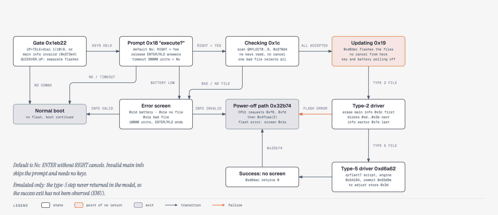

# 09. Recovery and failure modes

**Summary.** Three recoveries have run on a camera. Pulling the card recovers from a hanging card module. A normal keyed update with Ricoh's official 2.40 `QRFLECT3` put a generation 1 body back on stock firmware (spare, 2026-11-07). A package in internal memory (`/IROM/GRMOD.BIN`, generation 2 Koma firmware) changes the first rule: pulling the card no longer bypasses it, and the documented way out of a bad `/IROM` package has run only in the emulator. The flash-level safety net has never run on a camera: interrupted updates, invalid main info and the Monitor's card RAM loader. In the emulator, the original Monitor 1.00 and application 2.40 code recover from 35 of 35 interrupted-update cuts by loading the official file from the card. Recovery from a flash that does not boot is unproven on hardware.

Tags: HW, EMU, STATIC, INFERRED, defined in [features](evidence-ledger.md).

"Model" means the emulator with supplied CPU1 replies, keys, card and file APIs, GPIO levels, ECC behaviour and failure outcomes; raw spare/ECC bytes and flash above the captured range are synthetic. Addresses are firmware 2.40 runtime addresses unless marked Monitor.

Related: [02 Boot chain and Monitor](02-boot-chain-and-monitor.md), [03 Firmware image and update format](03-firmware-image-and-update-format.md), [05 Settings and adjustment store](05-settings-and-adjustment-store.md), [07 USB protocol](07-usb-protocol.md), [10 Emulator and tooling](10-emulator-and-tooling.md), [11 Modification playbook](11-modification-playbook.md), [13 Display, live view and USB streaming](13-display-live-view-and-usb-streaming.md).

## Failure, detection, recovery

"Recovery" is what the code and models predict unless the tag is `HW`. It is not a field-tested procedure.

| Failure | What the camera does | Recovery path | Tag |
|---|---|---|---|
| Card module hangs at boot (lens out, screen never on) | Loader runs the module after the update gate; module never returns | Pull the card. Generation 1, or generation 2 with nothing in `/IROM`: the next boot is stock. Generation 2 with an `/IROM` package: that package loads instead (see [§10](#10-card-module-and-irom-package-failure-modes)) | `HW` |
| `/IROM` package hangs at boot (generation 2) | Same, but the package loads with no card or with a card that holds no `GRMOD.BIN` | An SDSC card with an empty `GRMOD.BIN` boots stock; the installer in remove mode deletes the package ([§10](#10-card-module-and-irom-package-failure-modes)) | `EMU` |
| Card module missing, short or bad checksum | Loader rejects it, frees what it took, boot continues stock | None needed | `EMU` |
| Module executes a CP15 instruction (`MRC p15`) | The core hangs | Pull the card; never execute CP15 in a module | `HW` |
| Power cut or card pull during an update, after the info erase | Monitor sees invalid info, refuses the flash image, scans the card | Official `QRFLECT3` on the card → Monitor loads it to RAM → application updater reinstalls → clean boot; 35/35 cuts, either GPIO60 level | `EMU` |
| Cut before the info erase, or after the info program | Info still valid; old or new image boots | None needed | `EMU` |
| Torn info sector (partial bits, uncorrectable ECC, prefix write) | Info invalid, or valid but wrong | Card fallback for most torn models; fields left erased with magic, marker and type intact boot with wrong info that is never rewritten | `EMU` |
| Invalid header (magic, updated marker, type) | Monitor validator `0x1920` rejects it | Card RAM loader with a card; UART console without one (looks dead) | `EMU` |
| No card, info invalid | Console after about 5,000 timer ticks; no visible sign | Insert a card with the official file and cold-boot; flash is unchanged | `EMU` |
| GPIO60 high and GPIO50 low | Console before any file read | None found; neither level is user-selectable | `EMU` |
| Corrupt body under a valid header | Nothing: no payload checksum at boot | Keyed update with the official file, only if the application reaches the update gate `0x1eb22`; otherwise none | `EMU` |
| Hang or fault before the update gate, valid info | Nothing | None established; recovery code never runs | `STATIC` |
| Hang after the update gate (bad flashed hook) | n/a | Keyed update (UP+TELE) with the official file reinstalls; 4 of 4 cases | `EMU` |
| Calibration byte `0x08010431 = 0xFF` under a valid header | `MainCtrl` spins in `0x3ec14` before the gate | None established | `EMU` |
| Persistent uncorrectable read-back during an update | Update aborts, screen `0x1a`, info left erased | No card: console. Card: fallback loads, updater aborts again at the same place; never restored | `EMU` |
| Spare-pool exhaustion (more than 10 replaced blocks) | Update aborts with 10 table entries | Same as above | `EMU` |
| Block replaced during a successful update | n/a | Next boot reads the image through the replace table, byte-exact | `EMU` |
| Uncorrectable info sector | Update reports success; next boot cannot read info | Card fallback reinstalls without healing; the card is needed on every boot (one cycle simulated) | `EMU` |
| Torn `qrflect7` store commit | Boot loads ROM defaults (bad sum or magic) | A tear in the erase phase or first page cannot be repaired by rerunning `qrflect7`; a late tear may be committed with damaged words ([§9](#9-the-adjustment-store-the-battery-gate-and-the-monitor-reinstall)) | `STATIC` |
| Low battery before flashing | Screen `0x1d`; power-off if info is invalid | Charge and retry; nothing is written | `EMU` |
| Low battery during flashing | Not detected (polling is off) | Becomes an interrupted update | `EMU` |
| Wrong or malformed file on the card | Screen `0x1a` before any erase; the whole card is rejected | Remove it; flash untouched (exception: `QUICKVER.UP`, a separate flasher with no visible validation) | `STATIC` |
| Image over `0x2f0000`, or wrong tail marker | Refused after the info erase (size) / info invalid on every boot (tail) | Official file through the paths above | `STATIC` |
| Damaged Monitor (block 0) | Not modelled | None known; no updater writes block 0 for a type-2 file | — |

## 1. What has run on hardware

| Event | Outcome | Tag |
|---|---|---|
| Official 2.40 pair (`QRFLECT3` + `QRFLECT7`) on the spare, by its own 1.08 updater, keyed power-on | Succeeded; `-VER` reads `02.40`; `/IROM` byte-identical before and after; `-GCID` (store bytes `0x28..0x2f`) unchanged and not the ROM default on every post-update boot, so the store passed its validity check; Camera Info tag 5 later read `2007-09`, so the store commit landed | `HW (spare)` |
| Generation 1 image (`QRFLECT3` alone, keyed power-on) | Installed on both bodies; normal boot; `-VER` `02.40`; JPEG tag `Rev024M` | `HW (both)` |
| Loader runs a code-patching module (`GRMOD.BIN`) | Module ran and patched application `.text`; the patched sites first execute after the boot-time write, so stale I-cache did not bite | `HW (main)` |
| Koma bundle with CP15 telemetry enabled | Lens extended, screen never came on; the boot log stopped at the CP15 stage; pulling the card recovered | `HW (main)` |
| Same bundle with CP15 off | Boots; every telemetry stage completes | `HW (main)` |
| Restore: official 2.40 `QRFLECT3` (sha256 `de00e03d…c783b`) alone over generation 1, normal keyed update | Normal boot; JPEG tag `Rev0240`; photos on the card kept; the lamp blinked green for about 2-3 minutes | `HW 2026-11-07 spare, once` |
| Generation 2 Koma firmware, build 2b over the restored stock image (spare) and over generation 1 (main) | Both bodies boot; tag `240K2` | `HW 2026-11-07/08 both` |
| Package written to `/IROM/GRMOD.BIN` by the installer card module, then loaded from `/IROM` | koma04w (`747F061F`) runs from `/IROM` on both bodies, with a 2 GB card holding no `GRMOD.BIN` and with a 64 GB card | `HW 2026-11-08 both` |
| Card `GRMOD.BIN` and `/IROM` package both present, SDSC card | The card file loads | `HW 2026-11-07 spare` |
| Restore from generation 2 to stock | Install → cold boot → restore → cold boot cycle byte-exact on the build 2b image | `EMU` |
| `/IROM` package removal (installer remove mode); empty-card-file kill switch | Never run on a camera | `EMU` |
| Any interrupted or failed update; card RAM load; Monitor reinstall; UART console; RAM boot | Never observed | — |

The restore was a normal keyed update, the same route as an install. It shows that the keyed update replaces a Koma image with the official one. It does not exercise any failure recovery.

The card-module route has one recovery that is proven: pull the card. A module lives in RAM only; without `GRMOD.BIN` the generation 1 loader returns and the camera runs the stock image. Settings bytes a module left in the settings tail are ignored by stock code. On generation 2 the same action falls through to `/IROM` ([§10](#10-card-module-and-irom-package-failure-modes)).

Flash-level recovery is unproven on hardware, so a flash that does not boot should be treated as potentially fatal. The model shows a path; nothing has shown that the Monitor's SD mount, FAT and file reads work on a real card.

## 2. Recovery architecture

Four independent mechanisms exist in code. Their separation explains every failure case below.

| Layer | Where | Triggered by | What it does | Tag |
|---|---|---|---|---|
| A. Monitor normal boot | `0xb7c` → `0x1920`/`0x189c` → `0x156c` | Every cold boot | If main info is valid (magic, updated marker at `+0x1f0`, type 2 or 3), copies the payload to RAM and jumps to `0x1c000`. Does **not** recompute the payload checksum (`0x19ac` is not called) | `EMU` |
| B. Monitor card RAM loader | `0xa2c` → scanner `0x2394` → loader `0x2194` → validator `0x2138`/`0x19ac` → `0x1518` | Invalid main info at either GPIO60 level, except GPIO60 high with GPIO50 low; or GPIO60 high with no `MG1MODE` file | Validates a card file (size, magic, format, range, weighted checksum, type 2/3/7), stages it at `0x08000000 + load`, sets the jump; the application then runs from RAM | `EMU` |
| C. Monitor flash updater | `0x50ec` → `0x4e54` | `MG1MODE=VERUP_INMONITOR` on the card and GPIO60 high | Erases info (`0x4558`), programs main (`0x4308`), programs info (`0x4588`), verifies main (`0x4658`); skips the full pre-write validator | `EMU` |
| D. Application updater | `0x1eb22` → `0x5d18c` → `0xd6dec` | Held keys (UP+TELE, Movie dial), or invalid info in a running application | The stock update path ([03](03-firmware-image-and-update-format.md)) | `EMU` |

Layer B and layer D work together: B loads the official image into RAM, and that image's own updater (D) reinstalls it from the same file.

**Superseded.** An earlier application-only study assumed the Monitor hands an invalid-info image to the application. The real Monitor does not. The RAM loader is the scanner `0x2394` plus loader `0x2194`; `0x2138` is its validator, not the loader.

### Monitor boot decision

Fifteen scenarios run the original `0xb7c` control flow with supplied GPIO levels, mode file and flash reads; all pass (`EMU`).

| Supplied conditions | Result | Tag |
|---|---|---|
| Reset origin, GPIO60 low, valid main header | Loads internal payload, entry `0x1c000`; never reads `MG1MODE` or the card | `EMU` |
| Same, payload bytes changed, header and checksum untouched | Same selection; changed payload runs | `EMU` |
| GPIO60 low, invalid magic or marker | Card RAM scanner; success sets the RAM entry; failure drops to the console | `EMU` |
| GPIO60 low, valid header, flash-read failure | Returns from the load attempt without card recovery; branch unresolved | `EMU` |
| GPIO60 high, no `PB_LOW` | Reads `MG1MODE`; card RAM scanner unless `VERUP_INMONITOR`; a failed scan can fall back to a valid internal image | `EMU` |
| GPIO60 high, `MG1MODE=VERUP_INMONITOR` | Monitor flash updater `0x50ec` | `EMU` |
| GPIO50 low and GPIO60 high | Records `PB_LOW_DETECTED`, enters the console before reading any file | `EMU` |
| Software return (origin word `0x080000a4` ≠ BootRAM reset pointer `0x10800080`) | Console; no scan | `EMU` |

A 288-case truth table confirms the `0xb7c` control flow (`EMU`). What drives GPIO60 on the board, and whether a user can select it, is unknown; static evidence suggests it is low on a normal boot (`INFERRED`). `PB_LOW` is a name only; it is not shown to be the Playback button.

## 3. Interrupted update

The type-2 update erases main info (block `0x3c`) first, programs the body, and writes info last (`STATIC`). A cut after the info erase leaves info invalid, so layer A will not run a partial body.

| Cut point (37 total, each at GPIO60 low and high) | Result | Tag |
|---|---|---|
| Before the info erase | Boots normally (no damage yet) | `EMU` |
| After the info erase, before the body | Recovers | `EMU` |
| After each of the 34 body blocks `0xd..0x2e` (`0x2e` is also "after body, before info") | Recovers | `EMU` |
| After the info program | Boots normally (complete) | `EMU` |
| Sub-block cuts in blocks `0xd..0x12` (erase-only and mid-block, 24 rows) | All recover | `EMU` |
| Torn models at the info erase, info program, blocks `0xd`, `0x14`, `0x20`, `0x2e` | Recover, except the cases below | `EMU` |
| Info program with fields `+0x12`, `+0x20`, `+0x24`, `+0x26`, `+0x27`, `+0x28` or `+0x30` left erased (magic, marker, type pass) | Boots from flash, image exact; the info stays valid-but-wrong and is never rewritten | `EMU` |
| Info program "99% weak" (one seed), or complete with spare unwritten | Boots; the header still passes | `EMU` |
| Cuts during a replacement-table write (18 rows) | All recover through the fallback | `EMU` |

Recovery in every row is layer B (official file from the card into RAM), then the application's updater, then a byte-exact image and a clean cold boot without the card. 35 recover, 2 boot normally, 0 stick.

Sub-block cuts cover 6 of 34 body blocks. The other 28 were not run because the mechanism makes them redundant: while info is invalid the Monitor reads only the info sector, and the updater erases each block before programming it, so the state inside a body block does not change the outcome (`EMU` for the sampled rows, `INFERRED` for the rest).

Qualifiers that travel with 35/35:

- It rests on a Monitor SD path (mount `0x6034`, FAT, file reads) that has never run on hardware; in the model the mount and file APIs are supplied.
- Torn-write behaviour has no datasheet basis; torn models are named model choices, not predictions.
- One install plus one restore is two write windows (70 erases, 4,304 programs); each recovery adds one. No failure probability is attached.
- To make anything not rewritten visible, the old body has one bit flipped in every not-yet-erased sector; two controls without that change give the same results.

Ricoh's own instruction for a power loss during an update is to repeat the procedure and, if the camera still does not start, contact service.

**Modified images.** If the *install* of a modified image is cut, the file on the card is the modified image, and layer B reinstalls that image, which must itself reach its updater. Swapping the card to the official file is the way out in the model, but that case was not run separately (`EMU`).

**Superseded: "7 of 34".** An application-only study found only 7 of 34 cut positions reached a reflash. It used a fabricated Monitor that handed the partial body to the application. The real Monitor checks info at `0xb58` first and never runs a partial body. 7/34 remains true only of that fabricated setup.

## 4. Invalid header and the card RAM loader

**Detection.** `0x1920` rejects info for wrong magic, wrong updated marker at `+0x1f0`, or a type other than 2 or 3. `0x1748` pre-fills the read buffer with `0xff` and `0x1920` ignores the read result, so an erased block or a failed read also counts as invalid (`STATIC`).

**Card scan.** Scanner `0x2394` mounts at `0x6034` and tries `/ATA1/QRFLECT0..9` in order. A candidate needs a full 512-byte header, a successful stat, a payload read equal to the header length, type 2, 3 or 7, and a passing checksum. The payload is copied to RAM before validation, so a rejected file can leave staged bytes behind. Eight direct loader cases pass: official file, scan reaching name 3, stale-checksum mutation rejected, recomputed-checksum mutation accepted, size mismatch, truncated read, bad magic, missing files (`EMU`).

| GPIO60 | GPIO50 | `MG1MODE` | Usable card | No card | Tag |
|---|---|---|---|---|---|
| low | either | ignored | Scanner, application reset | Scanner, then console | `EMU` |
| high | high | absent or other | Scanner, application reset | Scanner, then console | `EMU` |
| high | high | `VERUP_INMONITOR` | Flash updater, no RAM scan | Updater path | `EMU` |
| high | low | not read | Console, no file read | Console | `EMU` |

Cold-reset runs from Monitor reset to `MainCtrl` confirm the first three reach the application with flash unchanged; the last stops at the console at 58,291 instructions (`EMU`).

**Not a healthy-camera route.** On a healthy camera the card fallback fires only with GPIO60 high and valid info, and nothing known lets a user set that. No supported camera action reaches the card RAM loader on a healthy body (`EMU`, bounded negative). The loader's value is as a safety net after a failed flash.

## 5. Corrupt body with an intact header

**Detection: none at boot.** The Monitor's normal path checks magic, marker and type, not the payload checksum. A one-byte payload change under an intact header is copied and executed (`EMU`). The application does not verify itself at boot either (`STATIC`, bounded: about 96% map coverage).

| Condition | Result | Tag |
|---|---|---|
| Valid info over a damaged body, GPIO60 low | Application faults at `0x5d9fc` | `EMU` |
| Same, GPIO60 high, card present | Runs from a RAM copy of the card image; **no reinstall**; flash stays damaged | `EMU` |
| Same, GPIO60 high, no card | Faults | `EMU` |
| Damaged application still reaches `MainCtrl` `0x1eb22` | Keyed update with any `QRFLECTn` reflashes it | `EMU` |
| Damaged application faults before the gate | No recovery code runs | `STATIC` |
| Latent uncorrectable body sector under valid info | Boots with one wrong byte (or an invalid instruction at `0x1c00c` for the first body sector without a card) | `EMU` |

The application order before the gate is reset code, C init, RTOS, CPU1 handshake, LCD and clock init, then the gate. This is why every Koma hook sits after the gate (hook site `0x281ee`) and why the linter refuses patches on code that runs before it ([11](11-modification-playbook.md)).

**Calibration hang.** A valid header can still hang before the gate through data. Writing `0x08010431 = 0xFF` into the adjustment store leaves `MainCtrl` spinning in `0x3ec14`, a loop `u = u + 1 & 0xff; while (u <= DAT_08010431)` that cannot end at `0xFF` (`EMU`). The official `qrflect7` writes a different value. Other random fills only delayed the gate; two were unresolved. Info stays valid and the gate is never reached, so no recovery is established for this class. Card scripts reach the same store through `adjcom`, which is why modules and scripts must never touch `adjcom`, the `V`/`W` engine or flash, and why only the dedicated installer writes `/IROM`.

## 6. No card, and GPIO60 high with GPIO50 low

**No card.** With info invalid and no card, the Monitor waits about 5,000 timer ticks (`0xae0`), then enters its UART console (`0x9d0`) at about 20.2 M instructions. The step that looks like an indicator (`0x2558`) is an empty function, and the Monitor has no USB code. Expect a camera that looks dead. Flash is unchanged, so a later boot with the card still recovers (`EMU`). The console is a UART at 38,400 baud; its pins are unidentified. Whether CPU1 keeps power on during the wait is unknown.

**GPIO60 high, GPIO50 low.** With a card present the Monitor records `PB_LOW_DETECTED` and enters the console at 58,291 instructions, before any card read (`EMU`). GPIO60 alone matters only in this combination and with `VERUP_INMONITOR`. Both lines are model inputs; neither is a demonstrated user-selectable strap (`INFERRED`).

## 7. Read-back failure, spare pool, info sector

**Persistent read-back failure.** The writers read programmed data back and compare (`0x638e8`/`0x63886`, `0x64f04`). An uncorrectable read-back in a body sector aborts the update with no replacement: 538 operations, empty table, info left erased, screen `0x1a`, power-off path (`EMU`). With a card, the fallback boots the official image from RAM and its updater aborts at the same place every time. It is never restored. A correctable bit in the same sector is normal. A card read error after the erase also fails with info erased.

**Spare-pool exhaustion.** An erase failure takes a spare (from `0xc` downward; it also needs a second free block), records type 2 and retries. A program failure records type 3, copies earlier sectors and retries. The table holds 10 entries (`STATIC`).

| Injected failure | Result | Operations | Tag |
|---|---|---|---|
| Erase fails at `0x14` or `0xd` | Replaced with `0xc`, completed | 2,198 | `EMU` |
| Erase fails at `0x14` and spare `0xc` | Chained to `0xb`, completed | 2,201 | `EMU` |
| Erase fails at info `0x3c` | Replaced, completed | 2,198 | `EMU` |
| Program fails at `0x14` sector 0 / `0x20` | Replaced, completed | 2,198 / 2,214 | `EMU` |
| Program fails at the info sector | Replaced, completed; info not at its physical sector | 2,323 | `EMU` |
| Factory marker on page 1 of `0x14` | Check misses it; marker erased; block used | 2,195 | `EMU` |
| 12 failing body blocks | Table full after 10; **aborted** | 699 | `EMU` |
| Every program and erase fails after op 1,000 | Spares used up; **aborted** | 1,039 | `EMU` |

Every abort leaves info erased with the body partly written, the same state as an interrupted update, and recovery then behaves like a read-back failure. The Monitor's own reader honours the replace table: in all 8 completed replacement cases the next boot reads the image exactly through the table (`EMU`). A factory marker on page 0 is refused before any operation, so that row does not separately test the table. `0x64b1c` checks the invalid-block marker on the first page only, while the OneNAND datasheet allows the first or second page (`STATIC`).

**Superseded.** Older text warned that a block replaced during an official update could leave the camera unbootable. The real Monitor reads through the replace table in every case tested.

**Uncorrectable info sector.** The update has no read-back on the info sector. A persistent uncorrectable error there makes the update return success, and the next boot cannot read info, so the Monitor lands on the console without a card. With the official card present, the fallback reinstalls and returns success without healing it: the camera then needs the card on every boot. Only one reinstall cycle was simulated (`EMU`). Response: keep the official file on the card; no service route is known.

## 8. RAM rescue round trip

From a zeroed main body and invalid info: Monitor RAM fallback → official application from the same virtual `QRFLECT3` → its installer → byte-exact main and info (2,152 programs, 35 erases) → a fresh cold boot without the card reaches normal startup; Monitor, store and extended data unchanged (`EMU`). The run stops when the installer returns, so the firmware's own post-update restart is not covered.

## 9. The adjustment store, the battery gate and the Monitor reinstall

### `qrflect7` torn commit

`qrflect3` writes only logical blocks `0xd..0x2e` and `0x3c`. `qrflect7` erases and rewrites block `0x3d`, the adjustment store, on every body that reaches its commit (`UEE00`) (`STATIC`). Every flash of generation 1, generation 2 and the restore used `QRFLECT3` alone, so none of them wrote block `0x3d`.

| Consequence | Tag |
|---|---|
| A bad sum or magic makes boot load ROM defaults (`0x27bdc` → `0x27bc0`); the camera works but loses the unit-specific calibration words (about 857 differ from ROM defaults on one body) | `STATIC` |
| A tear in the erase phase or the first page cannot be repaired by rerunning `qrflect7`: `UEEF1` reloads the erased bytes, byte 0 stays `0xFF`, `UEE00` refuses (it needs `0xAA` or `0x55`) and the driver only logs `ERROR` | `STATIC` |
| A tear later in the program phase (byte 0 already `0xAA`, sum word still erased) may be committed as valid by a rerun, with the words past the tear left `0xFF`; it assumes page-order programming | `INFERRED` |
| `0xd6dec` does not stop after a failed `qrflect3`: with `qrflect7` on the card it continues, so a failed main flash plus a store rewrite is possible | `STATIC` |

Damage would show as Camera Info tags 4/5 reverting to ROM-default dates. For restores, use `QRFLECT3` alone.

### Battery check runs only before flashing

`0x5d18c` reads battery state `0x2b9e92` through `0x32a22` at two points: before the file scan and again before `0xd6dec`. States 3 and 2 pass; others show screen `0x1d`. Then `0xd6c58` calls `0xd6bcc`, which clears `0x2c9e48`; the periodic body `0x8a790`, including battery poll `0x5290c`, is skipped while that flag is clear. In the reference run there were 654 polls and none at or after the info erase. With the reading forced to 0 from the info erase on, the update still finished (`EMU`): nothing stops a flash on low battery once it starts.

Supplied raw readings (scale unknown, not volts) under the first-poll thresholds 131/139/148 (`EMU`):

| Raw reading | Keyed update, info valid | Rescue, info erased |
|---|---|---|
| Below 131 | Power-off request at startup, no flash | Same |
| 131 to 138 | Screen `0x1d`, normal boot, no flash | Screen `0x1d`, power-off request, no flash |
| 139 and up | Flashes | Flashes |

A rescue attempt on a low battery fails safe in the model: no write, power-off, retry after charging. The thresholds come from camera-state-indexed tables in the adjustment store, identical in the ROM defaults (`0x175380`) and in `qrflect7` (`STATIC`):

| Table (`+4 × state`, bytes HALF / NEAR END / END) | Entry 2 (power-on lens drive) | Entry `0xb` (init default) | Entry 8 |
|---|---|---|---|
| Battery type 0, `0x08010e10` | 152 / 144 / 135 | 148 / 139 / 131 | 120 / 116 / 111 |
| Battery type 1, `0x08010d10` | 241 / 234 / 205 | — | 231 / 224 / 191 |

Which battery type is the DB-60, AAA cells or AC is unknown. Whether CPU1 cuts power on its own during a flash is unknown.

### Monitor reinstall (layer C)

At `0x50ec` the Monitor scans `/ATA1/QRFLECT0..9`, stages a file through `0x4cc8`, pads the buffer through `0x8e80` and calls `0x4e54`, which for type 2 runs the four steps in [§2](#2-recovery-architecture). Initial conditions of the runs: captured main data plus three retained spare metadata bytes seed the NAND, omitted markers and ECC are synthetic `0xff`, the flash interface is initialised and locked, and entry is direct at `0x50ec`, so this is not a reset or physical-activation test.

| Supplied condition | Result | Tag |
|---|---|---|
| Official type-2 file; corrupt main, invalid info | Returns 0; 35 erases, 2,152 programs; image and header exact; reloads byte for byte | `EMU` |
| Payload changed with stale checksum | Also programs it: this caller skips the full validator | `EMU` |
| Card read error, all files missing, or type-7 file | Returns −1; no program or erase | `EMU` |
| Erase fails at info `0x3c` or first main block `0x0d` | Replaced with `0x0c`; correct payload reconstructed | `EMU` |
| Info erase and every replacement fail | Returns −1 without programming main; tried `0x0c` down to `0x03` | `EMU` |

Block 0 is unchanged in every case. "Monitor reinstall" means the Monitor reprograms the *main application*; nothing restores the Monitor itself. Layer C differs from layer B: B checks the checksum and accepts type 7; C skips the checksum and rejects type 7. The physical selector for C (a `MG1MODE` file plus GPIO60 high) has no known user route.

## 10. Card-module and `/IROM` package failure modes

### Where the package is read from

Generation 1 reads only the card `GRMOD.BIN`. Generation 2 adds a fallback: the loader's one `open` (`0x57fa4`) calls `open_both` (`0x580cc`), which opens `/ATA1/GRMOD.BIN` and, only if that open fails, mounts `/IROM` and opens `/IROM/GRMOD.BIN` (`STATIC`). A card file that opens wins even if it is invalid; the loader then rejects it and boots stock, without trying `/IROM`.

| Card in the camera | Generation 1 | Generation 2 | Tag |
|---|---|---|---|
| SDSC card with a valid `GRMOD.BIN` | Card package | Card package; `/IROM` never opened | `HW` |
| SDSC card with an empty or invalid `GRMOD.BIN` | Rejected, stock | Rejected, stock; no `/IROM` fallback | `EMU` |
| SDSC card without `GRMOD.BIN` | Stock | `/IROM` package | `HW` (generation 2) |
| No card | Stock | `/IROM` package | `EMU` (generation 2) |
| 64 GB SDXC card, with or without a card `GRMOD.BIN` | Card not usable | The loader cannot read the card file; `/IROM` package | `HW` |
| `/IROM` file corrupt, missing or `/IROM` unformatted | n/a | Stock | `EMU` |

### Getting out of a bad package

| Situation | Way out | Tag |
|---|---|---|
| Card package hangs, nothing in `/IROM` (or generation 1) | Pull the card | `HW` |
| `/IROM` package hangs (or card pulled with a bad `/IROM` package) | Pulling the card does not help. Boot once with an SDSC card holding an empty `GRMOD.BIN` (kill switch): stock boot. A 64 GB card cannot carry the kill switch | `EMU` (`STATIC` for build 2b: the card-wins branch at `0x580d4` is unchanged) |
| Remove the `/IROM` package for good | SDSC card with the installer module as `GRMOD.BIN` and an empty `KOMARM.TXT`; boot about 60 s; the log reads `result=removed`. The installer is itself a card file, so it wins over the `/IROM` package | `EMU` (never run on a camera) |
| Replace the `/IROM` package | Installer as `GRMOD.BIN` and the new package as `KOMAPKG.BIN`; `result=installed`, or `same` if identical; then delete both files from the card | `HW 2026-11-08 both` |
| Restore stock firmware with a package still in `/IROM` | The official `QRFLECT3` keyed update does not touch blocks `0x54+`, so the file stays (`HW`: `/IROM` byte-identical across the official update). Stock 2.40 has no loader and ignores it (`STATIC`). A later generation 2 flash would load that old copy again (`INFERRED`) | mixed |

The installer touches `/IROM` only after confirming it is mounted, reads its copy back and deletes a copy that does not match. A power cut during the copy leaves a short or bad file, which the loader rejects by checksum (`EMU`). Install is remove-then-copy, so a failed copy leaves no package; the camera then boots stock without a card.

### Other module failures

| Failure | Behaviour | Response | Tag |
|---|---|---|---|
| Module hangs or crashes in its installer or a hook | Boot stops after the update gate | Card package: pull the card. `/IROM` package: see above | `HW` (card) |
| Module uses CP15 (`MRC p15`) | Core hangs; the firmware itself contains no CP15 instruction | Build with CP15 off; the linter and build options keep it out | `HW` |
| Self-modifying code | Coherent: a rewritten immediate ran its new value, fresh-address code runs | None needed | `HW` |
| Pool shortage | Largest free KernPool block was 3.9 KB with the 29.8 KB Koma body allocated, and 6,656 B with a smaller module | Packages now keep their resident code in a static region at `0x3dae00` (`HW`: `RES 003DAE00`, canary OK) | `HW` |
| Card probe slower than about 2.5 s | Loader skips the module silently; stock boot | Re-power | `STATIC` |
| One before-byte mismatch | Installer applies nothing and frees everything | None needed | `EMU` |
| Settings left by a module | Stock ignores tail bytes; recipe ids fall back to plain B&W or B&W(TE) | None needed | `STATIC` |
| Startup "lens out, lens in, power off" | Every boot-time abort shows this pattern; see below | Charge; dial on Auto; card in; press POWER | `INFERRED` |

The CPU runs modules in SVC mode (`HW`). Telemetry measures pool headroom while the transient body is still allocated, so the real figure after install is higher by up to the transient size.

**Lens out, lens in, power off.** Startup `0x1e7ac` loads settings and the battery driver, then `0x1ef90() == 0` starts the lens (`0x293f4(2)`). `0x1ede0` waits for the camera task and returns −1 on battery state 0 (END, which sets `end_factor 0x23a870 = 3`), a power-key or thermal request (`0x720d`), a fatal error report (`0x5205`) or a timeout. Any of these stops the zoom, retracts the lens, saves settings and powers off, so the cause is not visible from outside (`STATIC`). Battery END under the power-on lens load is the most likely cause; a lens home-position timeout or a card error at boot are possible; thermal shutdown, a settings-checksum failure and anything specific to the Movie dial position are excluded by code (`INFERRED`). A torn store is excluded as the cause on the spare, since its `-GCID` stayed valid after the update (`HW`). The lens-error log and battery counters live in the settings block (flash block `0x55`), which no ORIGINAL-mode USB command reads ([07](07-usb-protocol.md)); the stock dump script is the only route. The last shutdown reason is held in RAM only.

## 11. The partial flash dump

The main camera's stock dump script produced `IROM.DAT` of 6,736,896 bytes: 13,056 complete 516-byte records, ending just before physical block `0x66` (`HW`). Every fourth trailer byte is zero; the raw bad-block marker, ECC parity and controller status are not in the 516-byte output (`HW` + `STATIC`). The length is not the routine's coded limit (`0x67434` loops 65,536 sectors and returns −1 after any nonzero read result or a card write returning −1) and not a geometry boundary: the geometry table at `0x177978` gives both supported device IDs `0x14` and `0x15` as 512 blocks × 64 pages × 2 sectors (`STATIC`). The raw read `0x64d80` addresses a physical sector with no replace-table translation; `0x6490c` checks completion and status, then the ECC mask through `0x645c0` (`STATIC`).

| Injected condition at sector `0x3300` | Result | Tag |
|---|---|---|
| Uncorrectable sector read | Dump returns −1 after 13,056 writes; output matches the captured file byte for byte | `EMU` |
| Card write returns −1 for the next record | Same output file after 13,057 attempts | `EMU` |
| No fault, correctable ECC, or device ID `0x15` | Read succeeds | `EMU` |
| Uncorrectable main or spare ECC | Read returns `0x01003300` | `EMU` |
| Factory-bad marker alone | Read succeeds; the raw reader does not skip marked blocks | `EMU` |
| Full script route with a read error | Exact prefix written and closed, but the script handler returns 0 | `EMU` |

The file cannot tell the two causes apart; it keeps only three packed metadata bytes per sector. A first failure at the next block is plausible, but the alignment alone does not prove a bad block, an ECC error or a power loss (`INFERRED`). The captured part still holds the official main body (block `0xd`), the official header (block `0x3c`, sector `0x7e`), the store (block `0x3d`, starting `0xAA`) and the complete Monitor (`HW`). A future dump must be at least 4,094,976 bytes (`0x3e × 128 × 516`) to include block `0x3d`; blocks `0x54+` change on every boot and are not comparable. The dump routine is read-only for flash, but the restore token `UE104` and a whole-device erase sit one byte away from the dump opcodes (`STATIC`). A bounded per-sector status reader exists ([`tools/capture_diagnostic/range.c`](../../tools/capture_diagnostic/range.c)) and has never run on a camera.

## 12. Other failure modes

| Mode | Behaviour | Tag |
|---|---|---|
| One bad `QRFLECTn` on the card | Whole card rejected, screen `0x1a`, no flash; `QRFLECT0`, `4`, `7+` count as present but not accepted | `STATIC` |
| Two files both named `QRFLECT3` (modified and official) | Indistinguishable before flashing; label cards and hash the file before each update | `STATIC` |
| Failed flash plus any `QRFLECT` card on the next plain boot | Flashes with no prompt; the card decides what is written | `STATIC` |
| `SCRIPT.MG1` on an update card | Runs after a No, a timeout, a rejection, or the first boot after a flash | `STATIC` |
| Cancel after the prompt | Not possible; POWER is not read during the flash | `STATIC` |
| Update started with a broken screen | Prompt and rejection screens cannot be told apart; the default answer is No, so blind mistakes tend toward no flash; the lamp is the only positive sign | `STATIC` + `INFERRED` |
| Update duration | The lamp blinked green for about 2-3 minutes during a keyed `QRFLECT3` update (one observation) | `HW 2026-11-07 spare` |
| Flash error | Screen `0x1a` for about 10 s, then power-off; from the lamp alone it looks like success | `STATIC` |
| Nonzero version bounds in a built header | `0x27648` rejects the file when the installed version is out of range | `STATIC` |
| Settings block `0x1b000` corrupted with a valid sum | 832 injections all reached the update prompt | `EMU` |
| 64 GB card holding the only copy of a card package | The loader cannot read a card `GRMOD.BIN` on it; the package must be in `/IROM` | `HW` |
| USB `-NLST /EXT0` on a 64 GB FAT32 card | Answers `150`, then never sends data or `250`; subdirectories and `RETR` work ([07](07-usb-protocol.md)) | `HW` + `STATIC` |
| Host sends card commands (`-INFO`, `-NLST`) while the camera is writing a shot | The JPEG was damaged on the card itself (spare, 1,115,388 B, header at offset 1 MiB, no final EOI); the cause is inferred to be a file-layer race. The host-side fix (no card commands until the camera reports idle, komabridge 0.3.2) is not yet tested on a camera ([13](13-display-live-view-and-usb-streaming.md)) | `HW`, once |

## Key addresses

| Address | Meaning | Tag |
|---|---|---|
| Monitor `0xb7c` | Boot control: GPIO reads, `MG1MODE`, header check, load setup | `EMU` |
| Monitor `0x2524` / `0x253c` | GPIO60 / GPIO50 samples | `STATIC` |
| Monitor `0x1920`, `0x1748`, `0x19ac` | Info validator; `0xff` pre-fill; weighted payload checksum (not on the normal path) | `STATIC` |
| Monitor `0x2394`, `0x2194`, `0x2138` | Card RAM scanner, loader, validator | `STATIC` |
| Monitor `0x6034` | Card mount (supplied in every model) | `STATIC` |
| Monitor `0xae0`, `0x9d0` | No-card wait, UART console | `STATIC` |
| Monitor `0x50ec`, `0x4e54`, `0x4558`, `0x4308`, `0x4588`, `0x4658` | Flash updater; info erase, main program, info program, main verify | `STATIC` |
| App `0x1eb22` | Update gate | `STATIC` |
| App `0x281ee` | First call after the update check; Koma loader hook site | `HW` |
| App `0x57f78`, `0x57fa4`, `0x580cc` | Koma loader entry; its file open; generation 2 `open_both` (card, then `/IROM`) | `STATIC` |
| App `0x5d18c`, `0xd6dec`, `0xd6c58`, `0xd6bcc` | Update orchestration and battery gate, flash loop, direct programmer, polling off | `STATIC` |
| App `0x63c68`, `0x63b88` | Info erase (point of no return), body program | `STATIC` |
| App `0x32a22`, `0x5290c`, `0x8a790`, `0x2c9e48` | Battery state read, battery poll, periodic body, polling flag | `STATIC` |
| App `0x64d80`, `0x6490c`, `0x645c0`, `0x177978` | Raw sector read, status check, ECC check, geometry table | `STATIC` |
| App `0x67434`, `0x674bc`, `0x28194` | Dump, restore, whole-device erase | `STATIC` |
| App `0x3ec14` (`0x08010431`) | Calibration loop that hangs at `0xFF` | `EMU` |
| App `0x27c5c`, `0x27c28`, `0x27bdc` | `UEE00` commit, `UEEF1` reload, store load with default fallback | `STATIC` |
| App `0x1e7ac`, `0x1ede0` | Startup; boot-time abort wait (lens out, lens in, off) | `STATIC` |
| Flash blocks `0`, `1..0xc`, `0xd..0x3b`, `0x3c`, `0x3d`, `0x54+` | Monitor, replace table and pool, body, info, store, `/IROM` | `STATIC` |

## Open questions

- Whether the Monitor's card recovery path (SD mount, FAT, file reads, RAM load) works on a real camera; whether a camera boots at all with info erased. Only a deliberate interrupted update on the spare would test it.
- Restore from generation 2 Koma firmware, build 2b to stock on a camera (emulated only).
- The `/IROM` kill switch (empty card `GRMOD.BIN`) and the installer's remove mode on a camera.
- What physically drives GPIO60 and GPIO50 at Monitor `0x2524`/`0x253c`; whether the Monitor console is reachable without opening the body.
- The header-valid flash-read-failure branch: one model returns −1 and re-enters `0xb7c`, another boots the wrong byte. Treat it as unknown on hardware.
- Real torn-write, wear, read-disturb and ECC behaviour; CPU1's behaviour on low voltage during a flash; which battery type is the DB-60.
- Lamp pattern of update outcomes (success, rejection, error) on a body without a working screen; update duration has one observation.
- Why the dump stopped at sector `0x32ff` (read error or card write error); a dump of the spare would also give its Monitor version and store.
- How a damaged Monitor (block 0) could be restored; no source covers it.
- Which caller enforces which image-size window (`0x406800`, `0x422800`, `0x2f0000`); a candidate passing one and failing another after the erase is a brick path.
- The cause of the spare's 2026-11-06 lens-out, lens-in, power-off episode was never recorded; the body has booted and shot normally since (`HW` 2026-11-07/08).

## Evidence

- [analysis/flash-failure-real-monitor/README.md](../../analysis/flash-failure-real-monitor/README.md): 35/35 interrupted-update matrix, torn models, bad blocks, battery gate, conditions that stop recovery
- [analysis/monitor-boot-decisions/emulated-boot-decisions.json](../../analysis/monitor-boot-decisions/emulated-boot-decisions.json): 15 Monitor boot-decision scenarios
- [analysis/monitor-recovery/](../../analysis/monitor-recovery/): Monitor boot, card loader, updater and writer analysis
- [analysis/monitor-reinstall/report.json](../../analysis/monitor-reinstall/report.json): layer C reinstall cases and initial conditions
- [analysis/ram-application-lifecycle/verification-summary.json](../../analysis/ram-application-lifecycle/verification-summary.json): RAM rescue round trip
- [analysis/captured-monitor-emulation/verification-summary.json](../../analysis/captured-monitor-emulation/verification-summary.json): captured Monitor RAM boot
- [analysis/emu-update-replay/README.md](../../analysis/emu-update-replay/README.md): emulated 1.08 → 2.40 update replay
- [analysis/dump-boundary-audit/boundary-report.json](../../analysis/dump-boundary-audit/boundary-report.json), [emulated-captured-boundary.json](../../analysis/dump-boundary-audit/emulated-captured-boundary.json): partial dump length and injected causes
- [analysis/flash-review/REVIEW.md](../../analysis/flash-review/REVIEW.md): dump coverage and acceptance size
- [analysis/spare-poweron-diag/README.md](../../analysis/spare-poweron-diag/README.md): lens-out diagnosis, battery tables, torn-store analysis
- [analysis/usb-first-contact/README.md](../../analysis/usb-first-contact/README.md): official 1.08 → 2.40 update on the spare; `/IROM` unchanged across it
- [analysis/module-loader/README.md](../../analysis/module-loader/README.md): card-module loader; restore over generation 1 on the spare
- [analysis/sdhc/irom-fallback/README.md](../../analysis/sdhc/irom-fallback/README.md): `/IROM` fallback, card-wins rule, kill switch, failure modes
- [analysis/sdhc/driver/README.md](../../analysis/sdhc/driver/README.md): generation 2 Koma firmware, build 2b `open_both`, `/IROM` mount fix, install/restore cycle
- [analysis/sdhc/driver/prove-image/koma-fw2-240-75425a70.md](../../analysis/sdhc/driver/prove-image/koma-fw2-240-75425a70.md): build 2b install → restore cycle
- [analysis/sdhc/spare-test/modules/README.md](../../analysis/sdhc/spare-test/modules/README.md): `/IROM` installer modes (install, same, list, remove) and proofs
- [analysis/sdhc/diag/README.md](../../analysis/sdhc/diag/README.md): `irodump`, the installer variant used on the cameras
- [analysis/hw-tests/2026-11-07-spare.md](../../analysis/hw-tests/2026-11-07-spare.md): generation 2 Koma firmware, build 2b on the spare; 64 GB card rule; `/IROM` load
- [analysis/hw-tests/RUNBOOK-2026-11-08-PM.md](../../analysis/hw-tests/RUNBOOK-2026-11-08-PM.md): `/IROM` installs on both bodies, loader precedence, damaged shot during a card read
- [analysis/sdhc/widefs/ROOT-NLST-64GB.md](../../analysis/sdhc/widefs/ROOT-NLST-64GB.md): `-NLST /EXT0` hang on 64 GB FAT32
- [tools/capture_diagnostic/range.c](../../tools/capture_diagnostic/range.c): per-sector dump status reader (never run on a camera)
