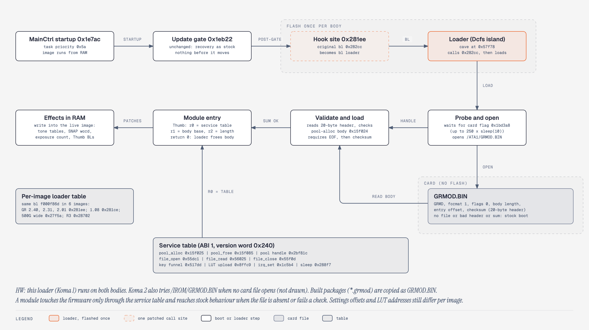

# 11. Modification playbook

**Summary.** Koma changes the camera in two layers: a firmware image flashed once (a card-module loader plus a version marker, added to Ricoh's 2.40 `QRFLECT3`), and one package file, `GRMOD.BIN`, that carries every feature as byte records, each checked against the bytes it expects to replace. Two firmware generations exist: generation 1 reads the package from the card only; generation 2 Koma firmware, build 2b adds an SDHC/SDXC driver and an `/IROM/GRMOD.BIN` fallback. As of 2026-11-08 both bodies run generation 2 Koma firmware, build 2b with package koma04w (build `747F061F`) in `/IROM` (`HW`). A feature is written as data for the `koma` linker, which refuses flash writes, early boot sites and unsafe settings writes. A card package is undone by pulling the card; an `/IROM` package is overridden by a card package. New firmware images are reserved for changes a module cannot make and carry the flash-level risk described in [09](09-recovery-and-failure-modes.md).

Tags: HW, EMU, STATIC, INFERRED, defined in [features](evidence-ledger.md).

Related: [03 Firmware image and update format](03-firmware-image-and-update-format.md), [05 Settings and adjustment store](05-settings-and-adjustment-store.md), [06 Image pipeline and colour](06-image-pipeline-and-colour.md), [07 USB protocol](07-usb-protocol.md), [09 Recovery and failure modes](09-recovery-and-failure-modes.md), [10 Emulator and tooling](10-emulator-and-tooling.md), [12 Version history](12-version-history.md), [13 Display, live view and USB streaming](13-display-live-view-and-usb-streaming.md), and the user-facing [build guide](../building.md).

## Change classes, ranked by what a mistake touches

Rank 1 is the lowest risk. The ranking is a judgement from the evidence below; no failure probabilities are measured.

| Rank | Class | Example | What a mistake touches | Undo | Tag |
|---|---|---|---|---|---|
| 1 | Observation | Read-only USB (`-VER`, `ls`, `get`); reading JPEG metadata | Side effects only: `-VER` arms a 3 s UI timer | n/a | `HW` |
| 2 | Package, data records | A tone table or a constant replaced in RAM | RAM until power-off | Pull the card (card package) | `HW` |
| 3 | Package, code | Hooks in the develop path, menu redirects, USB command handlers | RAM code that runs on every boot after the update gate; a hang stops the boot | Pull the card (card package) | `HW` |
| 4 | Package, settings rows | KOMA menu rows in the settings tail | Settings bytes stock ignores; persisted by the stock save | Remove the package; the bytes become inert | `EMU` |
| 5 | Package in `/IROM` | koma04w copied to `/IROM/GRMOD.BIN` by the installer module | One file in internal memory; the package loads on every boot with no card module, including with no card | A card `GRMOD.BIN` on an SDSC card wins (`HW`); the installer's remove mode deletes the file (`EMU`) | `HW` |
| 6 | Flash image, data only | A marker string in the image | The whole main image is rewritten (35 erases, 2,152 programs) | Official `QRFLECT3` by the keyed update: once over generation 1 (`HW`); over generation 2 `EMU` only | `HW` (marker) |
| 7 | Flash image, code | The loader at `0x57f78` and its hook; the generation 2 SD driver | As above, plus new code on every boot | As above | `HW` |
| X | Excluded | Anything writing the adjustment store (`qrflect7` edits, `adjcom`, `install`, `uninstall`, `poff`), Monitor blocks, `/IROM` other than the package file, the settings save from a module | Calibration can hang boot before the update gate; a torn store cannot be repaired by rerunning `qrflect7` | None known | `EMU` |

Ranks 6 and 7 have run on hardware as two images: generation 1 Koma firmware on both bodies from 2026-11-06, then generation 2 Koma firmware, build 2b on both bodies (2026-11-07). Everything since lives at ranks 2–5.

## 1. The delivery model: flash once, then packages

| Item | Fact | Tag |
|---|---|---|
| Generation 1 Koma firmware | Official 2.40 `QRFLECT3` plus the loader (344 B at `0x57f78`, inside dead Dcfs self-test function `0x57f74`), its hook (the `bl 0x282cc` at `0x281ee` redirected), and the marker `Rev%4.4x` → `Rev024M` (format string at `0x112578`). Reads `/ATA1/GRMOD.BIN` only; the card must be SDSC (stock driver) | `HW` |
| Generation 2 Koma firmware, build 2b | Generation 1 plus an SD 2.0/SDHC/SDXC card driver (CMD8, ACMD41 with HCS, block addressing) and an `/IROM/GRMOD.BIN` fallback in the loader. MakerNote tag `240K2`. The stock file system never mounts a high-capacity card by itself; the `widefs` package feature mounts it at full capacity | `HW` |
| Installed | Both bodies run generation 2 Koma firmware, build 2b with koma04w (58,092 B, build id `747F061F`) in `/IROM/GRMOD.BIN` (HW 2026-11-08 both) | `HW` |
| Load order | A card `GRMOD.BIN` wins; with no card module the `/IROM` package runs, on a 2 GB card (main) and on a 64 GB card (spare) | `HW` |
| 64 GB rule | On a 64 GB SDXC card the loader cannot read a card `GRMOD.BIN` (the card is not mounted at loader time) and falls back to `/IROM`. With a large card the package must be in `/IROM`; a card package works only on SDSC | `HW` |
| Visible proof | JPEG MakerNote tag 2 reads `Rev024M` (generation 1), `240K2` (generation 2) or `Rev0240` (stock); `-VER` and the version screen still read 2.40 (they report the header, not the body) | `HW` |
| With no package | Stock boot; the loader returns without effect | `HW` |
| Full package | koma04w: 22 features, resident block at `0x3dae00`; KOMALOG reads `BUILD 747F061F`, `RES 003DAE00`, canary OK, booted from `/IROM` (with CP15 telemetry off) | `HW` |
| Restore over generation 1 | Official 2.40 `QRFLECT3` by the normal keyed update: normal boot, tag `Rev0240`, photos on the card kept (HW 2026-11-07 spare, once) | `HW` |
| Restore over generation 2 | Install and restore cycle byte-exact in the model for build 2b; not run on a camera | `EMU` |

The generation 1 image is rebuilt from the user's own 2.40 file by `koma make-loader`, which refuses any input whose SHA-256 is not the official one ([`tools/koma/loader.py`](../../tools/koma/loader.py)). The generation 2 image is built by [`analysis/sdhc/driver/build.py`](../../analysis/sdhc/driver/build.py) from the generation 1 image (24 declared edits, 2,052 bytes, no change outside them, `STATIC`).

### What the loader does



| Step | Detail | Tag |
|---|---|---|
| 1 | Calls the original `0x282cc` first, so stock startup completes | `STATIC` |
| 2 | Waits up to about 2.5 s for the card-probe flag `0x1bd3a8`; a slower probe skips the module silently | `STATIC` |
| 3 | Opens `/ATA1/GRMOD.BIN`. Generation 2 only: if that fails, mounts `/IROM` through the firmware's `0x49384(0)` when `0x1fb200` = 0, then opens `/IROM/GRMOD.BIN` (tail `0x580cc..0x58104`) | `HW` (order) |
| 4 | Validates a 20-byte header: `GRMD`, format 1, length at most `0x10000`, checksum `rol(c,1) + word` | `EMU` |
| 5 | Allocates the body from KernPool `0x2bf81c`, reads it, verifies it | `EMU` |
| 6 | Calls `body + entry + 1` (Thumb) with a 48-byte service table at `0x5809c` | `HW` |
| 7 | Frees the transient part when the module returns | `EMU` |

Every rejection frees what it took and returns to stock. In the model, no file and a bad checksum leave milestones, task list, flash operations and console identical to stock, and 8 malformed variants are rejected before any module code runs. The loader executes nothing before the update gate `0x1eb22` (`EMU`). The `/IROM` mount is needed because in boot mode 1 (`0x1b9866` = 1, the hardware case) tFileTask mounts `/IROM` only when SD init fails, so with a working card `/IROM` is unmounted when the loader runs (`HW` for the failure, `STATIC` for the cause). `/IROM` stays mounted afterwards.

The service table gives the module: ABI version, image version word, pool alloc and free, file open, read and close, the key funnel `0x517dc`, the LUT upload `0x8ffc8`, the IRQ mask `0x1c5b4`, and sleep. Modules call firmware through it or through checked absolute addresses, never through a raw absolute `bl`. The loader has no write entry.

**Superseded.** An earlier 310-byte loader design overwrote island function `0x5848a`. The generation 1 image uses the 344-byte loader at `0x57f78` and leaves `0x5848a` alone. Per-body address tables written for the earlier form must be rebuilt for this one.

### The `/IROM` installer

A package reaches `/IROM` only through a standalone card module, built outside the `koma` linker ([`analysis/sdhc/spare-test/modules/`](../../analysis/sdhc/spare-test/modules/README.md); the variant run on both bodies is `irodump.grmod`, the same installer plus a log-dump step, [`analysis/sdhc/diag/`](../../analysis/sdhc/diag/README.md)). It runs as the card `GRMOD.BIN` on an SDSC card, with the package beside it as `KOMAPKG.BIN`.

| Mode | Trigger file on the card | Does | Tag |
|---|---|---|---|
| install | none | Checks `KOMAPKG.BIN` with the loader's own rules; if `/IROM/GRMOD.BIN` already matches, writes nothing (`result=same`); else removes the old file, copies, reads back, compares, and deletes a bad copy (`verify_fail`) | `HW` (both bodies 2026-11-08: `installed` on the spare, `same` on the main) |
| remove | `KOMARM.TXT` | Deletes `/IROM/GRMOD.BIN` and checks it is gone | `EMU` |
| list | `KOMALS.TXT` | Writes nothing to `/IROM`; logs the listing | `EMU` |

Every `/IROM` access is gated on `0x1fb200` = 1 (mounted): an unmounted `/IROM` accepts a copy that never reaches NAND. A first installer without its own mount logged `result=unmounted` on the spare (`HW`), which exposed the boot-mode-1 mount rule above. After an install the card `GRMOD.BIN` and `KOMAPKG.BIN` must be deleted, because a card package hides the `/IROM` one. A firmware flash does not touch `/IROM`; stock 2.40 has no loader and so ignores the file (`INFERRED`).

## 2. The feature model

A feature is a Python file, `tools/koma/features/<name>.py`, with `NAME`, `SUMMARY`, `OPTIONS`, optional `ROWS`, and `make(opts) -> Feature`. The `Feature` fields are records the installer applies:

| Field | Record | Effect | Before-bytes |
|---|---|---|---|
| `patches=[Patch(addr, before, after, why)]` | `DATA` | Writes `after` over `before`; code or data | Verified |
| `checks=[Check(addr, before, why)]` | `CHECK` | Nothing written; asserts bytes your code depends on (a callee's prologue, a table) | Verified |
| `hooks=[Hook(site, target, handler, next, why)]` | `BL` | Wraps the Thumb `bl target` at `site`; several features on one site chain | Site must decode as `bl target` |
| `redirects=[Redirect(site, before, handler, why)]` | `BL` | Exclusive `bl` rewrite at any 4 bytes; no chaining, no wrap convention | Verified |
| `pointers=[Pointer(addr, before, label, thumb, why)]` | `PTR` | A 4-aligned word becomes the resident address of `label` (+1 if Thumb) | Verified |
| `settings=[Settings(start, end, owned, why, values)]` | — | Declares settings bytes: `owned=True` is a private store; `owned=False` is a stock field and needs its stock-valid `values` | Linker check |
| `source` | — | Position-independent Thumb assembly (llvm-mc syntax, arm7tdmi, big-endian) | — |
| `init` | — | Label run once at install (r0 = service table, r1 = resident base), before records are applied, IRQs on | — |
| `blobs={label: bytes}` | — | Large data placed 4-aligned after the source | — |
| `exports`, `requires`, `conflicts` | — | Symbols for other features; dependencies; incompatibilities | — |
| `transient=True` | — | Init-only feature: code and data are freed after install; no hooks, redirects, pointers, exports or rows | — |
| `smoke`, `smoke_setup()` | — | Optional checks and RAM pokes for `koma smoke` | — |

**Before-bytes are the safety mechanism.** Every record names the exact bytes it expects. The installer verifies all of them before writing any, so a module built for another image, or meeting bytes another tool changed, applies nothing. The linker also checks them against the 2.40 image at build time.

**Resident and transient.** Feature code, tables and the manifest are resident: they stay in RAM until power-off. The installer, the records with their before- and after-bytes, the relocation table and any `transient=True` feature are freed after install. An 8 KiB tone table costs 16 KiB of transient before/after data and nothing resident. Resident size is the budget that matters: koma04w has 41,336 B resident and 16,736 B transient, and its resident block is linked at a fixed address outside KernPool (§4).

### Hook convention (wrap)

| Rule | Detail |
|---|---|
| Entry | The handler is entered exactly as the original `target`: same r0–r3, stack and lr |
| Next link | Call the next link with the original arguments through the linker symbol `next` (`ldr r3, =next`; `bl call_r3`) |
| Registers | Preserve r4–r11 |
| One feature on a site | `next` is the original function |
| Several features | Chained in build order; the site calls the first handler; the last handler's `next` is the original; the original runs exactly once |

### Source rules

| Rule | Why |
|---|---|
| Every label and `.equ` is private (prefixed `kf_<feature>__`) | Two features can both define `loop:` |
| Another feature's symbol is `$other.symbol` (must be in `requires`); core symbols are `$koma.version`, `$koma.manifest`, `$koma.status` | Explicit dependencies |
| `ldr rX, =label` and `.word label` become relocations | Fixed up to the runtime address at install (pre-relocated for a static resident block) |
| A plain label has no Thumb bit; write `label + 1` for a function pointer | ARMv4T interworking |
| Call firmware with `ldr r3, =0xADDR+1` and `bl call_r3` (`call_r3: bx r3`), or through the service table | No absolute `bl`; Thumb `bl` reaches only ±4 MB |
| `adr`, `b`, `bl` and literal loads keep their Thumb ranges; the assembler reports out-of-range fix-ups | — |

### Minimal example

A resident hook that counts stills by wrapping the call at `0x96436` (the first develop pass):

```python
from ..feature import Check, Feature, Hook
NAME, SUMMARY, OPTIONS = "my-hook", "counts stills", {}
SRC = """
handler:
    push {r4, lr}
    adr r1, count
    ldr r2, [r1, #0]
    adds r2, #1
    str r2, [r1, #0]
    ldr r3, =next
    bl call_r3                 @ the original 0x8ff0e, or the next feature's handler
    pop {r4}
    pop {r3}
    bx r3
call_r3:
    bx r3
.ltorg
.p2align 2
count: .word 0
"""
def make(opts):
    return Feature(NAME, "1.0", SUMMARY, source=SRC, options=opts,
                   hooks=[Hook(0x96436, 0x8FF0E, "handler", "next", "still develop")],
                   checks=[Check(0x8FF0E, bytes.fromhex("b5884929"), "prologue of the callee")])
```

### Writing a feature, step by step

| Step | Do | Why |
|---|---|---|
| 1 | Find the site in the 2.40 disassembly: a `bl` you can wrap, a constant you can patch, or a table pointer you can repoint | Records change existing bytes; there is no relinking |
| 2 | Prefer a hook (chainable) over a redirect (exclusive); prefer a data patch over code | Fewer conflicts with other features; less code on every boot |
| 3 | Add a `Check` for every firmware function or table your code relies on, not just the bytes you change | A module meeting a different image applies nothing instead of calling into the wrong code |
| 4 | Keep per-shot work in the develop hooks; keep boot work in `init`; mark init-only features `transient=True` | Resident memory is the scarce budget |
| 5 | If the feature has a setting, declare a `ROWS` entry and an exported `on_change` | The menu loads and commits the byte; stock saves it |
| 6 | Build alone, then with every other feature: `koma build`, `koma inspect`, `koma selfcheck` | The linker reports all conflicts at once |
| 7 | Add a `smoke` check if the shot can observe the effect (a register value, an upload); otherwise rely on unit tests and mark the hook SKIP | A SKIP is honest; a fake PASS is not |
| 8 | On the camera: one SDSC card with the package as `GRMOD.BIN`, the visible check, then pull the card | A card package wins over `/IROM`; pulling the card is the undo |

**Porting existing code.** A routine written for a fixed address usually needs one change: a hard-coded call to the original (for example `ldr r3, =0x8ff0f`) becomes `ldr r3, =next`, so the hook can chain with other features on the same site. Its own installer is dropped; Koma's records and init replace it. Options are passed with `--opt FEATURE.OPTION=VALUE`, for example a setting that either forces a default at every boot or keeps what the menu stored. Every camera build must pass `--opt telemetry.cp15=off`: `koma build` defaults to `cp15=on`, and nothing in the build applies the `CAMERA_OPTS` constant in [`tools/koma/features/__init__.py`](../../tools/koma/features/__init__.py) automatically. Build commands and the koma04w build script are in [10](10-emulator-and-tooling.md).

**Menu rows.** Rows are data: id, label, options, settings byte, default and group (`recipe`, `recipe-edit`, `focus`, `exposure`, `display`). The menu feature lays rows out one topic per page with a title row the cursor skips; a topic with more than 4 rows continues on the next page, and rows with no known group go to a final page (OTHER). Entering the menu loads each byte into its row (an out-of-range byte shows the default). A commit finds the rows that changed, writes only those bytes (only if in range), calls the declaring feature's `on_change` (r0 = value, r1 = byte address), then reloads every cursor from its byte, so a change in one row that rewrites others cannot be undone by stale cursors (`EMU`). Labels use only the stock font glyphs: 16 characters at most, option strings 9.

## 3. What the linker refuses

The three lint rules (details in [10](10-emulator-and-tooling.md)), all enforced in [`tools/koma/linker.py`](../../tools/koma/linker.py):

| Rule | Refuses | Reason |
|---|---|---|
| Flash and store writes | Any reference to one of 33 flash, store or updater routines (`FORBIDDEN_CALLS`, including the settings save `0x4949c`), as a loaded constant, a patched `bl` or a wrapped call | A package must never write flash |
| Early sites | Any patch, hook, redirect or pointer on a 32-byte line in the phase-A set: lines the emulator executed between reset and module entry, i.e. before the loader hook `0x281ee` | Stale cache lines, and nothing may change what runs before the update gate |
| Stock writes without values | A stock settings field written with no list of stock-valid values | Stock code must always find a value it accepts |

Two exceptions are written into the linker. `settingsio` may declare a bulk write over the stock settings block, for the boot import of a validated `PARAM.DAT` ([05](05-settings-and-adjustment-store.md)). The temporary `waitdiag` diagnostic may hook six RTOS wrappers that already run at install (`0x5d992`, `0x5d9ba`, `0x5d7c8`, `0x5d8aa`, `0x67178`, `0x672f4`): each entry sits at a static resident address equal to the stock target modulo 4096, so only the `bl` prefix halfword changes (one aligned store) and a task suspended between the two halves still reaches the stock target; the link refuses unless the suffix is unchanged.

The phase-A line set comes from emulator runs (`EMU`); a computed path the model never took is not in it.

The link also fails on overlapping writes, disagreeing hook targets, checks of bytes another feature changes, before-bytes that differ from 2.40, a hook site that is not `bl target`, writes into the loader or the publish slot, overlapping settings stores, dependency errors, and a body over 64 KiB.

## 4. Platform rules

| Rule | Detail | Tag |
|---|---|---|
| Never execute CP15 | `MRC p15` hangs the camera's core at boot. The firmware contains no CP15 instruction; cache state is set below `0x1c000`. A default `koma build` still has `telemetry.cp15=on`; camera builds set it off | `HW` |
| Self-modifying code is coherent | A rewritten immediate ran its new value; code at a fresh address runs (KOMALOG `SMC2 = A5`, `FRESH = 3C`) | `HW` |
| Modules run in SVC mode | Measured at boot (`CPSR = 0x80000013`) | `HW` |
| Patch only sites that first execute after install | Code fetched before install could sit in a stale I-cache line; the early-site lint enforces this | `EMU` (line set) |
| Pool is small | Largest free KernPool block 3.9 KB (`POOL = 0xF40`) with a 29.8 KB Koma body allocated (6,656 B with a smaller module) | `HW` |
| Static resident block | koma04 builds link resident code at `0x3dae00`, in the gap `0x3dadec..0x422800` above KernPool that no 2.40 literal points into, followed by a 16-byte canary; the pool then holds only the transient body. KOMALOG `RES 003DAE00` with canary OK on both bodies | `HW`; gap free: `INFERRED` |
| A free-running counter | `0x12010004` | `HW` |
| ARMv4T | No `blx`; return with `pop {r3}; bx r3`; calling ARM code needs `bx` through a register; data and literal pools are big-endian | `STATIC` |
| Toolchain | `llvm-mc -triple=thumbeb-none-eabi -mcpu=arm7tdmi`; the linker is `koma`, not a system linker | `STATIC` |
| Alignment | Island functions can start 2 mod 4; sources there need a pad halfword to keep literal pools aligned | `EMU` |

**Superseded.** Older notes listed the cache as "unknown, only a camera shows it" and a free pool of about 80 KB (the model's 78–80 KB figure). The camera has answered both as above.

### Memory map (runtime)

| Range | Use | Tag |
|---|---|---|
| `0x1b000..0x1bfff` | 4 KB settings block (magic `MG1H`; u32 checksum at `0x1bffc`, the sum of big-endian u16 words over `0x1b000..0x1bffb`), saved by stock at power-off | `STATIC` |
| `0x1c000..0x1a8880` | `.text` | `STATIC` |
| `0x1a8880..0x235968` | `.data`, used in place | `STATIC` |
| `0x235968..0x35fdec` | `.bss`, zeroed by reset | `STATIC` |
| `0x36adec..0x3dadec` | KernPool, `0x70000` bytes; package bodies are loaded here | `STATIC` |
| `0x3dae00..0x3e4f78` | koma04w resident block, canary `0x3e4f78..0x3e4f88` | `HW` |
| `0x56f80..0x58800` | Dcfs self-test island: 6,272 B, 16 functions, no reference from outside; the loader, and in generation 2 most of the SD driver, live here | `STATIC` |
| `0x08000000..` | Image SDRAM; DMA buffers must sit at or above it | `STATIC` |
| `0x08010000..` | Calibration values mirrored from the store; many readers; never write | `INFERRED` |

### Internal APIs

Calling convention: r0–r3 then stack, result in r0, callee preserves r4 and up.

| Function | Address | Notes | Tag |
|---|---|---|---|
| File open / read / write / close / unlink | `0x55dc0` / `0x56024` / `0x560ec` / `0x55f0c` / `0x55d80` | `/ATA1` card, `/IROM` internal; at most 2 files open; `0x55d80` carries no mount gate, so delete only a path that just opened | `STATIC` |
| `/IROM` mount | `0x49384(0)` | Takes the file-system semaphore, mounts drive 0, sets `0x1fb200` = 1; the playback COPY TO CARD path calls it the same way | `HW` |
| Pool alloc / free | `0x15f024(0x2bf81c, &ptr, size, 0)` / `0x15f084` | Returns 0 on success. The wrapper `0x6128a` is fatal on an empty pool (string `KERNEL MEMORY EMPTY` at `0x612cc`); do not use it | `STATIC` |
| Task create / sleep | `0x28800` / `0x288f6` | 23 extended task slots; task stacks come from KernPool | `STATIC` |
| Tick rate | `0x5df34` | Returns 1000 (millisecond ticks) | `INFERRED` |
| Key submit | `0x324e6` | Posts message `0x7103`; codes 6 POWER, 7 PLAY, 15 TELE, 16 WIDE, 19 MENU, 23 ENTER, 26 RL1, 27 RL2 | `STATIC` |
| Interrupt mask | `0x1c5b4` (ARM) | `old = mask(0xc0)` | `STATIC` |
| LUT select and upload | `0x8ffc8(selector, arg)` | Uploads a tone table to CC1/CC2 | `EMU` |
| Script start | `0x65108(buf, 0x10000)` | Buffer must be exactly 65,536 bytes | `STATIC` |
| OSD show/hide, widgets | `0x8128c`, `0x7f0d0`; `0x5bc00`, `0x5bc80`, `0x5bd44` | No plain "draw text at x,y" isolated | `STATIC` |
| Log, sprintf, memory helpers | `0x26baa` (log), `0x157c34` (sprintf), `0x157bac`, `0x157b2c`, `0x157ad8`, `0x158090` (memcpy and relatives) | Names inferred from call patterns | `INFERRED` |

## 5. Where to hook

Boot order in `MainCtrl` from `0x281e8`: `bl 0x1e7ac` (hardware bring-up and the update check), then `bl 0x282cc` at `0x281ee`, the loader hook.

| Goal | Site | Notes | Tag |
|---|---|---|---|
| Per-shot register writes, first develop pass | Wrap the call at `0x96436` (target `0x8ff0e`) | After stock has written its register values | `HW` |
| Per-shot writes, second develop pass | Wrap at `0xafd3e` | Overrides set only in pass 1 are lost when pass 2 rewrites them | `HW` |
| Shot tone-table upload | Capture route `0x9733a` → `0x90278` → `0x90408` → `0x16d31c` | The boot-time route `0x985a0` → `0x92050` → `0x8ffc8` feeds the live preview, not the shot | `EMU` |
| Full-press snap | RL1 focus handler `0x956a0`; patch at `0x9576c` | | `EMU` |
| SNAP distance | `0x3c83c` reads calibration halfword `0x08010892` (410 = 1024/2.5 m) at `0x3c840`, `0x3c850` | Two other readers (`0x36ff0`, `0x712a4`) | `EMU` |
| Key remap | Key funnel `0x517dc` (also carries injected and CA-1 keys) | Runs before the update check: guard with a flag set from the `0x281ee` hook | `STATIC` |
| Key dispatch | `0x8a814`, case `0x7103` | Runs on tOpeMain, created inside `0x1e7ac` with priority `0x50` (MainCtrl is `0x5a`, lower priority), so keys can be dispatched before the loader hook runs; do nothing until a flag set by the hook is seen | `STATIC` (task order); `INFERRED` (early messages) |
| Script start | `0x65108` (gate `0x1a90e4`) | Runs on MainCtrl, after the hook | `STATIC` |
| USB vendor commands | The command table `0x1fb400` (repointed records), the `-CCTL` handler, the app-state resolver `0x4fd1e` | Used by `tether`, `liveview` and `ksettings`; mechanism in [13](13-display-live-view-and-usb-streaming.md), verbs in [07](07-usb-protocol.md) | `HW` |
| Long exposure | One u16 at `0x17fe96` (5395 = 180 s) | Packed into a 10-bit field: 8180 wraps; 8172 (≈273 s) is the largest safe value | `EMU` |
| Bracket types | Enum in `0x6e164`; builders `0x54bd0`/`0x54d84`/`0x54f3c`/`0x5509e`; drive-type tests in about 8 sites | Three frames hard-coded | `STATIC` |
| Do not hook | Reset `0x1cf58`, `0x1e444`, `0x1e7ac`; task creation `0x28800`; USB descriptor and bring-up code; settings loader `0x3d4a4`; update code (`0x5d18c`, `0x27400`, `0x276d8`, `0x275cc`, `0xd6dec`, `0xd6c58`, `0x63b88`, `0x63c80`) | Before the gate, or the update path itself | `STATIC` |

**Superseded.** Full-press snap was first placed in the pre-shot handlers `0x74ed2`/`0x74fe4`/`0x75070`; those are UI key handlers. The exposure ceiling was first estimated at about 8180; that value wraps to 0. Tether was first designed as a 32-byte stub plus a 48-byte routine in the Dcfs island at `0x56f80` (emulator only); the `tether` feature is a 4-byte redirect at `0x4fe44` into the package.

A resident module sits within 3.9 MB of `.text`, inside Thumb `bl` range, so it can redirect any stock call site directly (`STATIC`).

### Free space in the image

Only relevant to flash images; packages use KernPool and the static resident block. "No inbound reference" is bounded by literal and branch scans; computed jumps and base+index table reads are invisible.

| Rank | Range | Size | Evidence | Tag |
|---|---|---|---|---|
| 1 | Dcfs self-test island `0x56f80..0x58800` | 6,272 B | No inbound reference in any held version; the established choice; stop at `0x58800` (`0x58804` uses live settings). Generation 2 uses `0x57274..0x57abf` and `0x57f74..0x58103` | `STATIC` |
| 2 | `0xb958c..0xb9974` | 1,000 B | One Thumb function, zero inbound, no strings | `STATIC` |
| 3 | `0xd9e14..0xda1d8` | 964 B | Bus peek/poke debug tool, zero inbound | `STATIC` |
| 4 | `0xa9934..0xa9d2a` | 1,014 B | Zero inbound; origin of the `gap` symbols, so it may be data | `STATIC` |
| 5 | `0xbdaf4..0xbddf8`, `0xbdf94..0xbe17a` | 772 + 486 B | FAT-check test code, interleaved with live code | `STATIC` |
| 6 | `.data` runs with no literal into them: `0x1b1670..0x1b1af5` (1,157 B), `0x176260..0x176682` (1,058 B), `0x176c80..0x176edc`, `0x177180..0x177380` | — | May be read base+index; `0x1b1670` is a companding-like table shared with R3/GX8 | `INFERRED` |

Not free space: zero runs in `.text` (leading entries of tables); the `gap` "functions" `0x1a5508..0x1a5e08` (a 9-row data table); the terminal monitor `0x61e3c..0x62d00` (live); the `bx pc` interworking thunks near `0x157b60`.

## 6. Settings

| Range | Use | Tag |
|---|---|---|
| `0x1b8b0..0x1b8b4` | Koma core: magic `KOMA` (`K` last), version byte | `EMU` |
| `0x1b8b5..0x1b8cf` | Koma menu rows, one byte each: `0x1b8b5` SNAP DIST, `0x1b8b6` FULL SNAP, `0x1b8b7`/`0x1b8b8` AUTO-ISO MAX / SLOW SHUTTER, `0x1b8b9` HIGHLIGHT ALRT, `0x1b8ba` LONG EXP LIMIT, `0x1b8bb` MENU LAYOUT, `0x1b8bc` KOMA FEATURES, `0x1b8bd` SAVE TO CARD, `0x1b8be` stall-fix flags (no row; default 173), `0x1b8bf` PEAKING, `0x1b8c0..` recipe rows, `0x1b8cc`/`0x1b8cd` GRAIN / VIGNETTE | `EMU` |
| `0x1b8d0..0x1b8ff` | Settings-io header `KSIO` (version, firmware tag, import status at `0x1b8dc`) | `HW` |
| `0x1b900..` | Recipe store `RCP6` v6 (records plus the FX table) | `EMU` |
| `0x1b1b3..0x1b2f7`, `0x1b327..0x1bffb` | Settings tail with no direct stock reference; persisted and checksummed by stock | `STATIC` |

The first boot with a new package writes every row default; later boots reset only out-of-range bytes. Stock's power-off save persists the block; a package never calls a save (the settings save `0x4949c` is on the lint list). Without the package, stock ignores these bytes. The block can be exported and imported as a card file (`PARAM.CUR`, `PARAM.DAT`); format and hardware results are in [05](05-settings-and-adjustment-store.md).

## 7. Feature catalogue

Features of koma04w: the `koma04` set in [`tools/koma/features/__init__.py`](../../tools/koma/features/__init__.py) plus `widefs` and `widefs_init`, which are not in the registry and are added at build time by [`analysis/sdhc/bundle/build.py`](../../analysis/sdhc/bundle/build.py). Sizes are resident bytes in koma04w ([inspect output](../../analysis/sdhc/bundle/inspect-koma04w.txt)). Tags give the strongest result for the current code; `EMU` rows have been in packages that ran on both bodies, but their own effect was not checked on a camera.

| Feature | v | Mechanism | Resident | Tag |
|---|---|---|---|---|
| `menu5` five-tab menu with KOMA tab | 3.0 | 16 `bl` records, 15 pointers, 3 data patches over the stock menu; opaque header band; data-driven rows | 13,368 B | `HW` (five-tab layout); `EMU` for the STOCK+KOMA and GR II layouts |
| `bwrecipes` recipes | 4.2 | Virtual IMG SET entries: 10 B&W looks, SELECT, 6 colour looks, CUSTOM 1–3; generated 8 KiB curves through the stock LUT upload; selector-cache invalidation; sharpness, toning, filter | 13,792 B | `HW` for MONO, SHINJUKU, HICON B&W, NOIR, POSITIVE, NEGATIVE, BLEACH, RETRO (earlier frames); `EMU` for the rest |
| `selcolour` SELECT | 2.0 | UV-plane pass on the master YUV: mono except one hue band | 720 B | `HW` |
| `fx` GRAIN, VIGNETTE | 1.0 | Y-plane pass chained after `selcolour` | 984 B | `EMU` |
| `preview` look in live view | 1.0 | Live-view hooks sharing `bwrecipes` tables | 480 B | `EMU` |
| `snapdist` SNAP distance | 1.0 | Replaces the calibration load at `0x3c840`/`0x3c850` | 200 B | `EMU` |
| `fullpress` full-press snap | 1.0 | RL1 focus handler `0x956a0` | 100 B | `EMU` |
| `fastkeys` faster keys | 1.1 | Key scan every 20 ticks instead of 50; the firmware rescales its own repeat timers. The scan-period word `0x2c9e58` is also the CPU1 exchange timeout, so v1.1 pins that timeout at the stock 50 ticks | 48 B | `EMU` |
| `autoiso` ISO-auto and slow-shutter limits | 1.0 | AE hook | 196 B | `EMU` |
| `longexp` long exposure 240 s | 1.0 | Count 5395 → 7200 at `0x17fe96`, plus EXIF and label | 180 B | `EMU` |
| `hlalert` highlight alert | 1.0 | Live view, histogram DISP and playback hooks | 944 B + heap | `EMU` |
| `peaking` focus peaking | 1.0 | Per-frame edge marks in OSD plane 1 | 1,024 B | `EMU` |
| `tether` USB shutter | 1.8 | Five 4-byte redirects: `0x4fe44` (app-state resolver), `0xcd03a` (keyset), `0xcd05e` (diaset), `0xcd090` (remtout), `0xd27f2` | 432 B | `HW` |
| `liveview` `-LVFR` frames | 1.3 | Repoints the dead `-FDWL` command record (ID 26) | 1,112 B | `HW` |
| `ksettings` `-KSET`/`-KGET`/`-KSTA`/`-PEEK` | 1.4 | New command records in the table at `0x1fb6ac..` | 1,248 B | `HW` (`-KSET`/`-KGET`, `-KSTA`); `EMU` (`-PEEK`) |
| `stallfix` second-session tether stall | 1.0 | Runtime-switchable fixes for the LCD mutex `0x2c02ec` leak, flag byte `0x1b8be` | 300 B | `HW` (arm 10.41 s off, 0.66 s on) |
| `waitdiag` wait-ring diagnostic | 1.1 | Temporary; hooks RTOS wait wrappers, reports through `-KSTA`; drop it to ship | 2,664 B | `HW` (answers) |
| `widefs` + `widefs_init` | 0.1 | Full-capacity FAT32 on SDHC/SDXC: sector-addressed FAT layer, lifts the generation 2 lockout, mounts the card. Needs generation 2 Koma firmware | 1,452 B | `HW` (64 GB cards, both bodies) |
| `settingsio-menu` | 1.1 | Rows MENU LAYOUT, KOMA FEATURES, SAVE TO CARD | 208 B | `EMU` |
| `settingsio` | 1.2 | Transient: boot import of `PARAM.DAT`, export of `PARAM.CUR` every boot | 0 B | `HW` |
| `telemetry` boot log `KOMALOG.TXT` | 1.0 | Transient: CPU mode, CP15 (off on camera builds), ticks, pool, resident block and canary, SMC test | 0 B | `HW` |

Tether, live view and the USB settings verbs are described in [13](13-display-live-view-and-usb-streaming.md) (mechanism and hardware rates) and [07](07-usb-protocol.md) (verbs).

The ADJ-lever freeze seen on these bodies also reproduces on official Ricoh 2.40 with no card and no Koma (reproduced on official 2.40); it is a known contact fault of original GR DIGITAL bodies, not caused by Koma. The `fastkeys` timeout pin is an emulator-tested change and is not known to affect it.

Other modules and image changes, not in koma04w:

| Change | Mechanism | Size | Tag |
|---|---|---|---|
| Colour-register probe (`colourprobe`) | Hooks at `0x96436` and `0xafd3e`; stock setters | 716 B | `HW` |
| Body marker `Rev024M` / `240K2` | Data bytes in the `Rev%4.4x` string at `0x112578` (in the flashed image) | — | `HW` |
| 16:9 | 1 data byte (`0x1bd3f5` 1 → 2) + 28-byte wrapper + 4 call sites | not a feature | `EMU` |
| New setting group | 44-byte routine at `0x281ee`, `U` marker at `0x1b1b3` | not a feature | `EMU` |
| Copyright text | 26 bytes inside the literal at `0xa8bc8`; shows in JPEG and DNG IFD0 | not a feature | `EMU` |
| B&W curve in the unused LUT slot `0xe` | 88-byte gate + 3 call sites + 8 KiB table at `0x19db30`; leaves the five stock tables alone | not a feature | `EMU` |
| FINE+ JPEG quality | No data-only form; 7 halfwords at `0x10f31e..0x10f336` plus counter literals (22 bytes) | not built | `STATIC` |

Shared limits of the `EMU` rows: the model has no lens, sensor or CPU1, and a still stops after develop. The SNAP change was exercised by calling the routine directly.

### Tone-table notes

The five stock tables (4096 big-endian u16, values 0..1023, at `0x193b30 + k·0x2000`) have not changed since 1.08 ([12](12-version-history.md)). Every shipped Ricoh u16 table reads 64 (or 65) at input 256; a table that breaks that pin changes the toe all five GR tables share, with hardware relevance unknown (`STATIC`). Detail level 5 selects table `0x199b30` in B&W, SETTING1, SETTING2 and TE, and the live preview loads it too, so replacing a stock table is not a B&W-only change. A module that uploads its own table on the capture route and invalidates the selector cache (`0x1f4db0`/`0x1f4db3`) leaves the stock tables and colour modes alone; that is how `bwrecipes` reaches the JPEG on the camera (`HW`).

| Tone fact | Consequence for a feature | Tag |
|---|---|---|
| The boot route `0x985a0` → `0x92050` → `0x8ffc8` reads the selected table before the update gate (on B&W contrast 5, table `0x199b30`, 8,192 reads) | A flash image that changes a table is read before the gate; a module's RAM patch lands after that first preview upload | `EMU` |
| The loops that read a table (`0x166436`, `0x16d3fe`) branch only on the busy bit and count, never on the values | Table values cannot steer the boot path | `STATIC` |
| A RAM patch of a stock table from a module reaches both the shot and the later preview uploads | Patching a stock table changes every mode that selects it | `EMU` |
| Without cache invalidation, after a custom B&W upload the stock preview upload reloads the stock table but leaves the selector cache holding the custom id, so the next shot can skip its upload | Always invalidate the selector cache after a custom upload | `STATIC` |
| Stills load the table to CC2, and also to CC1 when `cp+0x40` = 1 | Whether a still passes through one LUT or both is open | `STATIC` |
| The store bytes `0x13f0..0x13f7` in block `0x3d` map contrast levels to selectors (stock `22 21 1e 1f 20 20 05 20`) | Check them on a body before trusting "contrast 5 = table `0x199b30`" | `STATIC` |

### Measuring a tone change on the camera

Contrast is not recorded in the JPEG, so tone tests need a hand log and a fixed setup.

| Rule | Detail |
|---|---|
| Setup | Tripod, M exposure, fixed ISO and WB, flash off, one image size for every frame |
| Frames | At least 3 per setting; the reference setting and the changed one in the same session |
| Signature of a curve change | Shadows and mids move, highlights stay: for a darker curve, stock 32 → about 18, 64 → 40, 128 → 102, while 191 and above barely change. An exposure change moves 191 too |
| Pass rule (set before shooting) | At least half the predicted change at stock 64–128; under 3 levels at stock 190 and up; other contrast levels and colour within shot-to-shot noise |
| Most likely bad outcome | Not a brick but an ambiguous result: wrong file on the card, a setting silently reset, a body whose store selects another table, a frame with no highlights |

## 8. Worked example: measure on hardware with one card swap

The colour-register probe answers hardware questions the emulator cannot: does a register change the JPEG? It is a small module that writes one register value per shot, keyed to a shot counter in its own RAM, and restores the stock values afterwards.

| Step | What to do |
|---|---|
| 1 | Write the probe as a feature: a counter, a table of (frame, register, value) writes through the stock setters, baselines read on frame 0 through the stock getters, a restore before every write |
| 2 | Hook both develop passes (`0x96436`, `0xafd3e`) so the value survives the second pass |
| 3 | Check every setter and getter with `Check` records; build with CP15 off; `selfcheck`; `smoke` with `smoke_setup` poking the counter so the smoke shot writes a known value |
| 4 | Copy to an SDSC card as `GRMOD.BIN`; shoot N frames in one power-on, same scene, fixed WB; power off; pull the card |
| 5 | Decode: per-frame mean RGB of the whole frame and of fixed patches, converted to Y, Cb, Cr; deltas against frame 0 |
| 6 | Validity gates: the reference frame must show the known effect, and the restore frame must match frame 0 |

First round (`HW`):

| Frame | Write | Mean chroma | Verdict |
|---|---|---|---|
| 1 | stock | 63.8 | Reference |
| 2 | Chroma gain `0x12018004` = 0 | 0.0 (grey) | Hook and write path live |
| 3–4 | IQ matrix `0x12018028` = `C00000C0` / `40000040` | = stock | No effect as written |
| 5 | Chroma offset `0x12018030` | = stock | No effect as written |
| 6 | Chroma clip `0x1201802c` = 0 | = stock | No effect as written |
| 7 | Colour-matrix row `0x12018104` = `3F000000` | 137 | 3×3 matrix live: mean RGB 128/76/38 → 206/32/21 |
| 8 | none | = stock | Restore works |

Frame 7 moved luma about 5% while Cr rose about 59 codes: the byte acts mostly as a red-axis chroma push, not a plain red gain. Later frames show that the matrix bytes are sign-magnitude and linear (bit 6 is ignored; the stock path masks the rows with `0xbfbfbfbf`), that `0x120180d8` is chroma coring, and that control bit 6 of `0x12018100` does not enable the IQ stage. The stock control-word setter `0x172594` force-clears bit 7, so bit 7 is left alone.

The pattern generalises: one module, one power-on, a counter, before-byte-checked stock setters, a restore frame, decoding against a reference frame. Bracket modes run develop three times per still and must not be used with a counter-keyed probe.

## 9. Verification ladder

| Step | Package | Flash image |
|---|---|---|
| Build-time checks (before-bytes, conflicts, lint) | Required | n/a |
| Byte diff and container checksum | n/a | Required |
| `koma selfcheck` | Required | n/a |
| One emulator boot and one shot (`koma smoke`) | Required | Required (boot and photo pipeline) |
| Simulated install, cold boot and restore on the captured Monitor | n/a | Required |
| Gate checks: no change before the update gate, no extra flash writes, nothing in the flash drivers | Enforced by the lint | Required |
| On the camera | Card package on an SDSC card first; pull the card to undo. Install to `/IROM` only after it passes | Spare body first; restore with official `QRFLECT3`; dump and diff |

For a card package, pulling the card is the recovery, so one smoke test replaces the full flash-image proof chain. Visual changes must be checked on a camera, because emulator renders omit hardware-loaded images ([10](10-emulator-and-tooling.md)).

Rule for flash images: **one new kind of change per flash.** The MakerNote marker exists so that every later photo shows which body code ran.

## 10. Flash images

A new image is needed only for something a module cannot do, such as running before the card is probed, without a card, or (generation 2) initialising a card the stock driver rejects.

### Container fields that must stay correct

| Offset | Field | Constraint | Tag |
|---|---|---|---|
| `+0x10` | Type | 2 for `qrflect3` (main); 5 is the `qrflect7` text script; 7 is a RAM-only carrier | `STATIC` |
| `+0x11` | Format byte | `1` for type 2 | `STATIC` |
| `+0x12..0x13` | Version (`0240`) | Feeds the `Rev` tag and version screen; says nothing about body bytes | `STATIC` |
| `+0x14`, `+0x16` | Version bounds | Keep zero; nonzero makes `0x27648` check the installed version | `STATIC` |
| `+0x20`, `+0x24` | Load address, payload length | `load >= 0x1c000`; `load + length - 1 < 0x422800`; payload 2,201,960 B | `STATIC` |
| `+0x2c` | Total file size | 2,202,472, compared with the file's real size | `STATIC` |
| `+0x30` | Weighted checksum | `sum(byte * (2 + (load + i) % 6)) mod 2^32` over the payload | `STATIC` |
| `+0x1f0` | Tail `R_MG1_UPDATED!!!` | Not checked by the scan, but checked on every boot; a wrong tail flashes, then reads invalid | `STATIC` |

The image cannot grow: keep exactly `0x219b68` bytes and overwrite in place. The flash area for the main program ends at `0x2f0000` from block 13, checked only after the info erase. Base every image on the official 2.40 `QRFLECT3` (SHA-256 `de00e03d563fd1bdd0a2a925761b1a029993425049841119e3e83eef990c783b`).

### Traps

| Trap | Detail | Tag |
|---|---|---|
| Size | The scan admits up to `0x406800`, but `0x63b88` refuses over `0x2f0000` after main info is erased | `STATIC` |
| Identical names | A modified and an official `QRFLECT3` have the same name and size; label cards and hash the file before each update | `STATIC` |
| Case | The firmware opens `/ATA1/QRFLECTn` upper-case; Ricoh ships lower-case names; real FAT case handling is untested | `STATIC` |
| Type 7 | Skipped by the normal updater but programmable by the direct programmer `0xd6c58`; not unflashable | `EMU` |
| Mac litter | `._*`, `.Spotlight-V100`, `.fseventsd`, `.Trashes` do not match the scan but break "only one file" | `STATIC` |
| Extra files | Keep `SCRIPT.MG1`, `CONFIG.TST`, `CONFIG.BAK`, `SCINST.TST`, `IROM.DAT`, `QUICKVER.UP`, `REFLECT3`, `TST00000.BIN`, `TEMPLATE/`, other `QRFLECTn` and `RADJ/` off the update card; one bad `QRFLECTn` rejects the card | `STATIC` |
| `qrflect7` | Never edit or stage it; for restores use `QRFLECT3` alone | `STATIC` |
| Card size | The update check runs before any package, so an SDHC/SDXC card (mounted only by `widefs`) cannot carry an update; every flash so far used a 2 GB SDSC card | `HW` (2 GB); `INFERRED` (large cards) |

### Older official images

The version gate and container checks are the same code in every held version from 1.08 to 2.40, and every official header has zero bounds, so the firmware accepts any official `qrflect3` in either direction ([12](12-version-history.md)). The official 2.40 file stays the restore image. A downgrade has not been run anywhere; staging an old `qrflect7` with it would rewrite most of the adjustment store.

## 11. Hardware procedure for a flash

| Step | Action | Tag |
|---|---|---|
| 1 | Fully charged battery (the battery is checked only before flashing) | `STATIC` |
| 2 | A 2 GB SDSC card formatted in the camera, holding only the one `QRFLECT3` | `HW` |
| 3 | Power off, no USB cable, mode dial on Movie | `HW` |
| 4 | Hold UP + TELE + PLAY; release all three; press RIGHT (Yes); press MENU/OK | `HW` |
| 5 | Hands off; the green lamp blinks for about 2–3 minutes; never cut power or remove the card while it blinks | `HW` |
| 6 | Check: a JPEG's MakerNote tag 2 (`Rev024M`, `240K2` or `Rev0240`); `-VER` | `HW` |

In code, PLAY is not read by the gate; the default answer is No and the prompt times out as No after about 30 s; invalid main info enters the path with no keys and no prompt (`STATIC`). The same keystrokes worked blind on the spare, whose LCD is broken (`HW`).

**Without an LCD.** A blinking lamp means flashing; it is the best positive sign. A rejection, a No and a normal boot look the same without an AV display. A failed flash stops the lamp, shows screen `0x1a` for about 10 s and powers off, so from the lamp alone it looks like success. Afterwards, insert a clean card with no `QRFLECT` file, power on and shoot: a JPEG with the expected tag means the main firmware runs.

**Restore.** Official 2.40 `QRFLECT3` alone, same keystrokes. Over generation 1 this booted normally with tag `Rev0240` (HW 2026-11-07 spare, once). Over generation 2 it is `EMU` only. A package left in `/IROM` stays there; stock firmware does not load it (`INFERRED`). Recovery from a flash that does not boot is not proven on hardware ([09](09-recovery-and-failure-modes.md)).

## 12. Excluded

| Excluded | Why | Tag |
|---|---|---|
| Writing the adjustment store (`qrflect7` edits, `adjcom`, `install`, `uninstall`, `poff`, `UE`-tokens) | A committed bad byte can hang boot before the gate; a torn store cannot be repaired | `EMU` |
| Writing Monitor blocks | No recovery path; no updater rewrites block 0 | `STATIC` |
| Writing `/IROM` other than `/IROM/GRMOD.BIN` through the installer | Internal-memory files outside the package have no tested undo | `STATIC` |
| Calling the settings save from a package | Stock saves at power-off; a package that writes flash cannot be undone by removing it | `STATIC` |
| Hooks before the update gate | A crash there disables every recovery path | `STATIC` |
| Automatic Monitor RAM bootstrap | Out of scope for this project | — |

## Key addresses

| Address | Meaning | Tag |
|---|---|---|
| `0x281ee` | Loader hook (`bl 0x282cc`, bytes `f000 f86d`) | `HW` |
| `0x57f74`, `0x57f78` | Island function holding the loader; loader entry | `HW` |
| `0x580cc..0x58104` | Generation 2 loader tail: card open, then `/IROM` mount and open | `HW` |
| `0x5809c` | Service table passed to modules | `STATIC` |
| `0x58190`, `0x58194` | Koma publish slot: `KOMA` and the manifest address | `STATIC` |
| `0x1bd3a8` | Card-probe flag the loader waits for | `STATIC` |
| `0x1fb200` | `/IROM` mounted flag | `STATIC` |
| `0x1b9866` | Boot mode byte (1 on hardware: `/IROM` mounted only if SD init fails) | `STATIC` |
| `0x49384` | `/IROM` mount (drive 0) | `HW` |
| `0x1eb22` | Update gate | `STATIC` |
| `0x3dae00` | Static resident block (koma04 builds) | `HW` |
| `0x96436`, `0xafd3e` | Develop pass 1 and pass 2 hook sites | `HW` |
| `0x8ffc8` | Selector → table pointer and upload | `EMU` |
| `0x193b30..0x19bb30` | Five stock tone tables; `0x19db30` the slot-`0xe` table | `STATIC` |
| `0x1f4db0`, `0x1f4db3` | LUT selector cache | `EMU` |
| `0x12018004`, `0x12018104/108/10c`, `0x120180d8` | Chroma gain, colour-matrix rows, chroma coring | `HW` |
| `0x15f024`, `0x15f084`, `0x2bf81c` | Pool alloc, free, KernPool handle | `STATIC` |
| `0x6128a` | Fatal pool wrapper (`KERNEL MEMORY EMPTY`) | `STATIC` |
| `0x517dc` | Key funnel | `STATIC` |
| `0x8a814` | Key dispatch on tOpeMain (case `0x7103`) | `STATIC` |
| `0x4fe44` | Tether redirect site in the app-state resolver `0x4fd1e` | `HW` |
| `0x112578` | `Rev%4.4x` format string (marker) | `HW` |
| `0x63c68` | First destructive update step: erase main info | `STATIC` |

## Open questions

- Restore of the official `QRFLECT3` over generation 2 on a camera.
- Per-feature checks on the camera for everything tagged `EMU` above.
- Whether a stale I-cache can bite a package that patches stock code which already ran before install: the boot SMC test (rewritten code runs its new value) and the lint cover the known cases; a stock line patched after it ran has not been tested directly.
- Whether the IQ stage (`0x12018028/2c/30`) is wired and how it is enabled; the colour-matrix byte roles and scale; which develop pass makes the JPEG pixels.
- Whether stills pass through CC1, CC2 or both tone LUTs, and the tables' input encoding.
- Whether the 256 → 64 tone-table pin matters to the hardware.
- Whether the gap `0x3dadec..0x422800` is free for the whole session, not only the boot window the canary covers; a plain text-draw routine; the physical key and dial mapping.
- Whether 16:9 survives rate control and JPEG encode (the wrapper's main consumer `0x1131e0` was never reached).
- Which caller enforces which image-size window (`0x406800`, `0x422800`, `0x2f0000`).
- The installer's remove mode and a package that hangs at boot from `/IROM` (override by an SDSC card package is expected from the load order, not tested on a hung body).

## Evidence

- [analysis/sdhc/driver/README.md](../../analysis/sdhc/driver/README.md): generation 2 Koma firmware, build 2b image, SD driver, `/IROM` loader tail and mount fix
- [analysis/sdhc/driver/prove-image/koma-fw2-240-75425a70.md](../../analysis/sdhc/driver/prove-image/koma-fw2-240-75425a70.md): build 2b diff, container, boot and install/restore cycle in the emulator
- [analysis/sdhc/irom-fallback/README.md](../../analysis/sdhc/irom-fallback/README.md): `/IROM` fallback design
- [analysis/sdhc/probe/hw/SDPROBE-spare-2026-11-07.TXT](../../analysis/sdhc/probe/hw/SDPROBE-spare-2026-11-07.TXT): CMD8 answered on the spare (`C8_W0=1AA`, `A41_LAST=80FF8000`)
- [analysis/sdhc/spare-test/modules/README.md](../../analysis/sdhc/spare-test/modules/README.md): `/IROM` installer modes, gates and emulator arms; boot-mode-1 mount finding
- [analysis/sdhc/diag/README.md](../../analysis/sdhc/diag/README.md): `irodump`, the installer variant run on both bodies
- [analysis/sdhc/widefs/README.md](../../analysis/sdhc/widefs/README.md): full-capacity FAT32 module
- [analysis/sdhc/bundle/build.py](../../analysis/sdhc/bundle/build.py), [analysis/sdhc/bundle/inspect-koma04w.txt](../../analysis/sdhc/bundle/inspect-koma04w.txt): koma04w build (koma04 + widefs) and per-feature sizes
- [analysis/hw-tests/2026-11-07-spare.md](../../analysis/hw-tests/2026-11-07-spare.md): 64 GB rule, load order, static resident block and settings export on hardware
- [analysis/hw-tests/RUNBOOK-2026-11-08-PM.md](../../analysis/hw-tests/RUNBOOK-2026-11-08-PM.md): `/IROM` install on both bodies, end state, settings mirror
- [analysis/hw-tests/RUNBOOK-2026-11-08.md](../../analysis/hw-tests/RUNBOOK-2026-11-08.md): tether, live view and stall-fix results
- [analysis/static-resident/README.md](../../analysis/static-resident/README.md): static resident block and the gap above KernPool
- [analysis/koma-0.1/hw/](../../analysis/koma-0.1/hw/): boot logs (CP15 hang, SMC test, pool headroom)
- [analysis/koma-0.1/colourprobe.md](../../analysis/koma-0.1/colourprobe.md): colour-register probe rounds
- [analysis/koma-0.1/adj-hang.md](../../analysis/koma-0.1/adj-hang.md): CPU1 timeout shared with the key-scan period
- [analysis/stall/ROOT-CAUSE.md](../../analysis/stall/ROOT-CAUSE.md): second-session tether stall
- [analysis/feature-code-map/README.md](../../analysis/feature-code-map/README.md): code-cave ranking and "not caves"
- [analysis/hidden-modes/README.md](../../analysis/hidden-modes/README.md): card file names the firmware reacts to
- [analysis/module-loader/README.md](../../analysis/module-loader/README.md): loader behaviour and emulator rejection tests
- [tools/koma/linker.py](../../tools/koma/linker.py): lint rules, early-site exceptions, static resident span
- [tools/koma/loader.py](../../tools/koma/loader.py): generation 1 image edits
- [tools/koma/features/](../../tools/koma/features/__init__.py): feature registry, sets and `CAMERA_OPTS`
- [tools/komaset/komaset.py](../../tools/komaset/komaset.py): settings-block checksum
