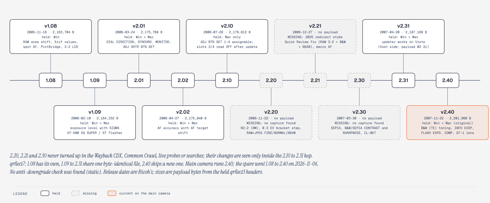
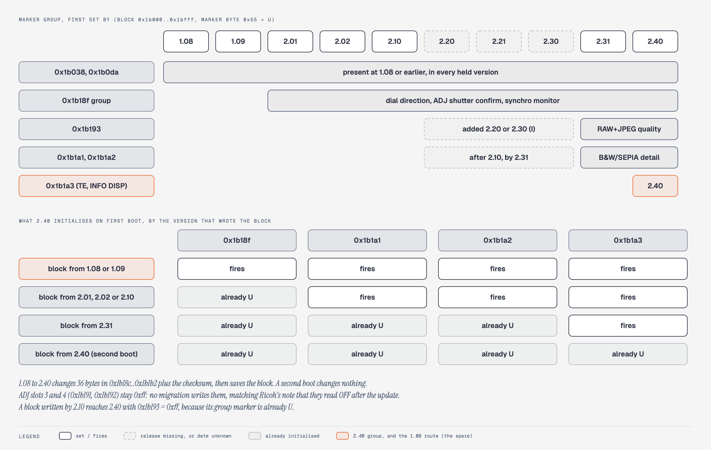
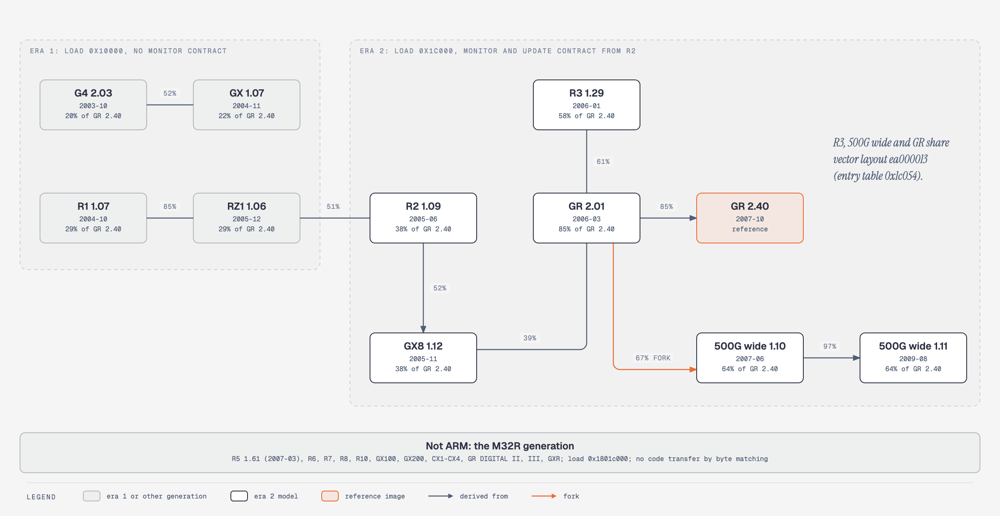

# 12. Version history

**Summary.** Ricoh shipped ten GR DIGITAL application releases, 1.08 (2005-11) to 2.40 (2007-11); seven are recovered and verified (1.08, 1.09, 2.01, 2.02, 2.10, 2.31, 2.40), and 2.20, 2.21 and 2.30 have not been found. Every release is a full recompile and relink with more than 96% of functions unchanged after relocation, and the update code, USB command table, script engine, CA-1 decoder and the five tone tables are identical throughout. The firmware has no anti-downgrade check, and the GR DIGITAL belongs to Ricoh's ARM `*rflect3` family with the Caplio R3 and 500G wide, not with the M32R GR DIGITAL II.

Tags: HW, EMU, STATIC, INFERRED, defined in [features](evidence-ledger.md). Addresses are runtime addresses in the named version; "2.40 =" gives the counterpart in 2.40.

Related: [03 Firmware image and update format](03-firmware-image-and-update-format.md), [05 Settings and adjustment store](05-settings-and-adjustment-store.md), [06 Image pipeline and colour](06-image-pipeline-and-colour.md), [07 USB protocol](07-usb-protocol.md), [09 Recovery and failure modes](09-recovery-and-failure-modes.md), [11 Modification playbook](11-modification-playbook.md).

## The seven recovered versions

| Version | Ricoh date | Payload bytes | What changed (Ricoh's notes, then code) | Tag |
|---|---|---|---|---|
| 1.08 | 2005-11-16 | 2,163,704 | Earliest held; RAW area, Exif values, spot AF, PictBridge and 3:2 LCD fixes cannot be diffed (no older image). Its updater scans the card without waiting for the file task | `STATIC` |
| 1.09 | 2006-02-10 | 2,164,232 (+528) | SIGMA EF-500 flash exposure: new external-flash init commands and a retuned AE flash path. Silent: the boot-race fix (update scan waits for the file task) | `STATIC` |
| 2.01 | 2006-03-24 | 2,175,768 (+11,536) | DIAL DIRECTION, SYNCHRO. MONITOR, ADJ SHTR BTN SET: three new settings bytes behind the first new marker group; three new SETUP rows. Silent: five capture timeouts 10 s → 30 s | `STATIC` |
| 2.02 | 2006-04-27 | 2,175,840 (+72) | AF accuracy with AF target shift: two functions changed, nothing else | `STATIC` |
| 2.10 | 2006-07-28 | 2,179,812 (+3,972) | ADJ BTN SET 1-4 freely assignable; EXPO CMP and WHT BAL added to the ADJ list; slots 3/4 read OFF on updated bodies. Held as the Mac package only | `STATIC` |
| 2.31 | 2007-04-20 | 2,187,168 (+7,356) | Ricoh: Vista host updater only. The image also carries 2.20 (N3:2, 0.3 EV bracket, RAW+JPEG quality, macro AF), 2.21 (Quick Review fix) and 2.30 (SEPIA, B&W/SEPIA contrast and sharpness, CL-BKT, Vista movie audio) | `STATIC` |
| 2.40 | 2007-11-22 | 2,201,960 (+14,792) | B&W (TE) toning in SEPIA's slot; INFO DISP; FLASH EXPO. COMP; GT-1 tele converter; new `qrflect7` | `STATIC` |

Missing: 2.20 (2006-11-22), 2.21 (2006-12-27), 2.30 (2007-03-30). Ricoh's archived download pages name the files, but no copy of their bodies turned up in Wayback and Common Crawl listings, Ricoh hosts, or web and code search (bounded negative; [analysis/fw-history/README.md](../../analysis/fw-history/README.md)). Their changes are seen only inside the 2.10 to 2.31 hop, and the 2.30/2.31 split cannot be recovered. Old SD cards are a possible source: the update leaves `qrflect3` and `qrflect7` in the card root.

## 1. Packages and components

| Fact | Tag |
|---|---|
| Every package holds `FirmUpdate.exe` (or the Mac updater), host DLLs, `SUPPORT.INI`, and `qrflect3` + `qrflect7` | `STATIC` |
| Where both Windows and Mac packages exist (1.09, 2.01, 2.02, 2.31, 2.40), the Mac `QRFLECT3` equals the Windows `qrflect3` byte for byte; this validated the StuffIt decoder used for the Mac-only 2.10 | `STATIC` |
| The PC updater changed once: 1.08–2.02 share one build, 2.31 and 2.40 another | `STATIC` |
| `qrflect7`: 1.08 has its own; 1.09 to 2.31 ship one identical file (31,970 B); 2.40 ships a new one (31,914 B) | `STATIC` |
| Header build dates at `+0x18`: 1.08 2005-11-09, 1.09 2006-01-30, 2.01 2006-03-23, 2.02 2006-04-10, 2.10 2006-07-13, 2.31 2007-04-06, 2.40 2007-10-24 | `STATIC` |
| Monitor 1.00 (2005-08-06) and extend data 1.00 (2005-09-23, fonts and resources) are older than any release; no package carries a type-1 or type-6 file | `HW` |
| The main camera's flash holds no residue of any earlier application | `HW` |

Both project bodies run 2.40-based Koma firmware: generation 2 Koma firmware, build 2b, MakerNote tag `240K2`, with the header still reporting 2.40 (`HW 2026-11-08 both`). Generation 1 Koma firmware (tag `Rev024M`) ran on both from 2026-11-06. The spare ran 1.08 until it was updated with the official 2.40 pair by its own 1.08 updater (`HW spare`). The official 2.40 `QRFLECT3` applied over generation 1 Koma firmware by the normal keyed update booted with tag `Rev0240` once (`HW 2026-11-07 spare`); restore from generation 2 to stock is `EMU` only ([09](09-recovery-and-failure-modes.md)).

## 2. Size and change per hop

| Hop | Function-level change | Image growth | Tag |
|---|---|---|---|
| 1.08 → 1.09 | About 25 real changes in 7 groups | +528 B | `STATIC` |
| 1.09 → 2.01 | About 12 logic changes, plus UI-struct offset shifts | +11,536 B (about 8.4 KB new label bitmaps) | `STATIC` |
| 2.01 → 2.02 | 2 real changes | +72 B `.text` | `STATIC` |
| 2.02 → 2.10 | 156 changed, 53 added | +3,528 `.text`, +444 `.data` | `STATIC` |
| 2.10 → 2.31 (includes 2.20, 2.21, 2.30) | 173 changed, 67 added | +5,676 `.text`, +1,680 `.data`, +216 `.bss` | `STATIC` |
| 2.31 → 2.40 | Of 8,468 functions: 8,108 identical or relocation-equivalent, 260 changed, 100 new or rewritten | +14,792 B | `STATIC` |
| 1.08 → 2.40 overall | 7,887 equivalent, 367 changed, 214 new | +38,256 B | `STATIC` |

Counts come from masked matchers with different settings per hop, so rows compare in kind, not to the unit. "Changed" includes layout churn: most 2.31 → 2.40 rows are struct-offset and stack-frame shifts from inserted settings bytes.

## 3. Release item to code

| Release item | Code and data | Tag |
|---|---|---|
| 1.09 SIGMA EF-500 | External-flash init gains commands `0xb4={03}`/`{23}`, a level re-send, a `cfg[0x507]` subtraction, pre-flash `0xb1` → `0xb2`; AE byte tables retuned. That this is the SIGMA fix is inferred: the image never names SIGMA | `INFERRED` |
| 2.01 DIAL DIRECTION | Byte `0x1b18c`; four new 0x24-byte wrappers (2.40 = `0x7e714`..`0x7e780`) swap a key's handler with its opposite | `STATIC` |
| 2.01 SYNCHRO. MONITOR | Byte `0x1b18e`; six new gate sites (2.40 consumers `0x7af4c`, `0x75bc8`, `0x7b1f6`, `0x7c5a4`) | `STATIC` |
| 2.01 ADJ SHTR BTN SET | Byte `0x1b18d` (default 1, active at 0); 2.40 consumers `0x74220`, `0x742b0` | `STATIC` |
| 2.02 AF target shift | One function copies the shifted window's coordinates and adds an early-out; one gains clamps | `STATIC` |
| 2.10 ADJ 1-4 | SETUP 25 → 27 rows; cursor → value table gains EXPO CMP `0x0a` and WHT BAL `0x0b`; commit writes `0x1b191`/`0x1b192`; slot 3/4 defaults only on full reset, so updated bodies read OFF | `STATIC` |
| 2.20 0.3 EV bracket | AUTO BRACKET `OFF/ON/WB-BKT` → `OFF/±0.3/±0.5/WB-BKT/CL-BKT`; step setter (2.40 `0x40518`) writes the 0.5 EV value, then overwrites it with 0.3 EV | `STATIC` |
| 2.20 RAW+JPEG quality | Byte `0x1b193`, appended into the 2.01 marker group; 2.40 consumers `0x7eb28`, `0x694a0`, `0x846aa` | `STATIC` |
| 2.20 N3:2 (8M) | PIC QUALITY 9 → 10 options; 3264×2176 was already in the 2.01 size table | `STATIC` |
| 2.20/2.21 macro AF | About 25 changed functions in the AF cluster; the two releases cannot be separated | `INFERRED` |
| 2.21 Quick Review fix | Candidates only | — |
| 2.30 SEPIA | IMG SET 6 → 7 options; SEPIA is cursor 4 with **value 6** (`00 01 02 03 06 04 05`); routes a dormant fixed-tint mode of the unchanged register writer | `STATIC` |
| 2.30 contrast/sharpness for B&W and SEPIA | Section 5 | `STATIC` |
| 2.30 CL-BKT | Byte `0x1b194` (0 = ON); bracket 4 → drive type 7 or 8; reuses the WB-BKT loop (2.40 `0xa0840`) | `STATIC` |
| 2.30 Vista movie audio | AVI writer (2.40 `0x8909c`): audio `strf` 16 → 18 bytes, a zero `cbSize` added | `STATIC` |
| 2.40 B&W (TE) | Reuses IMG SET value 6 and detail screen 4 from SEPIA; register writer `0x8ff0e` case 2 reads Cb/Cr from table `0x1f4c88` by tone `0x1b1a9` and density `0x1b1aa`; marker group `0x1b1a3` | `STATIC` |
| 2.40 CL-BKT B&W (TE) | Same byte `0x1b194`, relabelled; drive types 7/8 in `0x96350`, `0x97694`, `0x97aee`, `0xafd20` | `STATIC` |
| 2.40 INFO DISP | `0x72a82` new; setting `0x1b1a6` | `STATIC` |
| 2.40 FLASH EXPO. COMP | Two new OSD names, the only real ASCII additions in the whole ladder; ADJ value `0xd`; storage byte unknown | `STATIC` |
| 2.40 GT-1 tele converter | Lens-position correction `0x719bc` gains a slot-1 path keyed on flag `0x23a8a0`; `qrflect7` newly writes store `+0x1ca8..0x1cb2` and `+0x1cd2`; no GT-1 label | `STATIC` |

Addresses in the earlier versions, for re-diffing ([analysis/version-diff/1x](../../analysis/version-diff/1x/README.md), [2x](../../analysis/version-diff/2x/README.md)); all `STATIC` except the SIGMA reading, which is `INFERRED`:

| Item | Earlier version | Later version |
|---|---|---|
| 1.09 external-flash init and fire path | 1.08 `0xa2524`, `0xa1fe4`, `0xa1dbc`, fire `0x34bd8` | 1.09 `0xa285c`, `0xa294c`, `0xa22ec`, `0xa20dc`, `0xa2a98` |
| 1.09 AE flash path | 1.08 `0xac29c`, `0xac47c`, `0xac6a4`, `0x92210` | 1.09 `0xac678`, `0xac830`, `0xaca74`, `0x9241c` |
| 2.01 dial wrappers | none | 2.01 `0x7cbdc`, `0x7cc00`, `0x7cc24`, `0x7cc48` |
| 2.01 synchro gate sites | none | 2.01 `0x72fbc`, `0x73716`, `0x7980c`, `0x7ab94`, `0x79546`, `0x7c6c8` |
| 2.01 ADJ SHTR BTN gates | none | 2.01 `0x73582`, `0x7360e` |
| 2.01 SETUP row table (20 to 23 flag rows of 12 bytes; count byte `0x16` to `0x19`) | 1.09 `0x1bc9c8..0x1bcaac`, count `0x1bcae8` | 2.01 `0x1bd504..0x1bd60c`, count `0x1bd648`; new label bitmaps from `0x2107e4` |
| 2.02 AF target shift | 2.01 `0xe69fe`; clamps in `0xe5356` | 2.02 `0xe6a16`, `0xe5356` |
| 2.10 ADJ 1-4 | load switch `0x6b6ce`, commit `0x6bd40` (clamp 9 to 11) | same functions, edited |
| 2.20 bracket validator | `0x6dcf8` (accepts 0..4) | same |
| 2.20 bracket step setter | 2.10 `0x40318` | 2.31 `0x40400` (2.40 `0x40518`): writes +/-8 (1/16 EV), then +/-5 when bracket is 3 |
| 2.20 RAW+JPEG JPEG-table pick; N3:2 size estimators | 2.31 `0x83446`; `0xc5254`, `0xc52b8` | |
| 2.20/2.21 macro AF cluster; Quick Review candidates | `0xe5dc8..0xea784`; `0x13b85c`, `0x13e7f0..0x13f040`, `0x145b40..0x147aac` | |
| 2.30 mono-mode chooser (returns 2 for IMG SET 6) | 2.10 `0x6dd90` | 2.31 `0x6e11c` |
| Register writer (unchanged since 2.01) | 2.10 `0x8e716` | 2.31 `0x8ec86`, 2.40 `0x8ff0e` |
| 2.30 CL-BKT second call site; WB-BKT loop | 2.10 loop `0x9edb4` | 2.31 `0x94f54`, loop `0x9f3ec`; 2.40 loop `0xa0840` |
| 2.30 AVI writer | 2.10 `0x878fc` | 2.31 `0x87e38`, 2.40 `0x8909c` |

## 4. Silent changes

| Release | Change | Tag |
|---|---|---|
| 1.09 | **Boot-race fix.** 1.08's startup `0x1e7ac` scans for `QUICKVER.UP` and `QRFLECTn` without waiting for the file task; 1.09 waits up to 6000 × `sleep(10)` on a new flag (2.40 `0x1bd3a8`). In 1.08 an open before mount returns −1 and skips the file. The generation 1 image loader waits on the same flag | `STATIC` |
| 1.09 | A state-4 helper call dropped (helper left dead at `0x44228`); a 15/30 display-rate field; AE tables in `0xa0` → `0x78` steps; several cfg defaults. The boot-race flag is 1.09 `0x1b7cdc` and the scan routine moved from `0x1e7ac` to `0x1eb36` | `STATIC` |
| 1.08 → 1.09 | `qrflect7`: 51 changed values in per-zoom-step tables | `STATIC` |
| 2.01 | Five capture/transfer poll timeouts 10 s → 30 s (`0x2710` → `0x7530` at `0x9d220`, `0x9d3f4`, `0x9e0dc`, `0x9e250`, `0x9e358`); a key-`0x32` re-arm after mode entry (`0x75710`, `0x75738`) | `STATIC` |
| 2.10 → 2.31 | USB file-info buffer `0x84` → `0x88` bytes (`-SRET`/`-FDAT` handlers `0xcb8a4`, `0xcc248`); settings-tail memset start `0x1b308` → `0x1b300` (`0x1b2f8` in 2.40); compiled store default at `+0x18ec` halfword `0x405c` → `0x4055` | `STATIC` |
| 2.31 → 2.40 | `qrflect7`: store byte `+0x18ed`, an AF contrast-peak threshold, 92 → 85, read once (2.40 `0xeaa8c`); four zoom-step words `+0x07be..0x07c4` no longer written; ADJ version word → `0x0240`; package date → 2007-09 | `STATIC` |
| 2.31 → 2.40 | Digital-zoom helpers `0x75254`, `0x753d4` new or rewritten; no isolated silent logic fix among near-identical pairs (bounded skim) | `STATIC` |

The compiled default of `+0x18ed` became 85 in 2.31, while `qrflect7` kept writing 92 until 2.40 brought it to 85.

**Superseded.** The 2.40 store change was first reported as byte `+0x18ec` (`0x5c` → `0x55`) with about 13 readers. It is the low byte of a big-endian halfword: `+0x18ed` changes and has one reader; `+0x18ec` is unchanged.

## 5. Settings layout over time

The 4 KB settings block at `0x1b000` (magic `MG1H`, u16 sum at `0x1bffc`) has no format version. A release that adds persistent bytes either gives them a **marker byte** that the loader (2.40 `0x3d4a4`) sets to `0x55` ('U') after writing that group's defaults, or appends them without one.

| Marker group | Bytes it initialises | Introduced | Tag |
|---|---|---|---|
| `0x1b038` | `0x1b039`, START SETTING `0x1b0d4`; rebuilds My Settings | Before 1.08 | `STATIC` |
| `0x1b0da` | `0x1b0ac..0x1b0f0` (meaning unknown) | Before 1.08 | `STATIC` |
| `0x1b18f`='U' + `0x1b190`=`0xAA` | `0x1b18c` dial direction, `0x1b18d` ADJ shutter confirm, `0x1b18e` synchro monitor | 2.01 | `EMU` |
| none | `0x1b191`/`0x1b192` ADJ slots 3/4 (cursor clamp gives OFF on old saves) | 2.10 | `EMU` |
| appended to the 2.01 group | `0x1b193` RAW+JPEG quality; a 2.10-shaped block reaches 2.40 with it `0xff` | 2.20 | `EMU` |
| `0x1b1a1` | `0x1b194` CL-BKT, `0x1b195`/`0x1b196` SEPIA contrast/sharpness, `0x1b197`/`0x1b198` B&W contrast/sharpness | 2.30 | `EMU` |
| `0x1b1a2` (fix-up) | Range repair of the 2.30 bytes to 1..5; My Settings copies | 2.30 or 2.31 | `EMU` |
| `0x1b1a3` | `0x1b1a5` TE option, `0x1b1a6` INFO DISP, `0x1b1a7..0x1b1aa` TE contrast, sharpness, tone, density; My Settings copies | 2.40 | `EMU` |

Dates come from the loader in each held version, and the emulator confirms them: booting each version's own default block and then 2.40 fires exactly the groups that version lacks. Literal references into `0x1b180..0x1b1bf` grow 0 (1.08, 1.09) → 16 (2.01, 2.02) → 22 (2.10) → 40 (2.31) → 64 (2.40). After 2.40, `0x1b195`/`0x1b196` are orphaned. The tail `0x1b1b3..0x1b2f7` and `0x1b327..0x1bffb` has no direct references; Koma keeps its bytes there.

**Superseded.** The `0x1b18f` group was once dated "2.10 / 2.20" and `0x1b194..0x1b198` called "the B&W record". The group dates from 2.01, and `0x1b195`/`0x1b196` were SEPIA's bytes.

## 6. The B&W contrast story

| Step | Fact | Tag |
|---|---|---|
| 1 | The five 4096-entry tone tables (2.40 `0x193b30 + k·0x2000`) are byte-identical in all seven versions. The selector (2.40 `0x92050`) and upload (2.40 `0x8ffc8`) are relocation-identical from 1.08 | `STATIC` |
| 2 | Before 2.30, B&W contrast was a factory constant: the 2.10 getter reads store `0x08010c74` for B&W (sharpness `0x08010c75`), SETTING1/2 bytes for modes 4/5, and fixed store bytes for the others. Every mode already reached the same five tables through the same selector | `STATIC` |
| 3 | 2.30 swapped the constant for a user byte: B&W → `0x1b197`/`0x1b198`, the new SEPIA case → `0x1b195`/`0x1b196`; the SETTING detail editor gained B&W (id 3) and SEPIA (id 4) branches | `STATIC` |
| 4 | SEPIA was a dormant feature switched on: the register writer's unused mode 2 already wrote a fixed tint (`reg & 0xffc00fff`, OR `0x1044000`, OR `0x390`) | `STATIC` |
| 5 | 2.40 reused SEPIA's slots for B&W (TE): IMG SET value 6, detail screen 4 (2.40 still logs the SEPIA detail string for it), CL-BKT byte `0x1b194`, register-writer mode 2 with the constant replaced by a 6 × 5 tone/density table at `0x1f4c88`. The getters moved next to the pipeline (2.40 `0x92cc8`, `0x91268`) with case 6 repointed to `0x1b1a7`/`0x1b1a8` | `STATIC` |
| 6 | Consequence: B&W, TE, SETTING1/2, HARD, NORMAL, SOFT and the LCD preview all read the same five global tables, and no release ever edited them | `STATIC` |

**Superseded.** `0x92cc8`, `0x91268` and `0x8ff0e` were once listed as new in 2.40. They are the 2.30 getters and the 2.01 register writer, relocated and edited. IMG SET value 6 dates from 2.30 SEPIA, not 2.40.

## 7. Menu growth

| Hop | Label rows | Labels added (English) | Tag |
|---|---|---|---|
| 1.08, 1.09 | 597 | — | `STATIC` |
| 1.09 → 2.01 | 605 | DIAL DIRECTION, SYNCHRO. MONITOR, ADJ SHTR BTN SET, RAW/JPEG SETTING (two releases before Ricoh lists the feature) | `STATIC` |
| 2.02 → 2.10 | 609 | ADJ BTN. SET.3/4, EXPO.CMP, WHT.BAL | `STATIC` |
| 2.10 → 2.31 | 617 | B&W, SEPIA ×2, CL-BKT, CL-BKT SEPIA, N640, ±0.3/±0.5 | `STATIC` |
| 2.31 → 2.40 | 632 | B&W (TE), TONING EFFECT, five tint names, CL-BKT B&W (TE), FLASH EXPO. COMP./FLA COMP, INFO DISP | `STATIC` |

No label row was ever removed. Labels are glyph-coded u16 strings in nine languages, and 2.x labels are appended at the top of the language tables. SETUP grows at 2.01, 2.10 and 2.30 and has 30 rows in 2.40. Option counts: QUALITY 9 → 10 (2.20), IMG SET 6 → 7 (2.30), BRACKET 3 → 5 (2.20/2.30). Readable ASCII is almost frozen across the ladder, and no debug string was removed (bounded: printable runs of six or more characters).

## 8. What never changed

| Item | 2.40 address | Since | Tag |
|---|---|---|---|
| USB command table: 35 records, names, ids, argument counts | `0x1fb400` | 1.08 | `STATIC` |
| `-CCTL` and its five subcommands (`remtin`, `diaset`, `keyset`, `remtout`, `poff`) | handler `0xcd000` | 1.08 | `STATIC` |
| `SCRIPT.MG1` table: 25 records; interpreter `0x65108` | `0x177aa4` | 1.08 | `STATIC` |
| Five tone tables | `0x193b30..0x19db30` | 1.08 | `STATIC` |
| CA-1 VBUS shutter decoder (ISRs, state machine, pin `0x38`, thresholds) | `0x1319e8`.. | 1.08 | `STATIC` |
| Update path: scan `0x278d4`, type-2 checker `0x276d8`, version gate `0x27648`, streaming checksum `0x275cc`, flash loop `0xd6dec`, programmer `0xd6c58`, `0x63b88` (47-block cap) | — | 1.08, except the 1.09 boot sync | `STATIC` |
| `Rev%4.4x` format | `0x112578` | 1.08 | `STATIC` |
| Dcfs self-test island with no inbound reference (the generation 1 image's loader site) | `0x56f80` | 1.08 | `STATIC` |
| WB-BKT development loop | `0xa0840` | 2.01 | `STATIC` |
| Load address `0x1c000`; header bounds `+0x14..+0x17` = 0 | — | every version | `STATIC` |

## 9. No anti-downgrade

The version gate `0x27648` rejects a file only if its header bounds `+0x14`/`+0x16` are nonzero and the installed version falls outside them. Every held official `qrflect3` (twelve Windows and Mac copies, 1.08 to 2.40) has zero bounds, and the gate and the rest of the update path are the same code in all seven versions. A 2.40 body's updater would therefore accept an official 1.08–2.31 `qrflect3`, and the reverse (`STATIC`). The only version comparison anywhere is in the PC updater (`FirmUpdate.exe`), which sends `-VER` and asks "Already updated" when camera ≥ file; Ricoh's four update PDFs contain no downgrade wording. No downgrade has been run, so the acceptance above is a reading of the code.

| Consequence | Tag |
|---|---|
| Any official package can rewrite main body and info with the same checks; restore still needs a working updater or the Monitor card path ([09](09-recovery-and-failure-modes.md)) | `STATIC` |
| A `qrflect3`-only downgrade keeps the 2.40 store; the changed byte `+0x18ed` already equals 2.31's compiled default | `STATIC` |
| 2.31 reading a 2.40 store: IMG SET value 6 (`0x1b030`) is B&W (TE) in 2.40 and SEPIA in 2.31, so the setting reads as SEPIA until B&W is chosen again | `STATIC` |
| The 0x30-byte lens-error log base moved from `0x1b300` (2.31) to `0x1b2f8` (2.40), so each version reads the other's entries 8 bytes out of phase and logging could latch off by chance | `INFERRED` |
| Staging an old `qrflect7` too restores that version's store values, except four zoom-step words 2.40 stopped writing | `STATIC` |
| 2.31 selects GT-1 slot 1 when CPU1 signals a tele adapter (`0x71454`, flag `0x236ed8`), so the 2.40 GT-1 constants are inert only with no converter fitted | `STATIC` |
| Newer marker groups stay in the block; older loaders apply only their own range checks; on return to 2.40 no migration runs | `STATIC` |
| Nothing ties an image to a version: the `Rev` tag and `-VER` read the header word, not body bytes | `STATIC` |

## 10. Old images in the emulator

| Run | Result | Tag |
|---|---|---|
| Each version with 2.40 hook addresses | 1.08, 1.09, 2.01, 2.02, 2.31 pass reset, BSS init and startup, create 16 tasks, then idle (stubs sit at 2.40 addresses) | `EMU` |
| Hooks remapped by byte signature | Every version reaches about 6.9k distinct blocks, 1,739–1,769 CPU1 exchanges, 17 flash operations, and probes the same card files as 2.40 | `EMU` |
| 1.08 running the official 2.40 update on the captured Monitor | Takes the update path on UP + TELE + PLAY; both files pass; 2,198 flash operations, the same as 2.40's own updater; final flash equals the 2.40 install everywhere except `/IROM` | `EMU` |
| The `qrflect7` step in that run | Stalls after about 900 bytes of the script in both versions: store commit, power-off and reboot are not observed | `EMU` |
| The 1.08 boot race | Does not appear in the model; the only card access before the prompt is `QUICKVER.UP`, so a race could at worst miss that file, and neither outcome writes flash | `INFERRED` |

## 11. Version markers

| Marker | Source | 1.08 body | 2.40 stock | Generation 1 | Generation 2 | Tag |
|---|---|---|---|---|---|---|
| USB `-VER` reply | Header version | `200 9.17 01.08` | `200 9.17 02.40` | 02.40 | 02.40 | `HW` |
| MakerNote tag 2 | `Rev%4.4x` of header `+0x12`, at `0x112120` | `Rev0108` | `Rev0240` | `Rev024M` | `240K2` | `HW` |
| Camera Info tag 5 | Package year-month written into the store by `qrflect7` | `2005-11` | `2007-09` | | | `HW` |
| MakerNote tag `0x1003` | Unknown | 1 | 0 | | | `HW` |
| Header build date | `qrflect3` `+0x18`, printed by the boot banner (`0x1e3ac`) | 2005-11-09 | 2007-10-24 | | | `STATIC` |

Tag 2 and the version screen report the header. Koma firmware changes the format string (five bytes in generation 1) so that tag 2 comes from body bytes, which is why generation 1 reads `Rev024M` and generation 2 reads `240K2` (padded with NULs, copied into `PARAM.CUR` by the settings export, [analysis/koma-0.4-candidate/koma2-overlap.md](../../analysis/koma-0.4-candidate/koma2-overlap.md)) while `-VER` still reads 2.40. The `240K2` tag is observed on both bodies ([analysis/hw-tests/RUNBOOK-2026-11-08-PM.md](../../analysis/hw-tests/RUNBOOK-2026-11-08-PM.md)); the `-VER` entries for Koma follow from the unchanged header (`STATIC`). Different generation 2 builds can carry the same tag, so a photo cannot tell two builds apart ([analysis/sdhc/hw64/README.md](../../analysis/sdhc/hw64/README.md)). JPEG encoder structure is the same in 1.08 and 2.40 frames (`HW`).

## 12. The Ricoh firmware family

| Generation | Main file | ISA / RTOS | Load | Models | Tag |
|---|---|---|---|---|---|
| `*rflect3`, older layout (`ea00000f`, entry table at `+0x44`) | `?rflect3` | ARM big-endian, Nucleus PLUS 1.11.17 | `0x10000` | G4/G4 wide, RX, GX, R1 line, RZ1, 400G wide, Pro G3 | `STATIC` |
| `*rflect3`, `0x1c000` layout | same | same | `0x1c000` | R2, GX8 (`ea00000f`); and with the GR's exact vector layout (`ea000013`, entry table at `0x1c054`): R3 1.29, 500G wide 1.10/1.11, GR DIGITAL 1.08 to 2.40 | `STATIC` |
| `*launch3` | `?launch3` | Renesas M32R big-endian | `0x1801c000` | R5 onward, GX100/200, CX1 to CX4, GR DIGITAL II, III, GXR | `STATIC` |
| `UNITY FILE` | `*_v*.frm` | M32R-like | | CX5, CX6, PX, GR DIGITAL IV | `INFERRED` |
| `LENGTH=` header | `?LAUNCH3` | ARM little-endian | | G600, G700, G800 | `STATIC` |

Relatives of GR 2.40 by two measures ([analysis/fw-hunt-wide/README.md](../../analysis/fw-hunt-wide/README.md), [analysis/sibling-arm-diff/README.md](../../analysis/sibling-arm-diff/README.md)):

| Relative | 24-byte window overlap / shared strings (10+ chars) | Identical-code share | Notes | Tag |
|---|---|---|---|---|
| GR 2.01/2.02 | | 85% | | `STATIC` |
| 500G wide 1.10 | 44% / 2450 | 64% (67% with GR 2.01) | Forked from GR about 2.01/2.02, spring 2006; GR's pro and UI features removed; carries all five GR tone tables byte for byte and the same store selector map | `INFERRED` |
| R3 1.29 | 42% / 2406 of 2821 | 58% | Three re-derived curves; no B&W selector counterpart | `STATIC` |
| GX8 1.12 | 26% / 1957 | 38% | Built on R2 (52%), not on GX (37%); GX8 `0x1551dc` equals GR's NORMAL table | `STATIC` |
| R2 1.09 | 25% / 1829 | 38% | Hub of the 2005 code | `STATIC` |
| R1 1.07 | 21% / 1631 | | | `STATIC` |
| GX 1.07 | 16% / 1431 | | | `STATIC` |
| 2003-2004 models | | 20-29% | | `STATIC` |

GX8, R2 and GR share the driver library (`sdl_cc1/cc2/dma/jpg/mem/rsz/ven/aud/tmr`), the CPU1 `REQ_*` set, `Usart2` and the `-CCTL` strings (`STATIC`).

| Family fact | Tag |
|---|---|
| `-CCTL` is enabled only in GX, GX8 and GR; the `dialset` script command (25 commands against 24 elsewhere) exists only in the same three | `STATIC` |
| The Monitor/update contract (load at `0x1c000`, header validator, `QUICKVER`, CPU1 boot trigger) arrived with R2 in 2005 | `STATIC` |
| 889 GR 2.40 functions (26,532 instructions, 5.9%) have no sibling pair: TE mode, tone-detail and manual-Tv screens, RAW/DNG EXIF `0x8564c`, My Settings `0x29454..0x2a17c`, settings migration `0x3d4a4`, the external-flash serial driver `0xa4a70..0xa5530`, and unnamed blocks (see Open questions) | `STATIC` |
| The adjustment-store command language (`V`/`W`, `X12C0`, `UEEF1` ... `UEE00`) is one format across 16 scripts; 500G wide matches 1,822 of 2,195 GR store offsets, R3 1,414 of 2,186, GX8 978 | `STATIC` |
| Quantisation tables (Annex K) appear in every model including M32R; Tv/ISO EXIF tables are shared with all ARM models and GR II/III; F-number and Av tables only with GR DIGITAL II (same 28 mm f/2.4 lens, inferred) | `STATIC` |
| The M32R generation has no stored tone LUT found (bounded search) | `STATIC` |
| 776 GR names transferred to 14 sibling images | `STATIC` |
| Code does not transfer to the M32R generation; data tables and the store language do | `INFERRED` |

**PARAM.DAT.** GX8 and R2 save and load the 4 KB settings block as `/ATA1/PARAM.DAT`. GX8 `0xb2b68` is not that code: it is the whole `U`-group adjust command handler (459 blocks). PARAM.DAT is two 14-instruction helpers it calls, save `0x102df4` and load `0x102e48` (R2: `0x1068e8`, `0x10693c`), reached by the tokens `UE020` (save), `UE021` (load) and `UE022` (reset, which rebuilds defaults and writes flash). Load copies the file over RAM `0x1b000` with no magic, size or checksum check and does not write flash. The GR counterpart, `0xd095c`, is the GR `U`-group handler and about 5.4 KB long; an earlier figure of 84 instructions was a Ghidra artifact from an unresolved Thumb `tbh` jump table. GR 2.40 contains no `PARAM.DAT` string, and the helpers are a short remove, create, write, close pattern over file primitives the GR already has, so the sibling offers command plumbing rather than reusable code ([analysis/param-dat-sibling/README.md](../../analysis/param-dat-sibling/README.md) section 6, `STATIC`). Koma's own `PARAM.DAT`/`PARAM.CUR` settings import and export is a package feature and shares no code with these helpers ([05](05-settings-and-adjustment-store.md)).

**Loader hook sites.** The same Thumb `bl` (`f000f86d`, right after `startup` returns in `MainCtrl`) exists in every checked image: GR 2.40, 2.31 and 2.01 `0x281ee`, GR 1.08 `0x281ce`, 500G wide 1.11 `0x27f5a`, R3 1.29 `0x28702`. The 6,272-byte Dcfs self-test island holds the same 16 functions in each (masked byte agreement 0.95 to 0.96 against GR 2.40) at GR 2.40 `0x56f80`, 2.31 `0x56e20`, 2.01 `0x56c24`, 1.08 `0x569ec`, 500G `0x54f00`, R3 `0x57f80`; no reference from outside reaches an island entry (bounded; computed calls unresolved) (`STATIC`, [analysis/master-firmware/README.md](../../analysis/master-firmware/README.md)). One module binary using only the service table loaded and ran on GR 2.40, 500G wide and R3 images in the emulator with the hooks relocated (file layer stubbed) (`EMU`).

**Body differences.** Key matrix: 42 records in GR, 500G and R3, 31 in GX8 and R2. USB controller: external on GR, 500G and GX8, SoC block on R2 and R3. Lens: 28 mm prime on the GR, zooms elsewhere, CCD-shift anti-shake on R3. Strobe and flash hardware differ (`STATIC`). Shared: the updater, the Monitor hand-off, the file/pool/RTOS layer, the CPU1 transport and the store layout. Calibration values are per body: never copy them across bodies, since the layout is shared and the values are not. Running GR firmware on a sibling body, or the reverse, is unrealistic (`INFERRED`).

**Superseded.** The GR DIGITAL was once called the last ARM-era Ricoh engine. The 500G wide 1.11 (built 2009-08) is later.

## 13. How Ricoh ships a feature

| Pattern | Examples | Tag |
|---|---|---|
| Reuse dormant or general machinery | Tone tables and selector since 1.08; register-writer mode 2 for SEPIA; WB-BKT loop for CL-BKT; 3264×2176 for N3:2; SEPIA's slots for B&W (TE) | `STATIC` |
| Swap a factory constant for a user setting | B&W contrast from store `0x08010c74` to `0x1b197`; limits stay as code immediates or tables (180 s Tv clamp `0x6f43c`, RAW ISO cap `0x6e014`) | `STATIC` |
| Append enum values, never renumber | Bracket 3/4, IMG SET 6, ADJ `0x0a`/`0x0b`/`0x0d` | `STATIC` |
| Settings: a new marker group, an append, or no migration | 2.01/2.30/2.40 groups; 2.20 `0x1b193`; 2.10 ADJ 3/4 | `STATIC` |
| Hand-written UI and validators | Extended switches and else-if chains; commits are not table-driven | `STATIC` |
| Bolt-on overrides | 0.3 EV overwrites the 0.5 EV stores; CL-BKT adds drive types beside WB-BKT | `STATIC` |
| Labels first, sometimes early | RAW/JPEG SETTING's label shipped two releases before the feature | `STATIC` |
| Relink everything | No veneers into appended code; fixes stay local | `STATIC` |
| Ship calibration separately | GT-1 constants through `qrflect7`, a read-modify-write script | `STATIC` |

Koma cannot relink, so it takes the first, second, fourth and fifth patterns as module code plus data, and puts new menu rows in the settings tail ([11](11-modification-playbook.md)).

## Open questions

- Bodies of 2.20, 2.21 and 2.30; with them, the 2.30/2.31 split (marker group `0x1b1a2`) and the macro AF vs Quick Review changes.
- 1.08's own change notes (no older image exists); the two pre-1.08 marker groups are the only trace of earlier releases.
- Meanings still unknown: the 1.09 AE table and cfg changes, the state-4 helper, the 2.01 key re-arm, which AF mode reads `+0x18ed`, what store `0x08010c74/75` held on real units, the `0x1b0da` group, the FLASH EXPO. COMP storage byte (ADJ value `0xd` consumers), MakerNote tag `0x1003` (1 on 1.08, 0 on 2.40; firmware marker or setting).
- Where the GT-1 detection lives beyond the slot-1 path `0x719bc` keyed on `0x23a8a0`, and what raises the CPU1 tele-adapter events `0x26`/`0x28`; CPU1 firmware is not available.
- Silent fixes among the 260 changed 2.31 to 2.40 functions (only a high-similarity skim was done).
- Whether `0x1b193` holds garbage on bodies whose save predates 2.20, and how its consumers range-check it.
- `0x1f4c88` is read as the TE table by one analysis and as AF working words by another.
- The downgrade direction: static analysis says it works; nothing has run it, in the emulator or on a camera. The 2.40 to 2.31 to 2.40 round trip on a camera is untried.
- The `qrflect7` step stalls in every emulated update (after about 900 bytes of the script), so no model has run the store commit.
- The GR-only unnamed blocks `0x3094a`, `0x31130`, `0x3b430..0x3c5d6` and `0x12266c..0x123538`.
- Which models or regions use the alternate header string set behind `0xa88ee`.

## Evidence

- [analysis/fw-history/README.md](../../analysis/fw-history/README.md): package inventory, Ricoh change notes, missing-release search
- [analysis/version-diff/1x/README.md](../../analysis/version-diff/1x/README.md): 1.08 to 2.01 hops, silent changes, per-version addresses
- [analysis/version-diff/2x/README.md](../../analysis/version-diff/2x/README.md): 2.01 to 2.31 hops, 2.30 SEPIA and contrast, settings-tail memset
- [analysis/version-diff/240-and-ladder/README.md](../../analysis/version-diff/240-and-ladder/README.md): 2.31 to 2.40, marker ladder, update path and downgrade reading
- [analysis/feature-code-map/README.md](../../analysis/feature-code-map/README.md): feature to code map
- [analysis/emu-update-replay/README.md](../../analysis/emu-update-replay/README.md): update replay and the `qrflect7` stall
- [analysis/fw-hunt-wide/README.md](../../analysis/fw-hunt-wide/README.md): family ISA table, closest relatives
- [analysis/sibling-arm-diff/README.md](../../analysis/sibling-arm-diff/README.md): whole-program comparison, GR-only functions
- [analysis/sibling-tone-tables/README.md](../../analysis/sibling-tone-tables/README.md): shared tone tables and store values
- [analysis/master-firmware/README.md](../../analysis/master-firmware/README.md): loader hook sites, island, body differences
- [analysis/param-dat-sibling/README.md](../../analysis/param-dat-sibling/README.md): PARAM.DAT in GX8 and R2, GR handler size
- [analysis/downgrade-plan/](../../analysis/downgrade-plan/): scripts for the settings-literal and store-reader scans
- [analysis/koma-0.4-candidate/koma2-overlap.md](../../analysis/koma-0.4-candidate/koma2-overlap.md): `Rev024M` and `240K2` format strings
- [analysis/hw-tests/RUNBOOK-2026-11-08-PM.md](../../analysis/hw-tests/RUNBOOK-2026-11-08-PM.md): both bodies on generation 2 Koma firmware, build 2b
- [analysis/sdhc/spare-test/PLAN.md](../../analysis/sdhc/spare-test/PLAN.md): restore test over generation 1 Koma firmware
