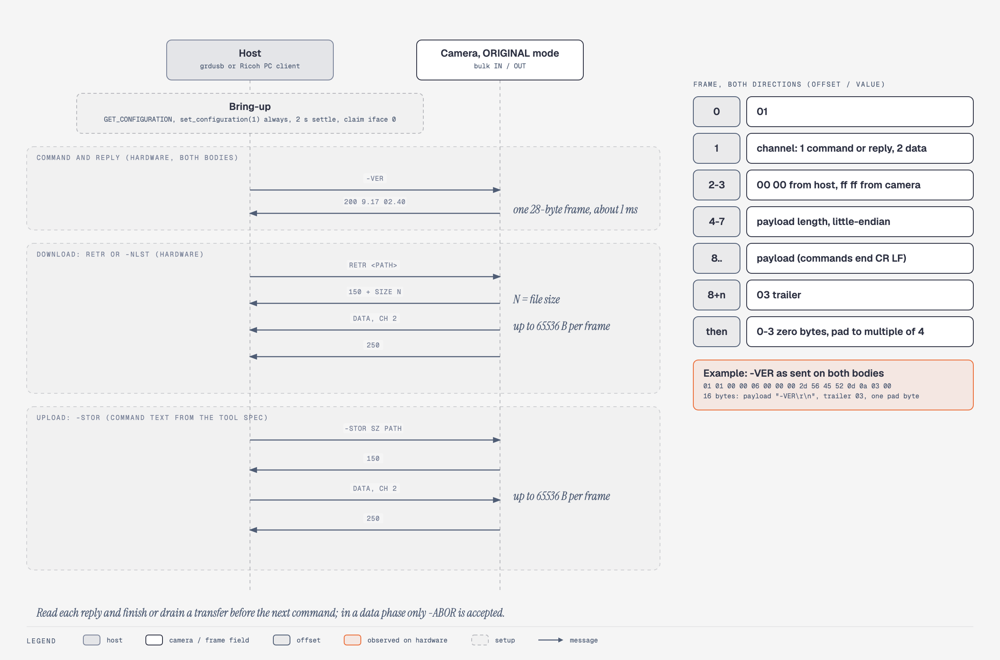

# USB protocol and live view

The GR DIGITAL speaks a text command protocol over a vendor-class USB interface. The host sends short ASCII commands and the camera answers with FTP-style numeric codes. A host can list, read, write and delete card files, read the version and clock, and inject key presses. It cannot flash firmware over USB, and stock 2.40 cannot fire the shutter this way. Koma's `tether` feature fixes the shutter and Koma adds five verbs for settings, memory reads and live view.

Addresses are firmware 2.40 runtime addresses.

## Identity and descriptors

| Mode (byte `0x1bd241`) | VID:PID | Interface class |
|---|---|---|
| 0 ORIGINAL | `05ca:2218` | `ff/00/00`, 2 configurations |
| 2 MASS STR | `05ca:0109` | cfg 1 `08/06/50`, cfg 2 vendor |
| 1 PTP | `05ca:0331` | `06/01/01` |

- Everything below needs ORIGINAL mode (setting byte `0x1b0d7`, SETUP > USB CONNECTION).
- Endpoints: `0x81` bulk IN, `0x02` bulk OUT, `0x83` interrupt IN (64 bytes). High speed, 512-byte bulk packets.
- PTP mode has no InitiateCapture, vendor operations or live view.

## Session bring-up

1. Turn the camera on first, then plug in USB. Plugged in while off, it boots a lens-retracted mode that remote control cannot use.
2. Always `set_configuration(1)`, then verify.
3. Wait 2 s and claim interface 0. Send no reset, clear-halt or `QUIT`.
4. Send commands. Replies arrive in one frame about 1 ms later.

Plugging in raises the cable-in flag `0x23a888` and the camera forces application state 9 (the USB screen). Unplugging in state 9 powers it off.

## Frame format

Both directions use one layout:

| Offset | Size | Value |
|---|---|---|
| 0 | 1 | `0x01` |
| 1 | 1 | Channel: 1 command or reply, 2 data |
| 2 | 2 | Host `00 00`, camera `ff ff` |
| 4 | 4 | Payload length, little-endian |
| 8 | n | Payload |
| 8+n | 1 | `0x03` |
| | 0 to 3 | Zero pad to a multiple of 4 |

`-VER` goes out as `01 01 00 00 06 00 00 00 2d 56 45 52 0d 0a 03 00`.

- Commands are ASCII ending CR LF. The verb is case-insensitive.
- Data payloads are at most 65,536 bytes. There is no checksum. A first byte other than `0x01` resets receive state.
- `/EXT0` is the card. `/IROM` is internal memory. Paths are at most 256 characters.
- A download is the command, `150`, channel-2 frames, `250`. An upload is `-STOR <size> <path>`, `150`, host data frames, `250`.
- The camera ignores commands until it has replied, and in a data phase drops everything except `-ABOR`. Read every reply and finish every transfer before the next command. A host that stops reading mid-transfer blocks later verbs until `-ABOR` or a replug.

## Command reference

Handlers run one at a time in the USB command task. Class: R reads only, R* reads but can write when closing a file on a damaged cluster chain, S session RAM, W writes the card.

| Command | Reply and behaviour | Class |
|---|---|---|
| `-VER` | `200 9.17 VV.VV`. See hazards | R* |
| `-GCID`, `-GSID`, `-TIME`, `-RTST` | Camera ID, SD ID (empty with no card), clock `YYYY/MM/DD HH:MM:SS`, RTC status | R |
| `-DCAP <vol>` | `200 /EXT0 capacity N byte,free N byte.`; `451` with no card | R |
| `-NLST <path>` | `150`, 32-byte FAT-layout records (size big-endian at `0x1c`), `250 -NLST command success.`. `/` returns a 5-byte volume name. `450` if unopenable | R |
| `RETR <path>` | `150 data connection for RETR.(N)`, data, `250`; `450` if missing | R* |
| `-INFO <path>` | `200 N byte W= H= K= for -INFO.` (W=0 H=0 for non-images) | R* |
| `-FDAT <path>` | `200 date=YYYY:MM:DD hh:mm:ss` | R* |
| `-PRET <path>,<off>,<len>` | `150`, partial data, `250`. Never tried on a camera | R* |
| `CWD <path>` | `250` or `501` | S |
| `-ABOR` | `426` or `226`; deletes a partial upload | W |
| `-STOR <size> <path>` | `150`, data, `250`; deletes any existing file first | W |
| `DELE <path>` | `250` or `500` | W |
| `RMD`, `RNFR`, `RNTO` | Remove directory, rename. Never tried | W |
| `-CCTL [,n[,n]]` | Key and dial injection, below | S |

`-SDIS`, `-GDIS`, `-FUPL`, `-FDWL` and `-PWOF` are dead stock records that Koma reuses. `-SPWD`, `-SINF`, `-ATTR`, `-GFCI`, `-GFGI`, `-SGID`, `QUIT` and `-FMT` answer `501`, so formatting is unreachable over USB.

Reply codes: `200` success, `150` transfer start, `250` complete, `226` or `426` `-ABOR`, `500` failure, `450` open error, `451` no card, `-CCTL` failure or Koma verb refusal, `501` syntax error or ID-0 command.

## `-CCTL` remote control

Format `-CCTL keyset,3,22\r\n`: one space, then comma-separated decimals of 1 to 4 digits. Replies are `200`, `451` (failure) or `501`.

| Subcommand | Accepted when | Effect |
|---|---|---|
| `remtin` | State 0 | Sets remote flag `0x1bd1b8`; state 1 |
| `diaset,N` | State not 0, N < 9 | Sets the virtual mode dial; state 2 |
| `keyset,A,C` | State 2, A < 4, C < 42 | Injects key C. A: 0 release, 1 hold, 3 tap |
| `remtout` | State not 0 | Clears the flag; state 0 |
| `poff,N` | Any | Saves config, arms a reboot. Never tried |

`diaset` must come before `keyset`. Known codes: 22 is DISP, 26 is RL1 (half-press), 27 is RL2 (full press). Release a held key with `keyset,0,C`.

Hazards:
- `remtout` clears only the flag and state word. Injected keys and the virtual dial persist. `keyset,0,2` turns all injection off and resets the dial to 9. Koma's `tether` does this clean-up.
- Codes 24 and 36 held in state 9 switch the camera to PTP. Code 7 pressed and 8 released powers off. Do not send 6, 7, 8, 9, 24 or 36.

### Why stock does not shoot

Every subcommand answers correctly and no picture is taken. Code at `0x4fe44` forces state 9 whenever the cable is in (`0x23a888 == 1 && 0x23a88c == 0`), whatever the dial says. State 9 ignores RL1 and RL2, and the record runner serves only states 2, 3, 4, 5, 10, 12 and 13.

### Koma tether

`tether` keeps the camera in state 2 under USB with four BL redirects.

| Site | Effect |
|---|---|
| `0x4fe44` | Skips the state-9 force when the cable is in, it is not a service boot, `remtin` is set and injection is on (`[0x2b9d34] != 0`). A stored state of 9 becomes 2 and re-resolves from the virtual dial (`diaset,4` gives state 2). |
| `0xcd090` | `remtout` also clears flag, keys, dial and `-CCTL` state and posts dial event `(0,4)`, so the camera returns to state 9 |
| `0xcd03a`, `0xcd05e` | `keyset` renews the Auto Power Off hold; `diaset` posts `(0,4)` |
| `0xd27f2` | Swallows the `-VER` timer message `0xa201` while USB is attached |

Routine `0x23578` leaks the LCD mutex, which made a second session take 10 to 20 s to arm. The `stallfix` option fixes it (0.66 s). Its flag byte is `0x1b8be` (high nibble must be `0xA`; write live with `-KSET 2238,<v>`): bit 0 makes `0xa201` a no-op under USB, bit 1 disables the 60 s lens auto-retract, bit 2 guards the mutex leak, bit 3 turns panel and backlight on at arm. Host values: `0xa0` all off, `0xad` default (bits 0, 2, 3), `175` all on. A quick-press shot can make no file; use half-press, then full.

## Koma verbs

Five verbs repoint dead stock records.

| Verb | Replaces | Syntax and limits | Replies |
|---|---|---|---|
| `-KSET <off>,<val>` | `-SDIS` | Decimal offset from `0x1b000`, value 0 to 255. Allowed: Koma rows `0x8b5..0x8cf`, look records and FX table `0x910..0xa13`, and a whitelist of stock bytes (EV, ISO, WB, metering, IMG SET, SETTING1/2, TE). Writes RAM only | `200 -KSET <off>=<val>`; `451 -KSET range`, `value` or `busy` (menu or ADJ open, half-press held, camera not idle); `501` |
| `-KGET <off>,<len>` | `-GDIS` | `1 ≤ len`, `off + len ≤ 4096` | `150`, one frame of raw settings bytes, `250`; `451 -KGET range` |
| `-KSTA` | `-FUPL` | None | `150`, one frame of big-endian u32 (version word `0x4b53LLNN`, state words, optional extension block), `250`. Works in any app state |
| `-PEEK <addr>,<len>` | `-PWOF` | Hex address, 1 to 7 digits; decimal length 1 to 256; range inside `[0x1a8000, 0x3e5000)` | `150`, raw bytes, `250`; `501 -PEEK range` |
| `-LVFR <mode>,<seq>` | `-FDWL` | Below | `150 -LVFR`, one frame, `250 -LVFR` |

`-KSET` can answer `451 busy` for about 9 s after an EV change. Retry. The settings byte map is in [settings-and-image.md](settings-and-image.md).

To add a data verb: a data phase continues only for record IDs 2, 10, 13, 14 and 26, so any other ID stalls (`-KGET`, `-KSTA` and `-PEEK` rewrite their parsed ID to 26 after dispatch). The handler signature is `void h(char **reply, int *len)`. A reply-then-data handler copies the first chunk to `[0x1bd308]+8`, sets `[0x1bd358]` (total), `[0x1bd35c]` (first chunk), `[0x1bd344]` (final `250` string) and `[0x1bd2d0]` = 4, and replies `150`. A verb sending from RAM sets `[0x1bd2bc]` = `0x8001`. Only the USB command task may send.

## Live view

The monitor is a ring of three frames at `0x8470000`, refreshed 30 times a second.

| Item | Value |
|---|---|
| Slot pointers | Y0..2 at `0x2cf640`, C0..2 at `0x2cf658` |
| Geometry | 640x244 visible, stride 672, slot 672x260. 156,160 B of Y plus 156,160 B of C per frame |
| Display slot | `[0x1f501c]` (completed frame). Write index `[0x1f5014]`, VD counter `[0x1f511c]` |
| Running flag | `[0x1f502f]` is 1 while the monitor runs. `0x9e218` blocks until the next VD (vertical sync) |

A frame read from `[0x1f501c]` right after a VD stays stable for about 66 ms. The ring holds no OSD. The OSD is a separate 4 bpp page at `0x08422800` (A) or `0x0842f280` (B), chosen by base register `0x1200c080`; its palette is at `0x12020100 + 4i` as `Y<<16 | Cb<<8 | Cr`, Cb and Cr signed. A capture stops the monitor. State 9 never runs it, which is why live view needs `tether`.

### Engines a stream can borrow

- Resize, `0x5e8f0(desc)`: source width 32 to 4096 and even, destination height even, each axis 1/8x to 8x. The destination stride must be width + 32 or the call returns -1.
- JPEG encode, `0x5e5cc(desc, scale, out)`: width a multiple of 16 and no more than the stride, 4-byte-aligned addresses. A 244-line source encodes as 240 lines. Quantiser `q = clamp(((scale*base >> 9)+1)>>1, 1, 255)`; scale 1024 keeps the base table.

Each engine has one global semaphore shared with capture, thumbnails and QuickView, so stream only while `[0x1f502f] == 1` and no shot is running. Buffers must be in SDRAM. Koma uses the free gap between `0x856ff00` and `0x85c5e00`.

The encoder emits scan data plus EOI only. A host must prepend SOI, DQT, SOF0, a standard Annex K DHT and SOS (macOS ImageIO refuses a JPEG without DHT).

### `-LVFR`

`-LVFR <mode>,<seq>\r\n` answers `150 -LVFR`, one channel-2 frame (16-byte header plus payload, at most 65,536 bytes), then `250 -LVFR`. Wait for `250` before the next pull. No data follows a `451` or `501`.

| Mode | Output | Payload |
|---|---|---|
| 0 | 160x120 grey, Y only | 19,200 B (rows packed from stride 192) |
| 1 | 320x240 JPEG scan, 4:2:2 | Scan + EOI |
| 2 | OSD page, 360x240 at 4 bpp plus 16 palette entries | 43,200 + 64 = 43,264 B |
| `scale<<4 \| 3` | 640x240 JPEG scan straight from the ring slot (stride 672) | Scan + EOI. Scale 0 means 448. Pixels are about twice as tall as wide |

`501 -LVFR mode` means an unknown mode. `451 -LVFR off` means (modes 0, 1, 3) the monitor is not running, the camera is not in tether state 2, an engine failed, or the scan has no `FF D9` (mode 3 retries once at twice the scale). Mode 2 answers without `tether`. After a card read (`RETR`, `-INFO`) in a tethered session, `-LVFR` answers `451` until the host re-arms with `-CCTL diaset,4`.

Payload header, 16 bytes, big-endian:

| Offset | Size | Field |
|---|---|---|
| 0 | 4 | `LVFR` |
| 4 | 1 | Mode |
| 5 | 1 | Flags: bit 0 truncated (payload capped at 65,520), 1 VD sync timed out, 2 OSD page B, 3 torn (VD count advanced by 2 or more), 4 OSD base register named neither page (A sent), 5 mode 3 re-encoded at 2x scale |
| 6 | 2 | Seq (low 16 bits of the host's value) |
| 8 | 2 | Width |
| 10 | 2 | Height |
| 12 | 2 | Payload length after the header |
| 14 | 2 | Scale (0 in mode 0, JPEG scale in modes 1 and 3, palette count 16 in mode 2) |

For a JPEG mode, rebuild the header from the reported width, height and scale and insert a DHT.

Modes 0, 1 and 2 reach about 28 fps and mode 3 about 13 fps. `RETR` from the card runs at about 3.9 MB/s.

## Known hazards

| Hazard | Detail |
|---|---|
| `-NLST /EXT0` on FAT32 | On a FAT32 card the camera answers `150`, then sends no data and no `250`, and accepts only `-ABOR` (the reader treats the root as FAT12/16). Subdirectories (`/EXT0/DCIM`) and `RETR` of root files work. Never list the card root |
| `-VER` side effect | Arms a 3 s timer that posts `0xa201`, which turns the panel off and retracts the lens. `tether` swallows it |
| Shot-write race | Polling a file with `-INFO` or `-NLST` while the camera writes it damaged the JPEG. Send no card command until `-KSTA` reports the camera idle |
| Mid-stream commands | A command during a data phase overwrites the first half of the shared USB buffer at `[0x1bd308]` |

## Updates over USB

The protocol has no flash command. A host can only copy `QRFLECT3` (2,202,472 B) and `QRFLECT7` (31,914 B) to the card; the camera flashes them at the next boot with the update key combination held. Ricoh's tool checked `-VER` and `-DCAP`, deleted both files, sent them with `-STOR`, then read them back with `RETR`. Do not write `/EXT0/QUICKVER.UP`: if it exists, boot flashes `QRFLECT3`, `4`, `5` and `0` with no visible magic or checksum checks. The image format is in [firmware.md](firmware.md).

## CA-1 cable release

Derived from firmware and emulated only; never tried on a camera.

Ricoh's CA-1 pulses VBUS only (mini-B pin 1 through 1 kohm): half press 30 ms, full press 150 ms, release 3 x 30 ms. Stock firmware reads GPIO pin `0x38` (56) and turns pulses into the RL1 and RL2 key events. Classification by high time in roughly 1 ms ticks: over 500 is ATTACH (a PC cable, then state 9); 10 to 60 is a short pulse; a first pulse over 120 is FULL; 60 to 120 or under 10 is ignored. From idle, one short pulse is RL1 press, then FULL is RL2 press, then any pulse releases both. FULL from idle does nothing. Short pulses never start USB or force state 9. Code: init `0x1319e8`, classifier `0x131a78`, state machine `0x131b3a`.
