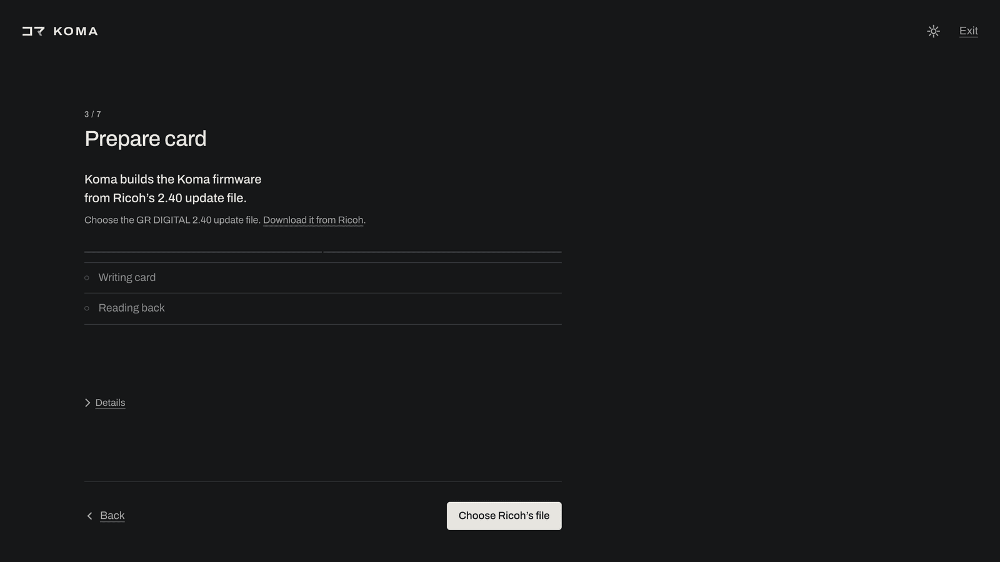
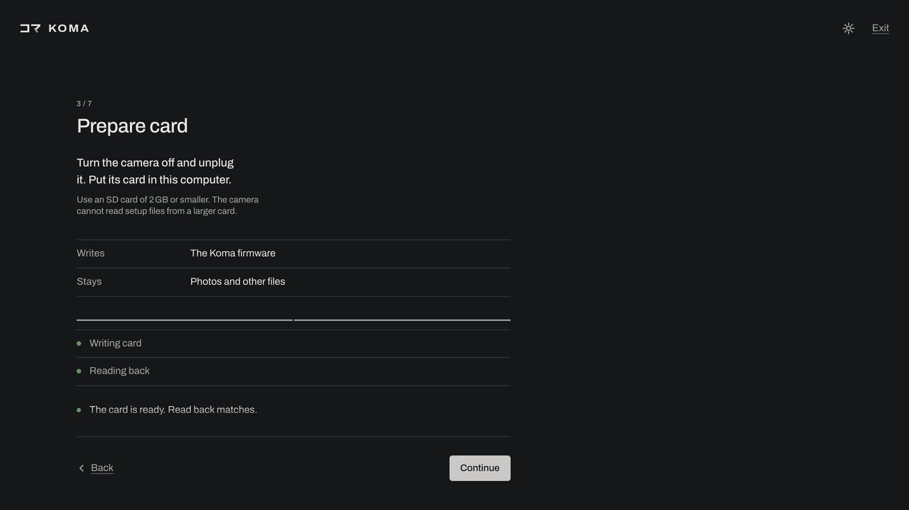
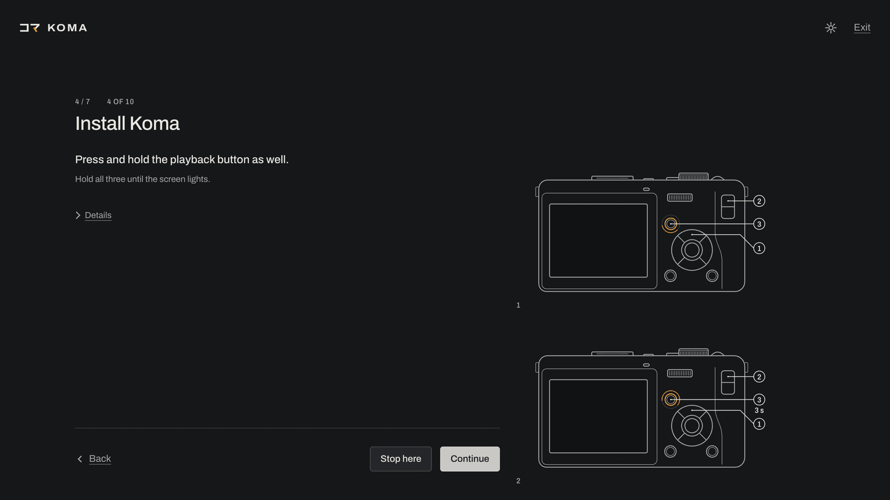
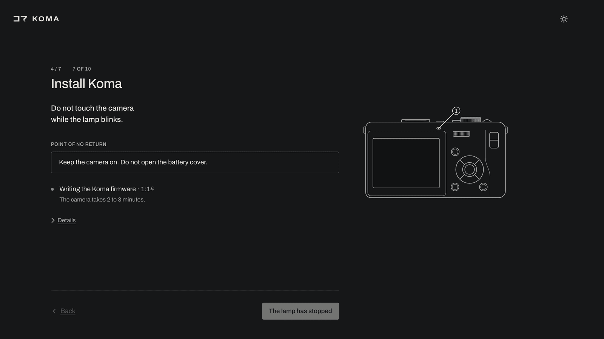
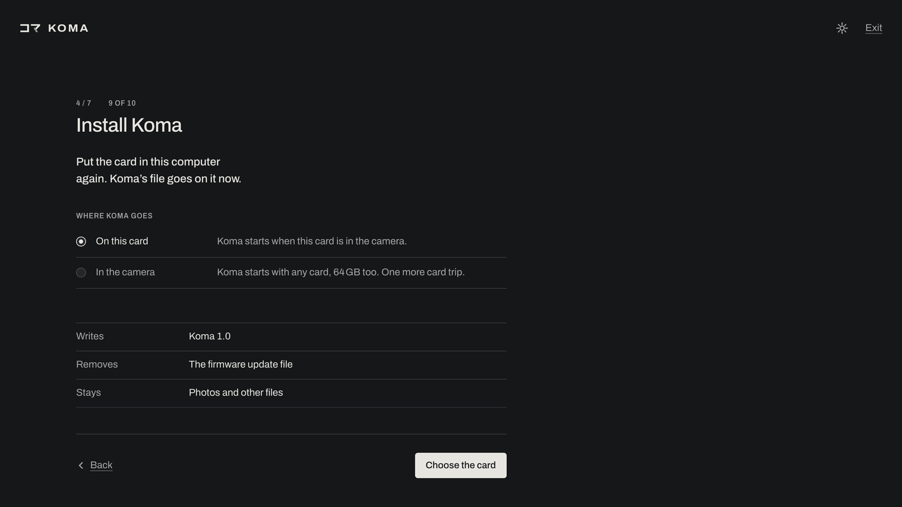

[English](../install.md)

# インストール

## アプリ

アプリにはPython 3.10以降とlibusbが必要です。`koma`を実行すると`http://localhost:8765/`で開きます。終了するにはCtrl-Cを押します。メニューバーやシステムトレイに常駐させるには`koma --tray`を使います。

### macOS

```
brew install overscanindustries/koma/koma
```

Webカメラ機能を使う場合は、代わりにpipxでインストールします。`brew install pipx libusb`のあと、`pipx install "koma-gr[tray,webcam]"`を実行します。

### Linux

```
pipx install koma-gr
```

トレイアイコンとWebカメラを使う場合は`pipx install "koma-gr[tray,webcam]"`を使います。libusbはたいてい最初から入っています。`koma doctor`で入っていないと表示されたら、インストールしてください（DebianとUbuntuでは`sudo apt install libusb-1.0-0`）。

`koma --install-udev-rule`を実行して、必要なudevルールをインストールします。管理者パスワードを求められます。手作業でインストールする場合は、次の1行を`/etc/udev/rules.d/70-koma-gr.rules`として保存します。

```
SUBSYSTEM=="usb", ATTR{idVendor}=="05ca", ATTR{idProduct}=="2218", TAG+="uaccess"
```

続けて`sudo udevadm control --reload-rules && sudo udevadm trigger`を実行し、カメラをつなぎ直します。

### Windows

[pipx](https://pipx.pypa.io)をインストールし（`py -m pip install --user pipx`のあと`py -m pipx ensurepath`を実行して、新しいターミナルを開きます）、次を実行します。

```
pipx install koma-gr
```

トレイアイコンとWebカメラを使う場合は`pipx install "koma-gr[tray,webcam]"`を使います。libusbはパッケージに含まれています。

Windowsでは、カメラ用のWinUSBドライバーも必要です。パソコン1台につき1回だけ設定します。

1. カメラのSETUP > USB CONNECTION（USB接続）をORIGINALにします。カメラの電源を入れてから、USBケーブルを差します。
2. [zadig.akeo.ie](https://zadig.akeo.ie)からZadigをダウンロードして実行します。
3. Options > List All Devicesを選び、USB IDが`05CA 2218`のデバイスを選びます（GR DIGITALと表示されるか、名前が空欄のことがあります）。
4. ドライバーをWinUSBにして、Install Driver（またはReplace Driver）をクリックします。
5. `koma doctor`を実行します。`camera driver`の行にWinUSBと表示されるはずです。

元に戻すには、デバイスマネージャーでこのデバイスをアンインストールし、ドライバーを削除するチェックボックスをオンにします。

### 確認

`koma doctor`を実行すると、USBの依存関係とドライバーを確認できます。カメラをつないでおく必要はありません。

## カメラへのKomaのインストール

アプリを開き、セットアップの指示に従います。リコーの2.40アップデートファイル、充電済みのバッテリー、2GB以下のSDカード、カードリーダーが必要です。アプリは、手元のアップデートファイルからパソコン上でファームウェアをビルドします。

アップデートファイルは[リコーのGR DIGITALファームウェアのページ](https://www.ricoh-imaging.co.jp/english/r_dc/download/firmware/grd/win.html)からダウンロードします（[`gr-240.exe`](https://www.ricoh-imaging.co.jp/english/r_dc/download/firmware/exe/gr-240.exe)）。中に入っている`qrflect3`ファイルも使えます。

| ファイル | SHA-256 |
|---|---|
| `gr-240.exe` | `e9257cbd89cd3f07163ef8700a9143121ecb69ecee94c1c935c7b7486fafa555` |
| `qrflect3` | `de00e03d563fd1bdd0a2a925761b1a029993425049841119e3e83eef990c783b` |



セットアップで求められたら、リコーのファイルを選びます。



セットアップはファームウェアをカードに書き込み、読み戻して確認します。



カメラで押すボタンを、セットアップがひとつずつ示します。



改造ファームウェアを書き込むと、カメラが使えなくなることがあります。ランプが点滅している間は、カメラに触れたり電源を切ったりしないでください。

Komaをセットアップ用のカードに置いたままにするには、**On this card**を選びます。FAT32のSDHC・SDXCカードを含め、ほかのカードでもKomaを使うには、**In the camera**を選びます。どちらの場合も、カメラのアップデーターがセットアップに小容量のカードを必要とします。



アプリを使わないインストール、更新、削除、リコーのファームウェアへの復元は、[手動インストール](manual-install.md)を参照してください。
