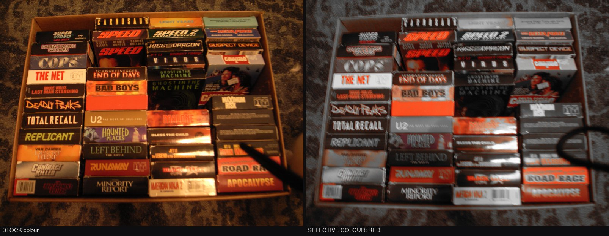
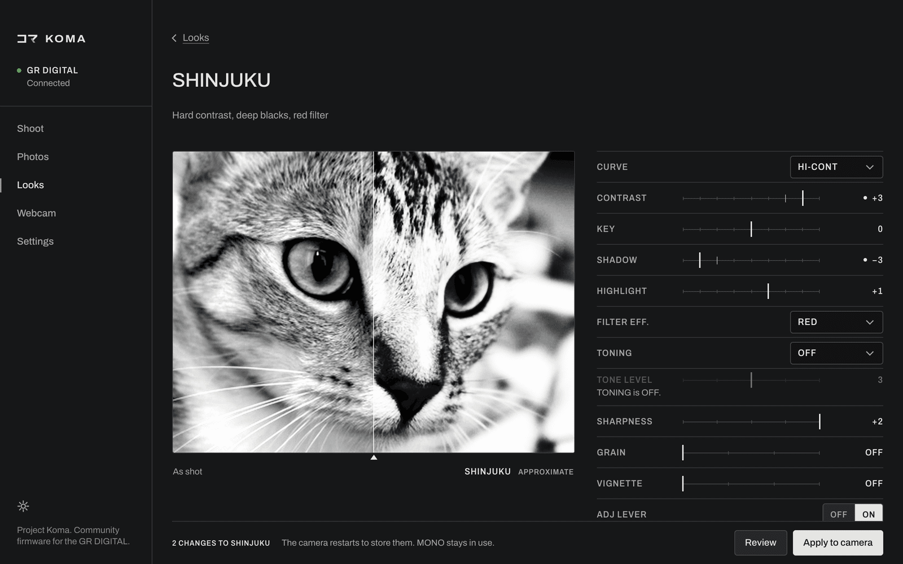

[English](../user-guide.md)

# ユーザーガイド

Komaの導入は[インストール](install.md)を参照してください。

## メニュー

MENUを押します。タブの並びは**STILL | KOMA | PLAY | CUSTOM | SETUP**です。純正でMOVIE MODE ONLYが入る位置にKOMAが入ります。動画モードではこの位置がMOVIEになり、純正の動画ページが開きます。純正の項目はSETUPにあります。

KOMAタブを開くと、FOCUSページが表示されます。

| ページ | 項目 |
|---|---|
| FOCUS | SNAP DIST, FULL SNAP |
| EXPOSURE | AUTO-ISO MAX, SLOW SHUTTER, LONG EXP LIMIT |
| DISPLAY | HIGHLIGHT ALRT, PEAKING, KOMA VERSION |
| OTHER | MENU LAYOUT, KOMA FEATURES, SAVE TO CARD |

UP/DOWNで項目を移動し、LEFTでページの列へ、RIGHTで最初の項目に戻ります。

## ルック

JPEGのルックは、IMG SET（画像設定）の項目で選び、編集します。21種類あります。

STANDARD, MONO, SOFT MONO, HARD MONO, HICON B&W, SHINJUKU, FILM 400, FINE 100, DENSE, NOIR, MATTE, SELECT, POSITIVE, NEGATIVE, SLIDE 50, WARM NEG, BLEACH, RETRO, CUSTOM 1, CUSTOM 2, CUSTOM 3

- STANDARDは、純正のNORMALの名前を変えたものです。編集できます。初期値のままなら純正のNORMALそのものを書き込み、RESETでその状態に戻ります。
- そのほかの純正の項目（HARD、SOFT、B&W、B&W(TE)、SETTING1、SETTING2）は一覧にありません。GR IIIと同じく、CUSTOM 1〜3がSETTING1/2の代わりになります。
- 隠れている純正の値が有効になった場合（MY SETTINGSの呼び出しやリセット）、IMG SETの項目にはその値が純正の名前で一時的に追加表示され、カーソルを外すまで残ります。
- 選択中の項目でRIGHTを押すと、そのルックの編集画面（`EDITING <look>`）が開きます。LEFTで戻ります。一時表示の純正項目でRIGHTを押すと、NO ADJUSTと表示されます。
- IMG SETをADJレバーに割り当てると、ADJ LEVERの項目がONのルックをレバーで順に切り替えられます。最後まで行くと最初に戻ります。初期状態ではSTANDARD、MONO、HARD MONO、HICON B&W、SHINJUKU、POSITIVE、CUSTOM 1です。

### モノクロのルック

| ルック | 内容 |
|---|---|
| MONO | 深めの中間調、早めに丸めるハイライト。フィルターなし |
| SHINJUKU | 硬いコントラスト、つぶれた黒、明るく飛んだ白。赤フィルター、シャープネス+2 |
| HICON B&W | GRのハイコントラスト白黒：黒に近いシャドウ、明るい白 |
| HARD MONO | GR IIIのハードモノトーン：非常に高いコントラスト、かすかな青の調色 |
| SOFT MONO | GR IIIのソフトモノトーン：低コントラストで持ち上げた階調 |
| FILM 400 | ISO 400フィルムのカーブ、黄フィルター |
| FINE 100 | 微粒子のISO 100フィルムのカーブ |
| DENSE | 長く濃い階調。SOFT MONOより暗く、締まった仕上がり |
| NOIR | ローキー、赤フィルター、深い黒 |
| MATTE | フラット、持ち上げたシャドウ、柔らかい白 |

### SELECT

1つの色相帯を除き、画面全体がモノクロになります。COLORで残す色相帯（RED、ORANGE、YELLOW、GREEN、BLUE、MAGENTA）を選びます。RANGEはNARROWかWIDEです。SATURATION（-3〜+3）で残す色の強さを調整します。

左：純正。右：COLORをREDにしたSELECT。

### カラーのルック

| ルック | 内容 |
|---|---|
| POSITIVE | 明るめ、深いシャドウ。暖色は残し、寒色は抑える |
| NEGATIVE | 柔らかく色あせた調子、持ち上げたシャドウ、控えめな発色 |
| BLEACH | 明るく詰まった中間調、低彩度、ティール寄り、専用カーブ |
| RETRO | 暖かく色あせた低コントラスト、セピア寄り |
| WARM NEG | 暖かいポートレート用ネガ：柔らかいコントラスト、かすかなマゼンタ |
| SLIDE 50 | スライドフィルム：深いコントラスト、非常に高い彩度、やや暖かめ |

### ルックの編集

ルックごとに編集内容を保持します。6〜8行目はルックの種類によって変わります。

| 項目 | モノクロのルック | カラーのルック | SELECT |
|---|---|---|---|
| CURVE | R3, STANDARD, HARD, HI-CONT, SOFT MONO, FILM 400, FINE 100, BLEACH | 同じ | 同じ |
| CONTRAST, KEY, SHADOW, HIGHLIGHT | -4〜+4 | -4〜+4 | -4〜+4 |
| 6 | FILTER EFF.：OFF, YELLOW, ORANGE, RED, GREEN | SATURATION：-3〜+3 | COLOR |
| 7 | TONING：OFF, SEPIA, SELENIUM, BLUE, GREEN | WARMTH：COOL 3〜WARM 3 | RANGE |
| 8 | TONE LEVEL：1〜5 | TINT：MAG 3〜GREEN 3 | SATURATION：-3〜+3 |
| SHARPNESS | -2〜+2 | -2〜+2 | -2〜+2 |
| SAVE TO CUSTOM | OFF, CUSTOM 1-3 | 同じ | 同じ |
| RESET | NO, YES | 同じ | 同じ |
| GRAIN, VIGNETTE | OFF, 1, 2, 3 | 同じ | 同じ |
| ADJ LEVER | ON, OFF：ADJレバーでこのルックに止まるかどうか | 同じ | 同じ |

CONTRASTはカーブの傾きを強めます。KEYは階調全体を明るく、または暗く動かします。SHADOWとHIGHLIGHTは、カーブの足（トゥ）と肩（ショルダー）を動かします。WARMTHはホワイトバランスを寄せ、TINTはグリーン・マゼンタ方向にずらします。

SAVE TO CUSTOMは、有効なルックの値をカスタム枠にコピーし、OFFに戻ります（ルック自体は有効なままです）。カスタム枠にはカラーのルックも保存できます。RESETはルックを初期値に戻します。CUSTOMの枠はMONOにリセットされます。

編集内容、CUSTOMの枠、ADJ LEVERの選択、すべてのKOMAの項目は、カメラの通常の電源オフ時の保存で保持されます。

アプリのLooksエディターにはカメラと同じ項目があり、最後に撮った写真でプレビューできます。

### ライブビューのプレビュー

液晶モニターには、有効なルックの一部が反映されます。彩度、カラーマトリクス、TINT、モノクロ用フィルター、調色です。撮影した画像には、常にすべてが適用されます。

## FOCUS、EXPOSURE、DISPLAYの項目

- SNAP DIST：1M、1.5M、2M、2.5M（純正）、5M、∞。
- FULL SNAP：OFF / ON。ONにするとAFモードで、シャッターボタンを一気に全押しした場合はスキャンせずにSNAP DISTの距離でピントを合わせます。ゆっくり半押しすれば、通常どおりAFが働きます。セルフタイマー使用時も無効にはなりません。
- AUTO-ISO MAX：STOCK、200、400、800、1600。ISO AUTOでフラッシュがオフのときに働きます。
- SLOW SHUTTER：STOCK、1/250〜1/2。ISO感度が上がり始める前の、もっとも遅いシャッター速度です。
- LONG EXP LIMIT：180S（純正）または240S。カウント表示、EXIF、画面表示もこれに従います。
- HIGHLIGHT ALRT：OFF / ON。ライブビュー、ヒストグラム表示、再生時に、白とびした部分を点滅で示します。
- PEAKING：OFF、RED、YELLOW。ライブビュー中に液晶モニターでエッジを色付けします。
- KOMA VERSION：表示のみ。`2.40K1.0`と表示されます。写真にはMakerNoteのファームウェアタグ`240K1.0`が記録されます。隠しサービス画面のバージョン表示、USBの`-VER`、ファームウェアのヘッダーは、引き続きリコーの`02.40`を示します。

## 時計の保持

Komaはカードの`KOMATIME.TXT`に時刻を保存し、時計が失われていれば電源オン時に復元します。

- 時計が設定されて動いていれば、Komaは電源オフ時に時刻を保存します。ただし、USB接続中と、カードへの書き込みが安全にできないほどバッテリーが少ないときは保存しません。
- 時計が失われていた場合、Komaは保存した時刻に60分を足して復元します。動いている時計には手を付けません。
- 失われた時計をパソコンから設定するには、カードの`KOMATIME.TXT`に`YYYY-MM-DD HH:MM:SS`を1行書きます。この時刻はそのまま使われます。受け付けるのは2006〜2035年です。

正確な時刻が重要な場合は、復元後にDATE SETTINGSを確認してください。

## バッテリーログ

Komaは電源オフ時に、バッテリーの測定値をカードの`KOMABATT.TXT`に書き込みます。

## OTHERページ

- MENU LAYOUT：5-TAB（初期値）、STK+KOMA（モードページ | KOMA | 純正のSETUP）、GR II（SHOOTING | KEY CUST. | SETUP。Komaの項目はSHOOTINGに入ります）。次回の起動時に反映されます。
- KOMA FEATURES：FULLまたはESSENTIAL。ESSENTIALにすると、次回の起動時にメニュー、設定のインポート/エクスポート、起動ログ、テザー、ライブビュー、テザー停止の修正だけを組み込みます。ほかの項目は表示も保存もされますが、働きません。
- SAVE TO CARD：YESでカードに`PARAM.SAV`を書き込みます。項目の表示はSAVEDかFAILEDに変わります。

## カード上のファイル

`PARAM.CUR`には、起動時に保存した設定が入っています。アプリはこれを使って設定を別のカメラにコピーします。`PARAM.DAT`は起動時に設定を読み込むファイルです。読み込み後、カメラは`PARAM.OK`か`PARAM.BAD`を書き込みます。

## アプリ

USB接続をORIGINALにしたカメラの電源を入れてからつなぎ、`koma`を実行します。

| ページ | 用途 |
|---|---|
| Overview | セットアップの開始、カメラの確認 |
| Looks | ルックの選択と編集 |
| Camera menu | 設定の変更 |
| Photos | 画像の取り込み、ダウンロード |
| Shoot | ライブビュー、テザー撮影、カメラ操作 |
| Webcam | Webカメラの設定とライブ配信 |
| Settings | 設定のバックアップ、復元、別のカメラへのコピー |

## テスト状況

Koma 1.0は、64GBのFAT32カードを含め、実機でテストしています。
