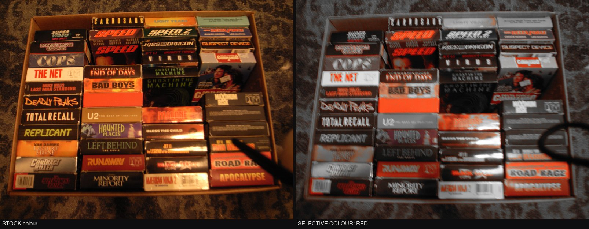
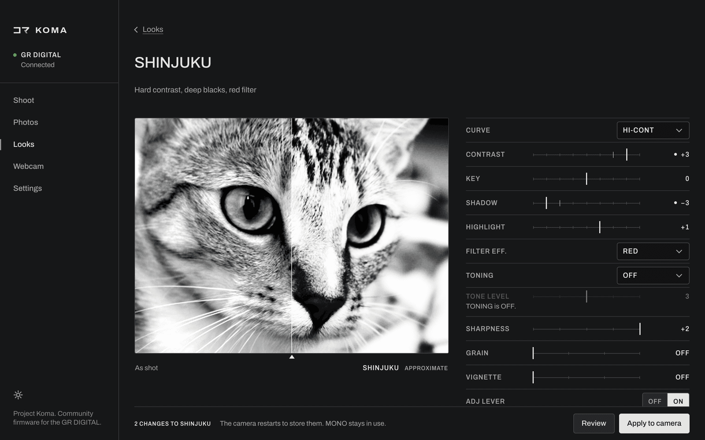

# User guide

See [installation](install.md) to set up Koma.

## The menu

Press MENU. The tab strip reads **STILL | KOMA | PLAY | CUSTOM | SETUP**. KOMA takes the slot that stock fills with MOVIE MODE ONLY. In movie mode that slot reads MOVIE and opens the stock movie page; SETUP holds the stock rows.

The KOMA tab opens on FOCUS.

| Page | Rows |
|---|---|
| FOCUS | SNAP DIST, FULL SNAP |
| EXPOSURE | AUTO-ISO MAX, SLOW SHUTTER, LONG EXP LIMIT |
| DISPLAY | HIGHLIGHT ALRT, PEAKING, KOMA VERSION |
| OTHER | MENU LAYOUT, KOMA FEATURES, SAVE TO CARD |

Use UP/DOWN to move between rows, LEFT to move to the page column and RIGHT to return to the first row.

## Looks

Choose and edit JPEG looks in the IMG SET row (Image settings). It has 21 entries:

STANDARD, MONO, SOFT MONO, HARD MONO, HICON B&W, SHINJUKU, FILM 400, FINE 100, DENSE, NOIR, MATTE, SELECT, POSITIVE, NEGATIVE, SLIDE 50, WARM NEG, BLEACH, RETRO, CUSTOM 1, CUSTOM 2, CUSTOM 3.

- STANDARD is stock NORMAL under a new name. It is editable. At its default values it writes plain stock NORMAL, and RESET returns it there.
- The other stock entries (HARD, SOFT, B&W, B&W(TE), SETTING1, SETTING2) are not in the list. CUSTOM 1-3 take the place of SETTING1/2, as on the GR III.
- If a hidden stock value becomes active (a MY SETTINGS recall or a reset), the IMG SET row shows it under its stock name as a temporary extra entry until you move off it.
- RIGHT on the highlighted entry opens that look's editor (`EDITING <look>`). LEFT returns. On a temporary stock entry RIGHT shows NO ADJUST.
- With IMG SET assigned to the ADJ lever, the lever steps through the looks whose ADJ LEVER row is ON, and wraps. By default these are STANDARD, MONO, HARD MONO, HICON B&W, SHINJUKU, POSITIVE and CUSTOM 1.

### B&W looks

| Look | Description |
|---|---|
| MONO | Deeper mids, earlier highlight roll-off, no filter |
| SHINJUKU | Hard contrast, crushed blacks, bright clipped whites, red filter, sharpness +2 |
| HICON B&W | GR Hi-Contrast B&W: near-black shadows, bright whites |
| HARD MONO | GR III Hard Monotone: very high contrast, faint blue toning |
| SOFT MONO | GR III Soft Monotone: low contrast, lifted |
| FILM 400 | 400-speed film curve, yellow filter |
| FINE 100 | Fine-grain 100-speed film curve |
| DENSE | Long, dense scale, darker and firmer than SOFT MONO |
| NOIR | Low key, red filter, deep blacks |
| MATTE | Flat, lifted shadows, soft whites |

### SELECT

The frame turns mono except one hue band. COLOR picks the band (RED, ORANGE, YELLOW, GREEN, BLUE, MAGENTA). RANGE is NARROW or WIDE. SATURATION (-3 to +3) scales the color that stays.

Left: stock. Right: SELECT with COLOR set to RED.

### Color looks

| Look | Description |
|---|---|
| POSITIVE | Key up, deep shadows, warm hues kept, cool hues muted |
| NEGATIVE | Soft, faded, lifted shadows, muted |
| BLEACH | Bright crushed mids, low saturation, teal lean, own curve |
| RETRO | Warm, faded, low contrast, sepia lean |
| WARM NEG | Warm portrait negative: soft contrast, faint magenta |
| SLIDE 50 | Slide film: deep contrast, very saturated, slightly warm |

### Editing a look

Each look keeps its own edits. Rows 6 to 8 change with the look type.

| Row | B&W looks | Color looks | SELECT |
|---|---|---|---|
| CURVE | R3, STANDARD, HARD, HI-CONT, SOFT MONO, FILM 400, FINE 100, BLEACH | same | same |
| CONTRAST, KEY, SHADOW, HIGHLIGHT | -4 to +4 | -4 to +4 | -4 to +4 |
| 6 | FILTER EFF.: OFF, YELLOW, ORANGE, RED, GREEN | SATURATION: -3 to +3 | COLOR |
| 7 | TONING: OFF, SEPIA, SELENIUM, BLUE, GREEN | WARMTH: COOL 3 to WARM 3 | RANGE |
| 8 | TONE LEVEL: 1 to 5 | TINT: MAG 3 to GREEN 3 | SATURATION: -3 to +3 |
| SHARPNESS | -2 to +2 | -2 to +2 | -2 to +2 |
| SAVE TO CUSTOM | OFF, CUSTOM 1-3 | same | same |
| RESET | NO, YES | same | same |
| GRAIN, VIGNETTE | OFF, 1, 2, 3 | same | same |
| ADJ LEVER | ON, OFF: whether the ADJ lever stops on this look | same | same |

CONTRAST steepens the curve, KEY moves the whole range lighter or darker, SHADOW and HIGHLIGHT move the toe and the shoulder. WARMTH leans the white balance; TINT shifts green-magenta.

SAVE TO CUSTOM copies the active look's values into a slot, then returns to OFF (the look itself stays active); a slot can hold a color look. RESET restores the look's defaults; a CUSTOM slot resets to MONO.

Edits, CUSTOM slots, ADJ LEVER choices and every KOMA row persist through the camera's normal power-off save.

The app's Looks editor has the same rows and previews them on your last photo.

### Live-view preview

The LCD shows part of the active look: saturation, the color matrix, TINT, the B&W filter and toning. The shot itself is always processed in full.

## FOCUS, EXPOSURE and DISPLAY rows

- SNAP DIST: 1M, 1.5M, 2M, 2.5M (stock), 5M, ∞.
- FULL SNAP: OFF / ON. With ON in AF mode, a quick full press focuses at the SNAP distance without scanning; a slow half press still autofocuses. It does not exclude the self-timer.
- AUTO-ISO MAX: STOCK, 200, 400, 800, 1600. Applies with ISO AUTO and flash off.
- SLOW SHUTTER: STOCK, 1/250 down to 1/2: the slowest shutter before ISO rises.
- LONG EXP LIMIT: 180S (stock) or 240S. Count, EXIF and display follow.
- HIGHLIGHT ALRT: OFF / ON. Blinking marks on clipped areas in live view, the histogram display and playback.
- PEAKING: OFF, RED, YELLOW. Edge marks on the LCD in live view.
- KOMA VERSION: read only; shows `2.40K1.0`. Photos carry the MakerNote firmware tag `240K1.0`. The hidden service version screen, USB `-VER` and the firmware header still show Ricoh's `02.40`.

## Clock keeper

Koma saves the time in `KOMATIME.TXT` on the card and restores it at power-on if the clock has been lost.

- With the clock set and running, Koma saves the time at power-off, except while USB is connected or the battery is too low for a safe card write.
- If the clock is lost, Koma restores the saved time plus 60 minutes. A running clock is left alone.
- To set a lost clock from a computer, write one line `YYYY-MM-DD HH:MM:SS` to `KOMATIME.TXT` on the card. That time is used as written. Years 2006 to 2035 are accepted.

After a restore, check DATE SETTINGS if exact times matter.

## Battery log

Koma writes battery readings to `KOMABATT.TXT` on the card at power-off.

## OTHER page

- MENU LAYOUT: 5-TAB (default), STK+KOMA (mode page | KOMA | stock SETUP), GR II (SHOOTING | KEY CUST. | SETUP, with Koma rows on SHOOTING). Takes effect at the next boot.
- KOMA FEATURES: FULL or ESSENTIAL. ESSENTIAL installs only the menu, settings import/export, the boot log, tether, live view and the stall fix at the next boot; other rows still show and store but do nothing.
- SAVE TO CARD: YES writes `PARAM.SAV` to the card and the row then reads SAVED or FAILED.

## Files on the card

`PARAM.CUR` holds the settings saved at boot. The app uses it to copy settings to another camera. `PARAM.DAT` imports settings at boot; the camera then writes `PARAM.OK` or `PARAM.BAD`.

## The app

Connect the powered-on camera in ORIGINAL USB mode and run `koma`.

| Page | Use |
|---|---|
| Overview | Start setup or check the camera |
| Looks | Choose and edit looks |
| Camera menu | Change settings |
| Photos | Import or download images |
| Shoot | Live view, tethered shooting and camera controls |
| Webcam | Webcam setup and live stream |
| Settings | Back up, restore and copy settings to another camera |

## Status

Koma 1.0 is tested on real hardware, including 64 GB FAT32 cards.
